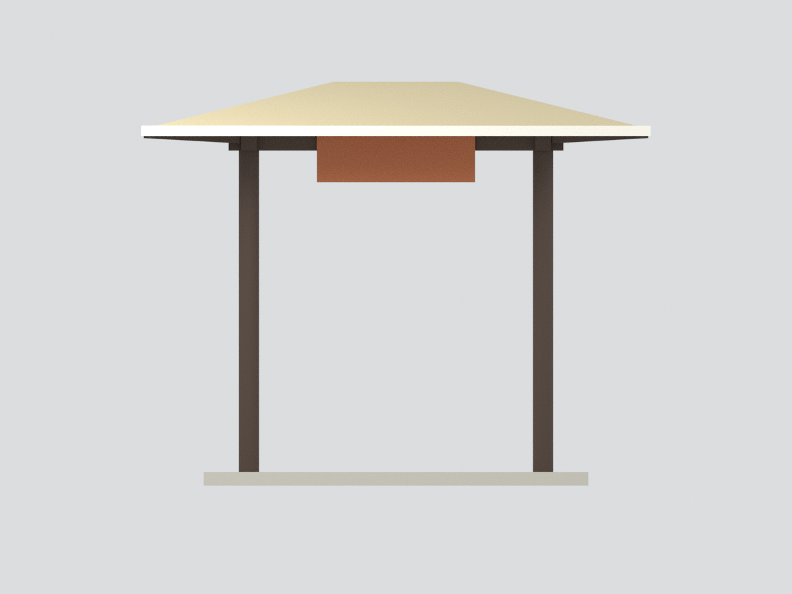
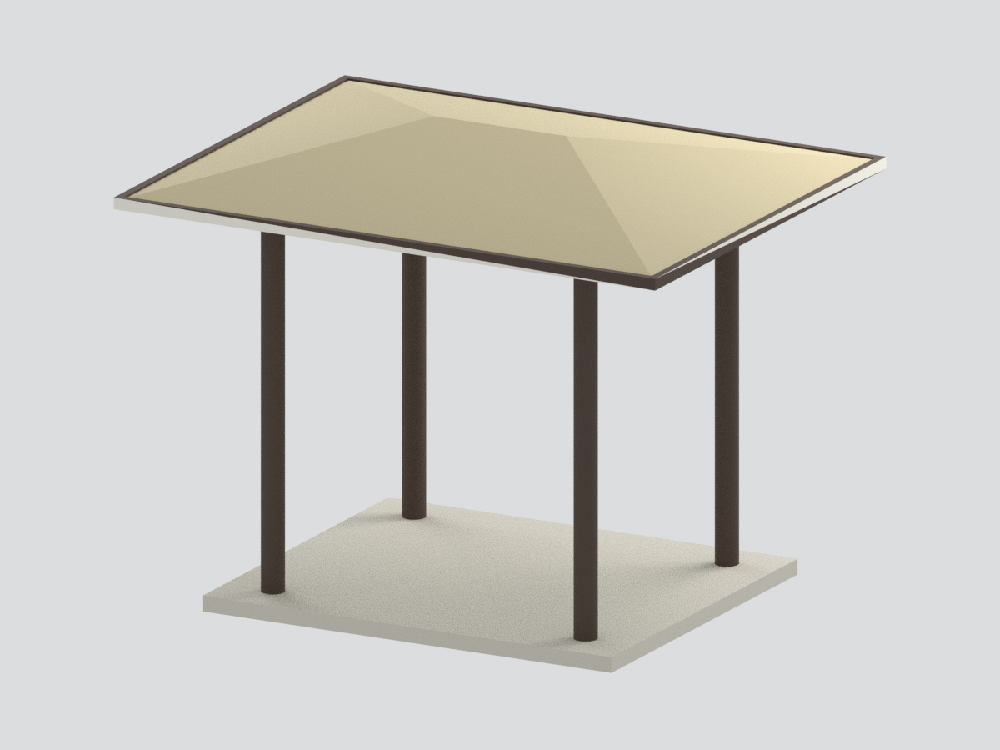
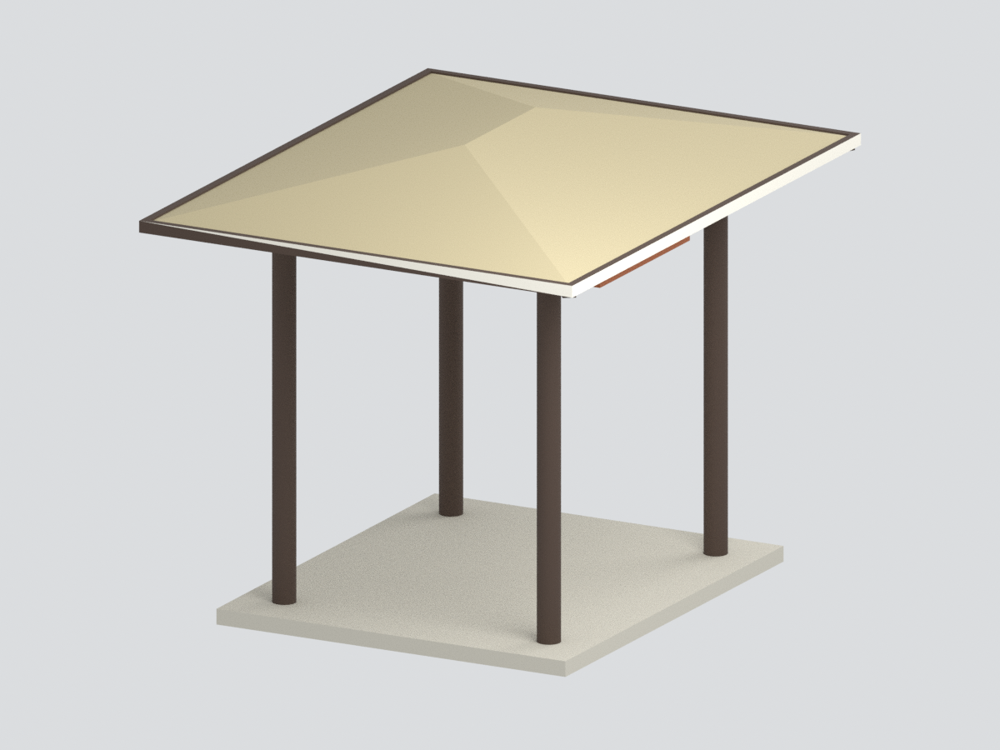
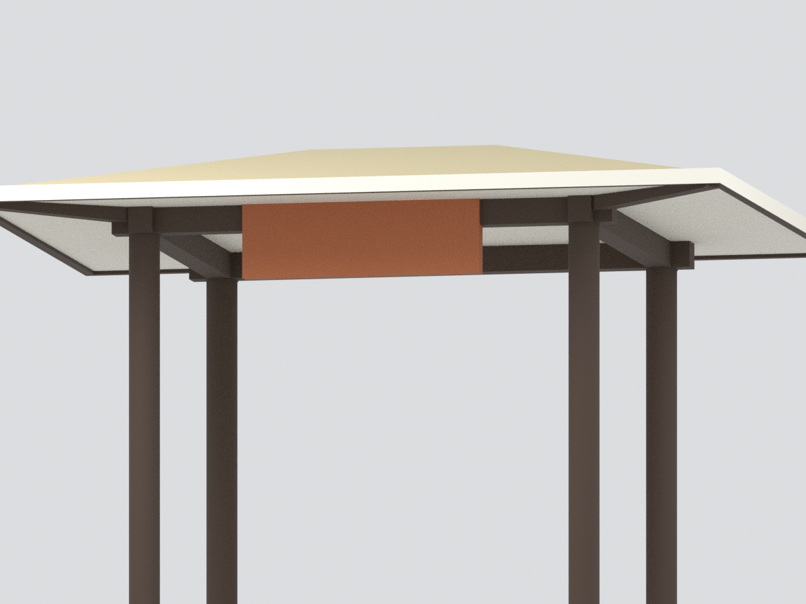

# 華梵大學 雲山亭｜主要亭體彩色模型

以華梵大學 2024-06-24 官方揭幕新聞三張照片為依據，重建獨立亭體的四圓柱、主要樑框、淺四坡屋頂、無字橘色匾與名義支撐底盤。**不是全景園區、測繪模型或施工復原**。

## 範圍與省略
- 覆面使用照片比例近似的厚實體；不將纖維覆材虛構為精細瓦片。背側未確認樑細節不添加。
- 雕像、供桌、供品、勒石、竹籬及植栽都是另件，不包含於亭體模型；匾額不造字。
- 支撐底盤跨越實照被人群與物件遮住的區域，僅為連通/展示支撐，不代表精確地坪、階梯或地形。
- 顏色按照片近似，未色彩校準。比例為名義模型單位，不是實測縮尺。

## 檔案
`model.stl` 單色幾何；`model.3mf` 五色面材質；`scene.blend` 含可編輯隱藏原始元件；`build_model.py` 可重建同一網格。尺寸約 135 × 108 × 107.1 mm。

## 驗證
幾何與檔案一致性見 `QA.json`；全新目錄重建見 `REBUILD-QA.json`；Blender/渲染/構圖及來源視覺審核各有獨立紀錄。這些不是實際試印保證。

## 六視圖

參考照片僅用於研究，不嵌入模型或發布包。來源與誤差見 [SOURCES.md](SOURCES.md)。
