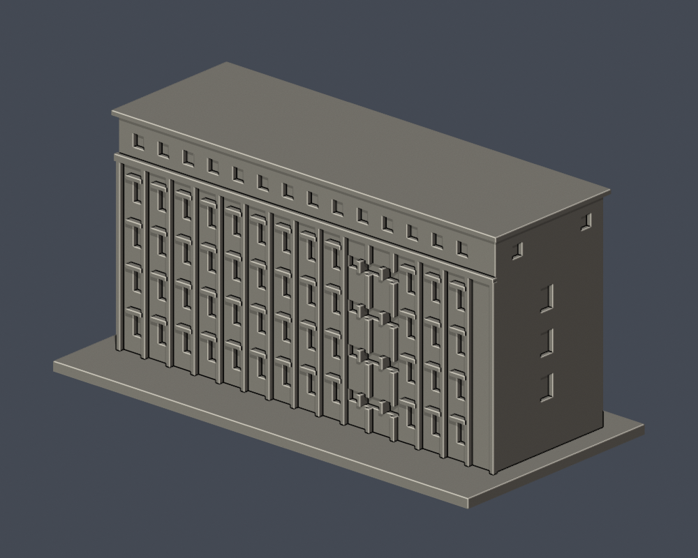
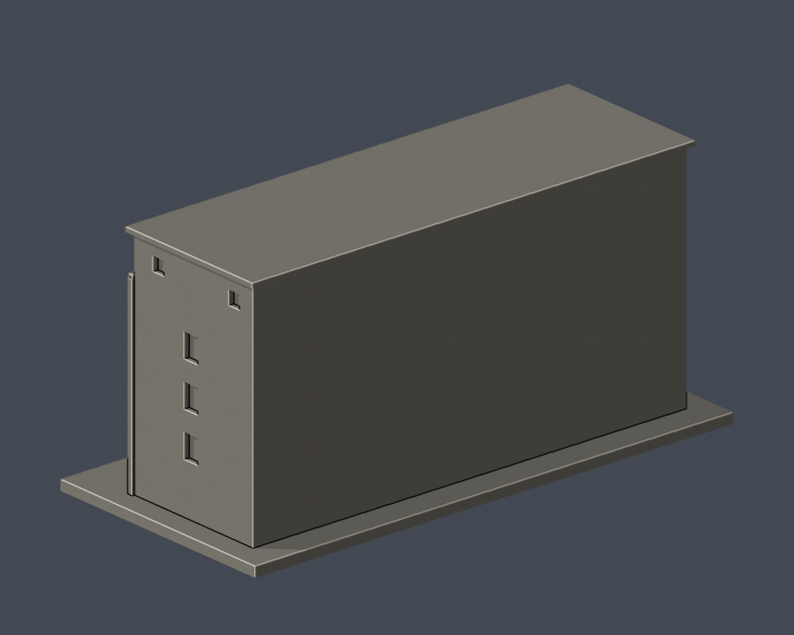

# 萬能科技大學仁愛樓（RHB）

依公开官方外觀實拍的微縮研究，非測繪級BIM，亦非2026即時完整外觀保證。

## 證據及近似
- 四排高窗上方第五層小窗，長向平屋頂
- 正面粗直柱與連續頂梁
- 偏心橫窗樓梯間及端牆中央窗

學務處提供751×441像素較完整長向及端牆實拍，頁面確認五層。前方樹蔭遮首層，背立面及深度未知；窗數與間距為視覺近似，未補猜測地面入口。橫幅廣告與管線省略。 主要實拍751×441像素，沒有放大新增細節；細窗、柱、深度及間距均為視覺近似，不能作精確復原。現行總務處校圖仍標此館，未取得照片拍攝年代。側後遮擋明示簡化。省略招牌文字、空調、植栽、細欄杆。

## 比例與重建
- 含底板尺寸：150.00 × 72.00 × 72.40 mm，單件最長150mm，各件獨立比例。
- 安裝 requirements.txt；執行 python build_model.py 重建STL，再用 blender -b -t 2 -P render_preview.py 產生可編輯完整網格scene.blend與實際STL圖。
- 執行 validate_model.py、check_layers.py、check_thin_features.py 複核。

## 實際STL正背並排
| 正面 | 背面（未見處簡化） |
|---|---|
|  |  |

## 檢查及列印限制
- 原STL法向/邊與頂點流形、正體積、單一連通外表面、無分離內腔殼、重建SHA與Blend/STL三角幾何一致：全部通過。
- 0.2mm間距非共面微偏移截面362層，每個閉環及組合Polygon有效性assert全通過，未自動修補無效形狀。
- 0.8mm XY開運算（1mm抽樣）0層超過1%面積損失，最大0.04%。附牆窗檐1.2mm、構架1.4mm以上，沒有孤立細柱；屋檐角隅損失不等同承重薄壁。
- 窗頂、拱口、柱廊、雨庇可能需支撐；此篩查不是完整壁厚測量、正式切片或實體試印，支撐不能補救噴嘴解析度。請在切片器複查材料、橋接及支撐可移除性。

## 公開來源
- https://www.vnu.edu.tw/campus
- https://www.osa.vnu.edu.tw/album/osa/1689/642e26fa-71be-4df0-ab63-c4c7e2187fae.jpg
- https://www.osa.vnu.edu.tw/1827?s=1930
- https://www.vnu.edu.tw/school_tour.html
- https://administration.vnu.edu.tw/oga/3130
- https://resource.vnu.edu.tw/images/webmap/webmap.jpg

第三方照片及校圖不隨公開模型包重製。
