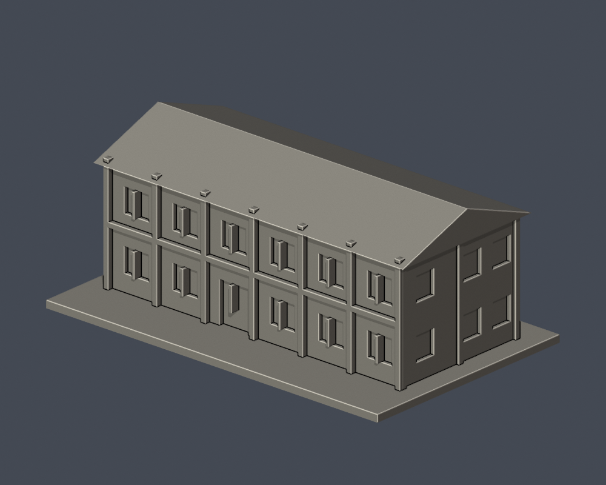
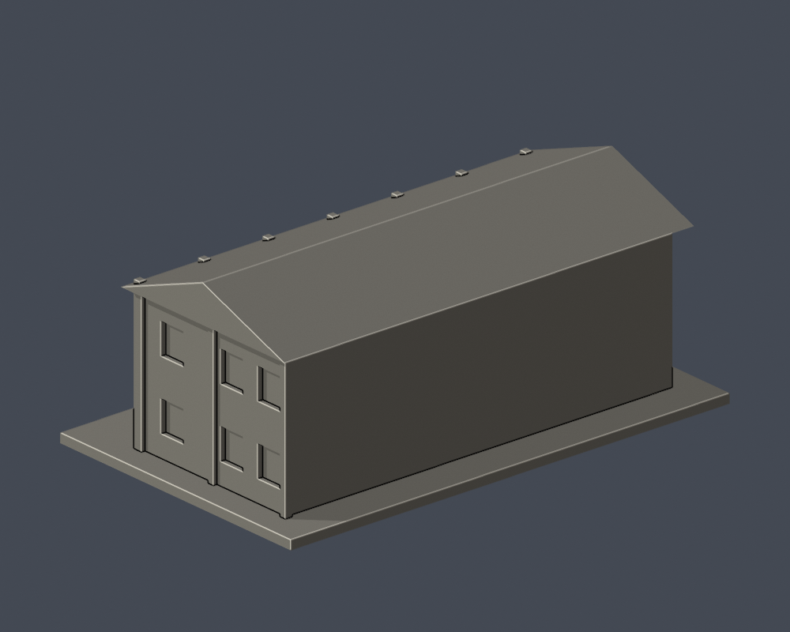

# 萬能科技大學萬強館（舊圖碼PH008）

依公开官方外觀實拍的微縮研究，非測繪級BIM，亦非2026即時完整外觀保證。

## 證據及近似
- 兩層低館、沿長軸的雙坡屋頂
- 長邊深色構架、分格成對窗
- 端牆窗與橫梁

官網校景仍有萬強館名稱；PH008見2024官方交通PDF，現行校圖未獨立標此號，故不視為當年完整現況保證。實拍受樹遮擋，窗數和深度僅大輪廓近似。 官方實拍只有190×143像素，沒有放大新增細節；細窗、柱、深度及間距均為視覺近似，不能作精確復原。現行總務處校圖仍標此館，未取得照片拍攝年代。側後遮擋明示簡化。省略招牌文字、空調、植栽、細欄杆。

## 比例與重建
- 含底板尺寸：150.00 × 93.00 × 61.00 mm，單件最長150mm，各件獨立比例。
- 安裝 requirements.txt；執行 python build_model.py 重建STL，再用 blender -b -t 2 -P render_preview.py 產生可編輯完整網格scene.blend與實際STL圖。
- 執行 validate_model.py、check_layers.py、check_thin_features.py 複核。

## 實際STL正背並排
| 模型預覽 | 模型預覽 | 模型預覽 |
| :---: | :---: | :---: |
| 正面  | 背面（未見處簡化）  |  |

## 檢查及列印限制
- 原STL法向/邊與頂點流形、正體積、單一連通外表面、無分離內腔殼、重建SHA與Blend/STL三角幾何一致：全部通過。
- 0.2mm間距非共面微偏移截面305層，每個閉環及組合Polygon有效性assert全通過，未自動修補無效形狀。
- 0.8mm XY開運算（1mm抽樣）0層超過1%面積損失，最大0.02%。窗框與框架為附牆裝飾，至少1.1mm；坡屋頂末端薄截面屬連續屋脊尖端，不是孤立承重柱。沒有用支撐宣稱修復薄特徵。
- 窗頂、拱口、柱廊、雨庇可能需支撐；此篩查不是完整壁厚測量、正式切片或實體試印，支撐不能補救噴嘴解析度。請在切片器複查材料、橋接及支撐可移除性。

## 公開來源
- https://www.vnu.edu.tw/campus
- https://www.vnu.edu.tw/images/campus/map45.png
- https://www.vnu.edu.tw/school_tour.html
- https://administration.vnu.edu.tw/oga/3130
- https://resource.vnu.edu.tw/images/webmap/webmap.jpg
- https://www.vnu.edu.tw/file_32651_萬能科大交通資訊.pdf

第三方照片及校圖不隨公開模型包重製。
