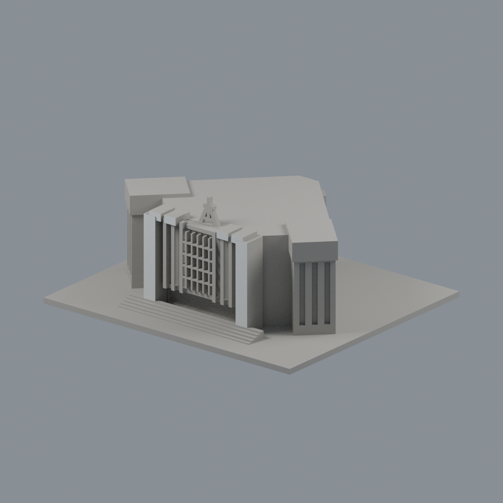
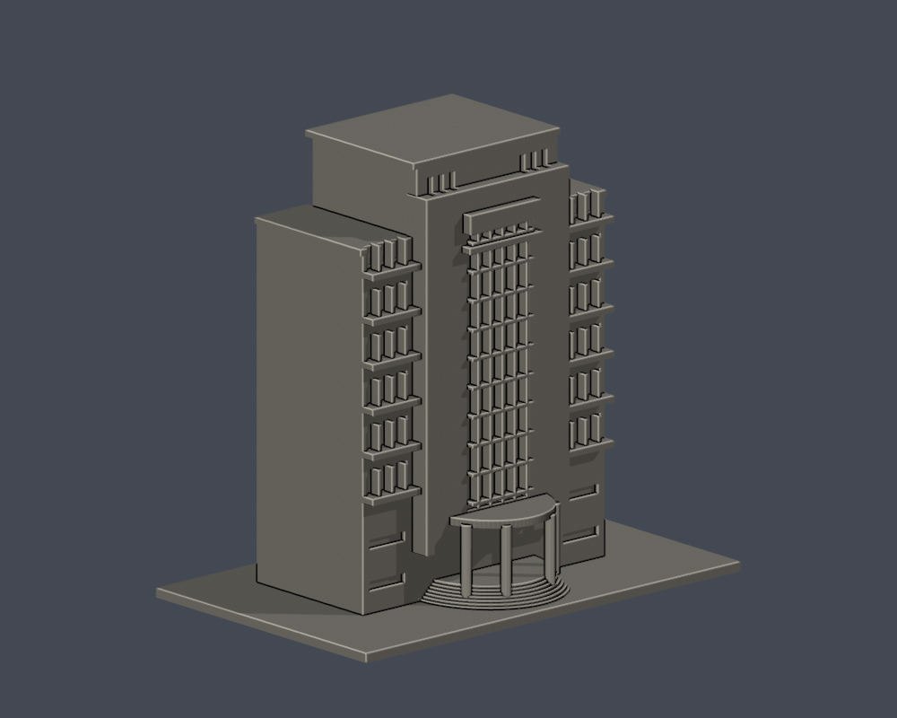
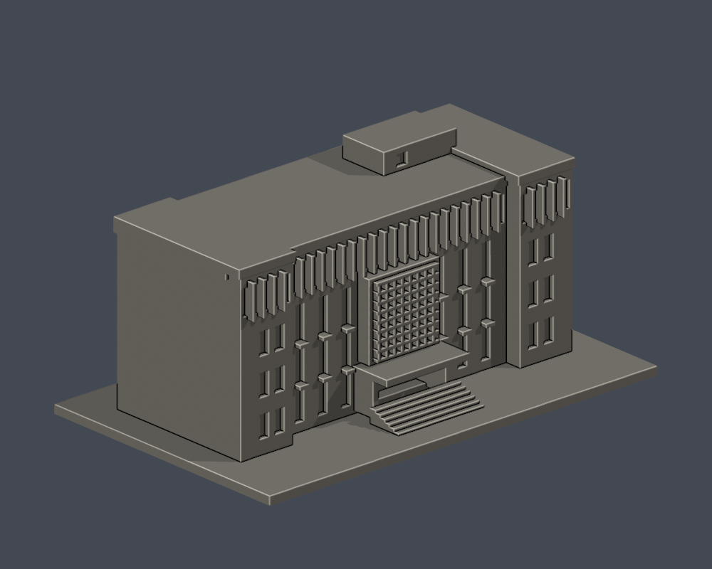
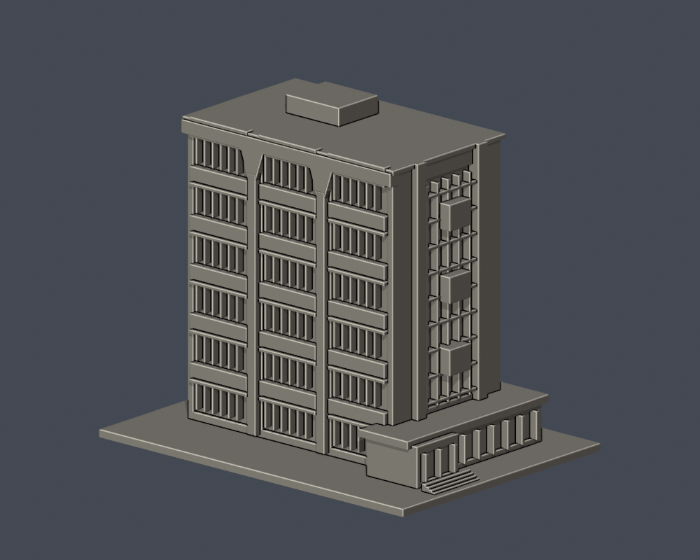

# 輔仁大學建築3D列印外觀模型

目前5件外觀近似模型。尚未完成全校逐棟盤點；60個官方校圖條目包含建物群、館內服務及球場，不能當作60棟。各件獨立比例、最大150 mm。未做實體試印，不能保證可印。

| 建築模型 | 建築模型 | 建築模型 |
| :---: | :---: | :---: |
|  **[中美堂](新莊校本部/buildings/fju-chung-mei-auditorium/README.md)** |  **[淨心堂](新莊校本部/buildings/fju-immaculate-conception-chapel/README.md)** |  **[濟時樓（主塔外觀近似）](新莊校本部/buildings/fju-fahy-memorial-building/README.md)** |
|  **[于斌樓（主體外觀近似）](新莊校本部/buildings/fju-yu-pin-administration/README.md)** |  **[舒德樓（主體外觀近似）](新莊校本部/buildings/fju-schutte-memorial-building/README.md)** |  |

[範圍與剩餘工作](新莊校本部/COVERAGE.md) · [逐來源／棟群待辦](新莊校本部/remaining-work.json)

每件頁面提供STL前後並排、source與不可確認區域、重建程式及幾何檢驗。原始照片未随包發布。舒德樓主体主要依2025照片，入口另以2026官方局部照片補證，不宣稱全棟2026已測绘。
