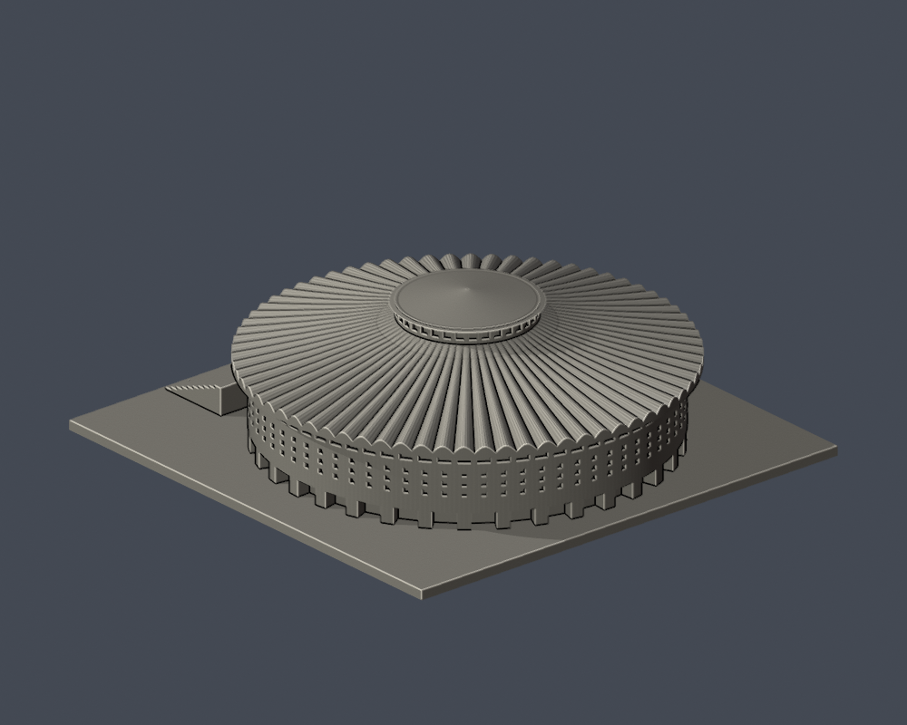

# 輔仁大學・中美堂

新莊校本部；官方校圖編號 29。這是公開照片導向的整棟外觀近似研究模型，並非精密測繪或BIM。

| 模型預覽 | 模型預覽 | 模型預覽 |
| :---: | :---: | :---: |
|  |  |  |

## 外觀依據與範圍
圓形主館、70瓣放射起伏屋頂、頂部採光鼓座與淺錐帽、正面三道拱門、階梯、下層周邊凹廊及有背板的格柵簡化。

## 必讀的證據缺口
未見完整背面近照；背面環向立面延續為估計，未假造獨立後門或附樓。實際尺度及屋面曲率未取得測量資料。圓形館體為連接底座的實心外觀模型，不重建室內看台。屋面花瓣、格柵、台階為列印尺度簡化，非精密施工模型。

每件獨立估計比例；含底座最長邊150 mm。模型預覽直接匯入交付的 model.stl；沒有用替代美化模型渲染。顏色僅為展示材質。

## 檔案與重建
- model.stl：原始交付列印網格
- scene.blend：由相同STL匯入、可編輯網格與展示鏡頭
- build_model.py、requirements.txt：可重建來源
- render_preview.py：以Blender 4.3.2以上產生展示及Blend
- validate_model.py、validation.json：原始法向、邊/頂點流形、單殼、正體積、重建SHA及Blend一致檢驗
- check_contour_validity.py：0.2 mm間距原始STL截面封閉／多邊形有效性，不修補輪廓
- thin_canonical_v2.py：0.8 mm參考寬度的形態篩檢，使用共邊一致插值
- sources.json：逐來源與年代／用途

使用Python 3.12建立虛擬環境，安裝requirements.txt後依序執行build_model.py；再以blender -b -t 2 -P render_preview.py產生圖片與場景；執行validate_model.py、check_contour_validity.py及thin_canonical_v2.py。

## 列印注意
底座平放。階梯、屋簷、柱廊、窗口凹槽及突出構件可能需要支撐；先用自己的切片器檢查懸空與橋接，按噴嘴／材料調整。0.8 mm篩檢不是全表面壁厚分析，也不是列印機路徑模擬。尚未做真正切片驗證或實體試印，不能保證可印。縮小會讓窗格、檐角及宗教符號變脆。

## 來源
- [輔仁數位圖書館：艱辛重建](https://elibrary.fju.edu.tw/fjcustory/2-1)：官方文字及現貌照片；1970啟用、70根弧形樑柱；現貌照片未標攝年
- [全國運動場館資訊網：中美堂](https://iplay.sports.gov.tw/gyminfo/index/7922)：正面照片；圖檔名稱含20140709，僅視為上傳線索，拍攝日期未確認
- [Wikimedia：中美堂2023](https://commons.wikimedia.org/wiki/File:FJCU_Chung_Mei_Auditorium_20230504.jpg)：實際查看正面；日期由檔案標示2023-05-04
- [Wikimedia：中美堂2025](https://commons.wikimedia.org/wiki/File:FJCU_Chung_Mei_Auditorium_20250413.jpg)：實際查看正面遠景；日期由檔案標示2025-04-13
- [Wikimedia：中美堂與醫院](https://commons.wikimedia.org/wiki/File:FJCU_Chung_Mei_Auditorium_and_Hospital_and_College_of_Medicine.jpg)：2025-08-22正面及周邊，可區分後方醫院並不屬中美堂
- [Wikimedia：醫學院旁中美堂側緣](https://commons.wikimedia.org/wiki/File:FJU_MD01.jpg)：實際檢視階梯側面、圓弧檐與下層外緣；未確認攝年

原始第三方照片僅用於私下核對，沒有包入發布資料；幾何自行撰寫，未擷取他人3D資產。
