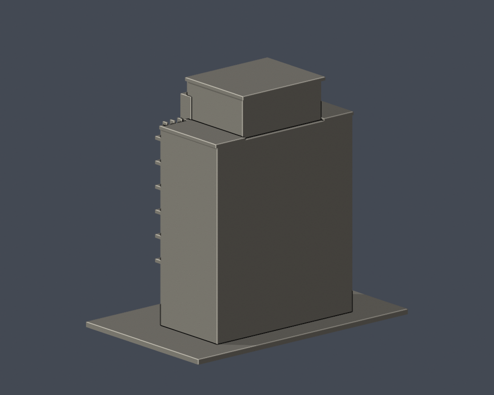

# 輔仁大學・濟時樓（主塔外觀近似）

新莊校本部；官方校圖編號 47。這是公開照片導向的整棟外觀近似研究模型，並非精密測繪或BIM。

<table><tr><td></td><td></td></tr></table>

## 外觀依據與範圍
完整主塔樓外包絡、中央高窗帶、左右窗列及水平挑板、較高中央頂部、圓弧入口雨遮与柱廊。

## 必讀的證據缺口
目前來源正面充足、兩側與背面不足；側背窗未臆測，背面保持簡化實面，進深為估計。入口階梯受樹木遮蔽，模型採概括階梯，並非精確雙曲梯段。範圍是主塔楼外觀，不等同館藏使用樓層或室內。圖書館面積不得作單棟實測尺寸。

每件獨立估計比例；含底座最長邊150 mm。模型預覽直接匯入交付的 model.stl；沒有用替代美化模型渲染。顏色僅為展示材質。

## 檔案與重建
- model.stl：原始交付列印網格
- scene.blend：由相同STL匯入、可編輯網格與展示鏡頭
- build_model.py、requirements.txt：可重建來源
- render_preview.py：以Blender 4.3.2以上產生展示及Blend
- validate_model.py、validation.json：原始法向、邊/頂點流形、單殼、正體積、重建SHA及Blend一致檢驗
- check_contour_validity.py：0.2 mm間距原始STL截面封閉／多邊形有效性，不修補輪廓
- thin_canonical_v2.py：0.8 mm參考寬度的形態篩檢，使用共邊一致插值
- sources.json：逐來源與年代／用途

使用Python 3.12建立虛擬環境，安裝requirements.txt後依序執行build_model.py；再以blender -b -t 2 -P render_preview.py產生圖片與場景；執行validate_model.py、check_contour_validity.py及thin_canonical_v2.py。

## 列印注意
底座平放。階梯、屋簷、柱廊、窗口凹槽及突出構件可能需要支撐；先用自己的切片器檢查懸空與橋接，按噴嘴／材料調整。0.8 mm篩檢不是全表面壁厚分析，也不是列印機路徑模擬。尚未做真正切片驗證或實體試印，不能保證可印。縮小會讓窗格、檐角及宗教符號變脆。

## 來源
- [輔仁耶穌會使命特色發展室：濟時樓](https://jmomission.fju.edu.tw/aboutFju.jsp?labelID=28)：官方正面外觀照片，檔案1_28_799_1.jpg；未標攝年，實際已查看
- [中研院宗教地景GIS：耶穌會會院聖堂](https://gisrl.ascdc.sinica.edu.tw/religiontw/?q=node%2F614)：2017-10-16正面照片，圖示濟時樓本體；實際已查看
- [輔仁招生：濟時樓圖書總館](https://fjcuadm.fju.edu.tw/library_detail.php?id=2)：現有用途、館舍3500坪；樓地板面積不換算成任意外輪廓尺寸
- [國家文化記憶庫：濟時樓](https://tcmb.culture.tw/zh-tw/detail?id=235824&indexCode=Culture_Place)：高挑門廳與對稱階梯之文字證據

原始第三方照片僅用於私下核對，沒有包入發布資料；幾何自行撰寫，未擷取他人3D資產。
