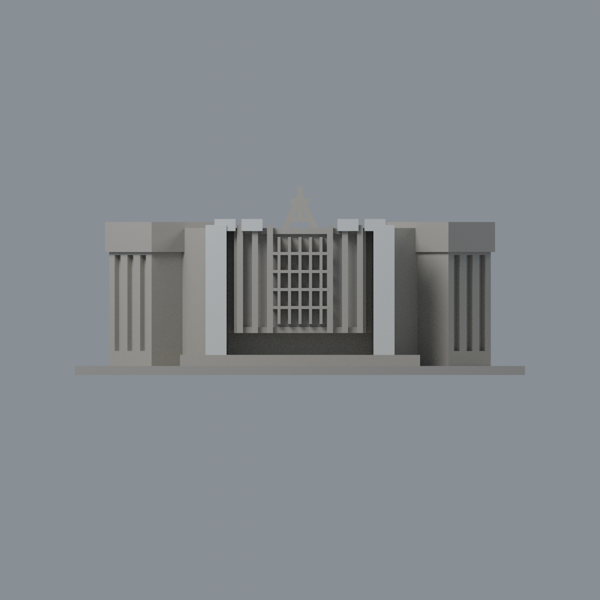
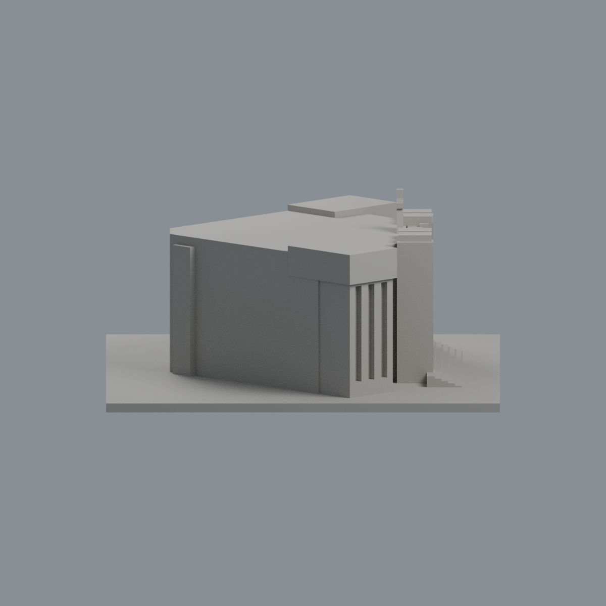
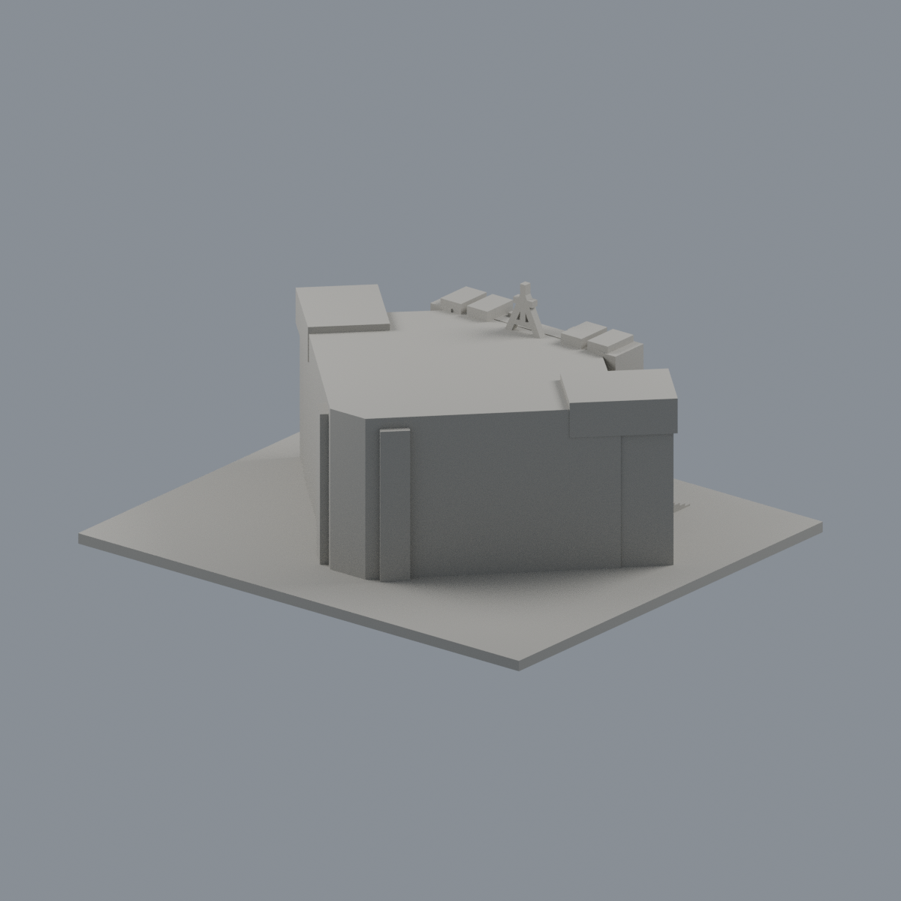
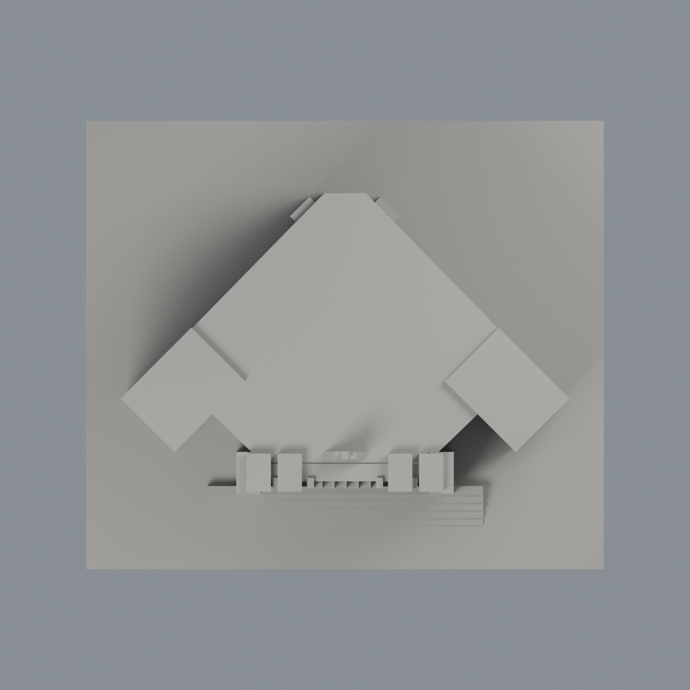

# 輔仁大學淨心堂｜歷史實景限域配色

這是原外觀近似研究模型的**加法式配色版本**，不是新建築、新套數、測繪或2026現況還原。原STL、舊scene與歷史製造QA不改。

## 已確認範圍
已親看FJAC前斜原照與原灰模／generator。只有兩厚門柱及四柱帽的**前臉16個完整原三角面，共702.20000267 mm²**採低飽和白灰`#D8DDDC`。中性`#AAA79F`只是未確認區域辨識代理，不主張建築原色。兩白柱各303.1000013 mm²；四帽依左至右20、28、28、20 mm²。外帽與大柱融合缺少的8 mm²不是跨材質三角漏塗。

每個入選三角形的全部頂點都須在指定垂直平面與有限x/z域內（epsilon 0.0002 mm）；不是只看中心點／包圍盒。詳[完整邊界QA](qa/material-boundaries.json)。未新增或切割三角形。

**保持中性：**柱側、帽側／頂／底（照片帽底棕暗，不可外推白色）、窗格／玻璃、翼牆、屋面、台階、Alpha／十字符號、背面。柱側通氣縫不補洞、不延染。後方高層聖言樓不納入。

## 年代與限制
原JPEG EXIF DateTime、DateTimeOriginal、DateTimeDigitized皆2008-09-08 09:50:53；無XMP。Commons 2009-02-21上傳／2024頁編輯都不是拍攝日期。這是2008歷史色彩視覺近似，未校色、非官方色號。原幾何另參考2013鳥瞰與2017入口配置；2025活動僅證使用，不能證外觀未變。未驗證側後色彩。精確尺寸、窗格／符號藝術細節仍是原模型簡化；非實體列印測試。

## 可編輯檔案與重建
- [3MF](fju-immaculate-conception-chapel-appearance.3mf)：毫米、逐原三角形材質。
- [Blender場景](scene.blend)：單一原網格、兩種可編輯材質、燈光與相機，無照片貼圖。
- [色票](palette.json)、[面映射](face-materials.json)、[來源](SOURCES.md)、[權利](LICENSE-NOTICE.md)。
- [可重建來源包](rebuild-source.zip)：解壓後於appearance/source依序執行`python build_appearance.py`、`python verify_exchange.py`、`python verify_material_boundaries.py`、`blender -b -t 2 -P render_appearance.py`、`blender -b -t 2 -P verify_scene.py`。依[requirements](source/requirements.txt)。
- 五圖：[前斜](previews/front.png)、[正面](previews/elevation.png)、[側面](previews/side.png)、[背面](previews/rear.png)、[俯視](previews/top.png)。

| 模型預覽 | 模型預覽 | 模型預覽 |
| :---: | :---: | :---: |
| 前斜  | 正面  | 側面  |
| 背面  | 俯視  |  |

QA含lib3mf strict零警告、真材質修改存檔重開、Blender材質修改存檔重開、乾淨重建、幾何精確比對。原製造QA未重算，不主張FFF或物理列印已測。照片不隨包分發。
