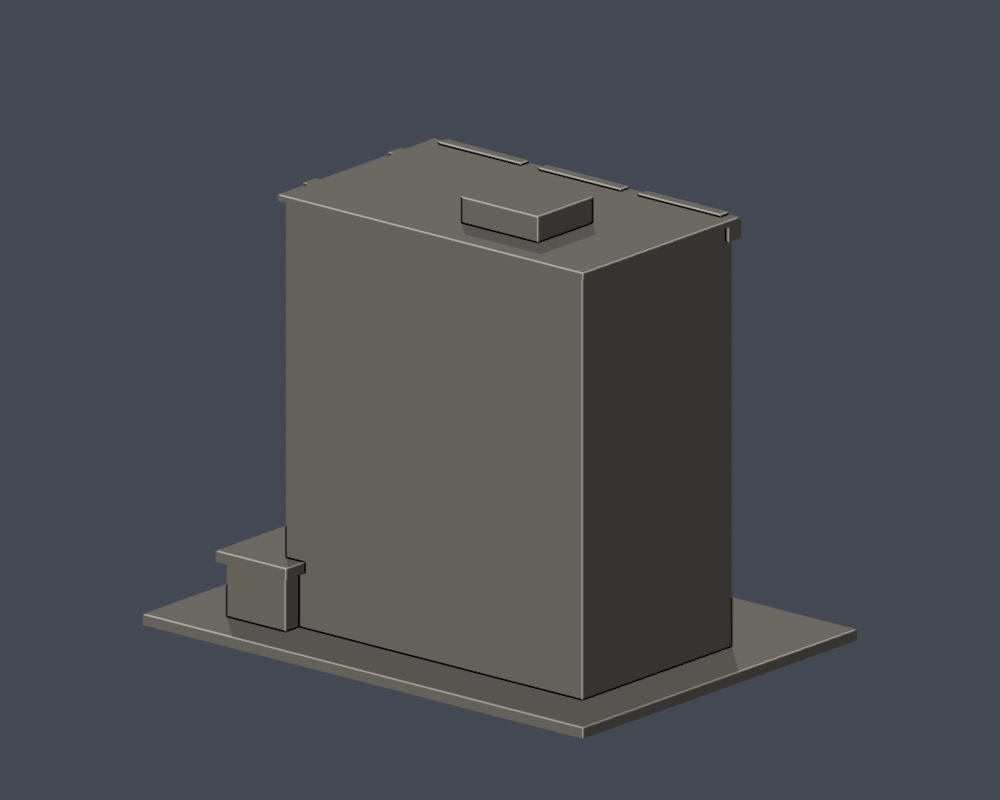

# 輔仁大學・舒德樓（主體外觀近似）

新莊校本部，官方校圖3號；含底座最大150 mm，每件獨立估計比例。不是測绘或BIM，也不是整校完成。

<table><tr><td></td><td></td></tr></table>

## 保留特徵
三大片連續玻璃窗面、六道窗列與不透明窗下板、兩道上端外張立柱、側面石牆與中央樓梯玻璃窗、三個突出不透明梯間面板、底層入口翼及2026劇場玻璃門廳。

## 不確定與範圍限制
主體依2025兩面照片，底部入口參照2026官方局部照片；其餘兩面未確定，刻意不補假窗。進深、屋頂設備房位置／大小、低翼範圍仍為近似。原石片及折板細紋省略；欄杆簡化成厚邊緣，未做裝修立面測绘。劇場是本棟內用途，不能另宣稱為第二棟。

## 檔案與驗證
model.stl為交付原始網格；scene.blend由相同STL匯入，包含可編輯網格與鏡頭。前後圖直接來自STL，顏色僅供展示。Python 3.12安裝requirements.txt後執行build_model.py；用Blender 4.3.2以上執行blender -b -t 2 -P render_preview.py。依序執行validate_model.py、check_layers.py、check_contour_validity.py、thin_canonical_v2.py。

validation.json與qa-summary.json記錄原始法向、邊／頂點流形、水密、單殼、正體積、獨立重建SHA與Blend幾何一致。0.2mm截面均須degree2、逐輪廓與組合Polygon有效，不使用repair掩錯。0.8mm形態篩檢只是幾何提示，不是全面壁厚分析。

## 列印注意
底座平放。窗格、挑檐、入口雨遮、柱廊及梯間突出板可能需支撐；按噴嘴、材料、機台與方向，在自己的切片器核對橋接及懸空。尚無真正切片驗證或實體試印，不保證可印。縮小比例會讓細件更脆。

## 公開來源
- [自攝公開照片：舒德樓20250413](https://commons.wikimedia.org/wiki/File:FJCU_Fr._Schutte_Memorial_Building_20250413.jpg)：2025-04-13清晰斜角，已實際檢視兩面立面與六道窗列、石牆面及樓梯窗、底部入口翼
- [官方：華觀劇場正式啟用](https://www.fju.edu.tw/focusDetail.jsp?focusClassID=0&focusID=2938)：2026-05-21文與新入口實照；位於舒德樓1樓，是用途／裝修更新，不另算獨立建物
- [華觀劇場：劇場歷史](https://sites.google.com/view/fujen-theatre/劇場歷史暨映象館)：原理圖劇場與舒德樓的關係；用途更動不等於全棟重建
- [官方現行校圖](https://www.fju.edu.tw/showImg/subLabelImg/1_7_23_3.png)：舒德樓CF／華觀劇場標示。以地圖辨識位置，不以圖示推定外牆

照片只私下核對，未随包散布；幾何由程式自行建立，未使用他人3D資產。

[2026年5月21日官方頁所用入口原照](https://www.fju.edu.tw/showImg/focus/focus2938.jpg)：本次已查看。這是局部入口照片，不能把整棟2025照片改稱2026現照。
