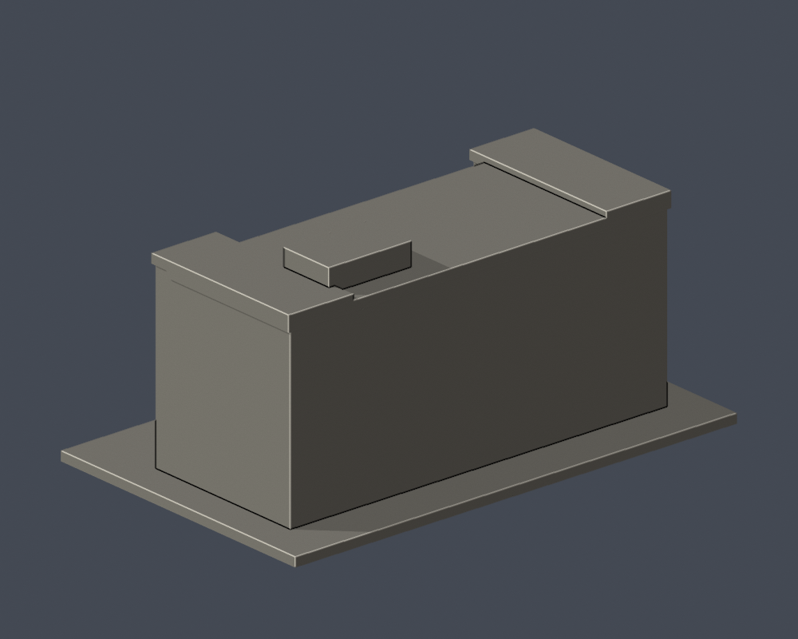

# 輔仁大學・于斌樓（主體外觀近似）

新莊校本部，官方校圖2號；含底座最大150 mm，每件獨立估計比例。不是測绘或BIM，也不是整校完成。

| 模型預覽 | 模型預覽 | 模型預覽 |
| :---: | :---: | :---: |
|  |  |  |

## 保留特徵
四層主體、中央內退正面、兩端前推翼、頂樓連續窗帶與遮陽直肋、三層高細窗、中央格柵及入口雨遮／階梯、右側可見屋頂小房。

## 不確定與範圍限制
正面多時期照片足夠，但未取得完整側背立面與可量測進深；側背採簡化實面，不發明窗口。外包絡比例與屋頂小房進深為估計，不是實測還原。塑像及旗幟不納入建築模型。格柵格數及肋厚為150mm尺度簡化。

## 檔案與驗證
model.stl為交付原始網格；scene.blend由相同STL匯入，包含可編輯網格與鏡頭。前後圖直接來自STL，顏色僅供展示。Python 3.12安裝requirements.txt後執行build_model.py；用Blender 4.3.2以上執行blender -b -t 2 -P render_preview.py。依序執行validate_model.py、check_layers.py、check_contour_validity.py、thin_canonical_v2.py。

validation.json與qa-summary.json記錄原始法向、邊／頂點流形、水密、單殼、正體積、獨立重建SHA與Blend幾何一致。0.2mm截面均須degree2、逐輪廓與組合Polygon有效，不使用repair掩錯。0.8mm形態篩檢只是幾何提示，不是全面壁厚分析。

## 列印注意
底座平放。窗格、挑檐、入口雨遮、柱廊及梯間突出板可能需支撐；按噴嘴、材料、機台與方向，在自己的切片器核對橋接及懸空。尚無真正切片驗證或實體試印，不保證可印。縮小比例會讓細件更脆。

## 公開來源
- [官方：野聲樓更名于斌樓](https://www.fju.edu.tw/focusDetail.jsp?focusClassID=3&focusID=2209)：2023-10-26揭牌近照，入口、雨遮與名牌；不是另一座新建樓
- [自攝公開照片：于斌樓20250822](https://commons.wikimedia.org/wiki/File:Cardinal_Yu_Pin_Administration_Building_20250822.jpg)：2025-08-22，完整正面已實際檢視；檔名標示年份
- [自攝公開照片：于斌樓20250413](https://commons.wikimedia.org/wiki/File:FJU_Cardinal_Yu_Pin_Administration_Building_20250413.jpg)：2025-04-13正面，確認端翼、頂窗帶與中央格柵
- [自攝公開照片：舊名時期正面](https://commons.wikimedia.org/wiki/File:FJU_YP02.jpg)：未確認攝年，僅補幾何交叉核對，不主張現貌年份
- [官方校史：奮起發展](https://elibrary.fju.edu.tw/fjcustory/2-2)：行政中心為四層建築，1981驗收啟用記錄

照片只私下核對，未随包散布；幾何由程式自行建立，未使用他人3D資產。
