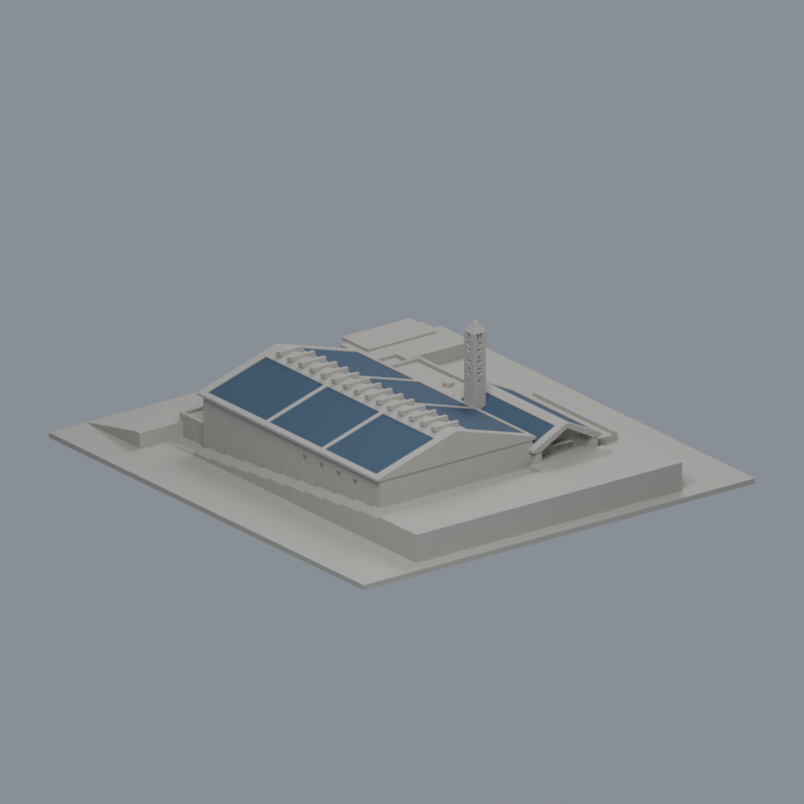

# 長庚大學

公開來源限定的有界近似模型。數位審核紀錄見隨附報告，是否正式發布以統一發布清單為準。未試印，不保證無支撐列印。

本候選收錄學生活動中心，並非長庚科技大學活動中心。校區採地理描述「校本部（桃園龜山）」；主體建成年尚未確證。

| 建築 | 正面：坡上入口與鐘塔 |  |
|---|---|---|
| [學生活動中心](校本部（桃園龜山）/buildings/cgu-student-activity-center/README.md) [屋頂PV限域外觀](校本部（桃園龜山）/buildings/cgu-student-activity-center/appearance/README.md) |  |  |

- [STL 模型](校本部（桃園龜山）/buildings/cgu-student-activity-center/model.stl)；[Blender 場景](校本部（桃園龜山）/buildings/cgu-student-activity-center/scene.blend)
- [來源、尺度界限與列印簡化](校本部（桃園龜山）/buildings/cgu-student-activity-center/sources.md)
- 以 NLSC 原生約 0.13526818 m/px 屋面投影建立約 48.15 × 72.91 m 主頂。這是有界尺度基礎，非地面實測牆基。
- 2018 三禾測量 PDF 的外加座標格與底圖尚未證明共尺度、共位置；僅採灰界拓撲。藍地籍線不是牆。
- 主檐 14.4 m、脊 21.4 m、塔 35.6 m、入口平台 8 m 均為照片推估，非實測。B1 依官方拆層及會議獨立支持，並非把圖中 1B 讀作 B1；不做全圈明露地下層。
- 跨年參考包括 2022 光電後屋面與較早照片；NLSC 的 2024 水印不等於拍攝日。
- 塔 X 後加退背芯，原穿孔簡化為凹紋；帽頂原三角開孔完全封實，入口細 X 為背接浮雕。屋脊及尖帽均有列印簡化，詳見建築說明。

預覽為本候選模型渲染；來源照片及 PDF 不隨候選散布。
