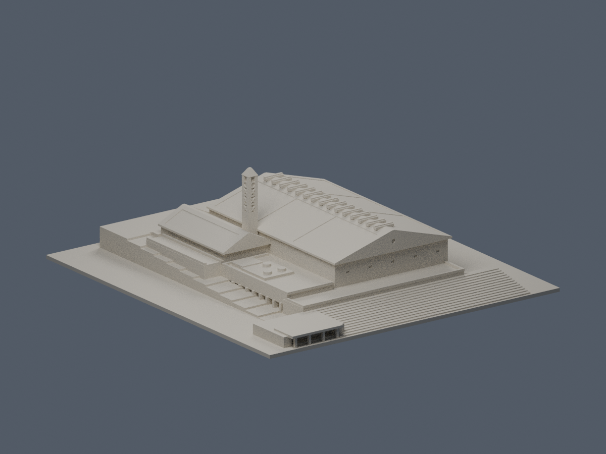

# 長庚大學學生活動中心

公開來源限定的有界近似模型。數位審核紀錄見隨附報告，是否正式發布以統一發布清單為準。未試印，不保證無支撐列印。

位於校本部（桃園龜山）。不是長庚科技大學活動中心，不包含相鄰白膜場或獨立體育館；後方僅保留活動中心相接的有限看台及司令台段。主體建成年尚未確證。

| 正面：坡上入口與鐘塔 | 背面：田徑場側 |
|---|---|
|  |  |

## 模型與來源

[STL](model.stl) · [Blender 場景](scene.blend) · [建模腳本](build_model.py) · [來源與證據限制](sources.md)

毫米單位，底面朝下，最大邊 150 mm。NLSC 原生約 0.13526818 m/px 的主頂投影為約 48.15 × 72.91 m；模型按每 1 m 約 1.18 mm 表達，約 1:847，不能視為實測復原。高建物視差及屋簷／牆基差異仍在。

2018 三禾圖外加座標格與底圖尺度、位置尚未閉合，僅用灰界辨主館、低翼、看台及司令台接合。不能稱已校測量尺寸模型；藍線是地籍，不沿藍線建牆。圖中原碼 1B 不是 B1，4R 亦不能直接改寫地上 4F。

B1–3F 由官方拆層圖及會議資料獨立支持。坡上為 3F 入口，坡下可見 1F 外廊；B1 無自然光，不做全圈明露層。底層退縮、背側細窗及所有高度均為照片有界近似。試稿主檐 14.4 m、脊 21.4 m、鐘塔 35.6 m、入口平台 8 m，均非官方標高或實測。

參考跨年：以 2022 光電工程後屋面為方向，配合較早的正背照片及 2018 拓撲。2024 為 NLSC 圖面水印，不是已確認拍攝日；本作不宣稱某一日完全一致的現況。

## 明示的列印簡化

- 鐘塔約 4.47 mm 寬。X 斜撐內側加退背實芯，把來源真穿孔封背成凹紋；不宣稱重現原構造鏤空。
- 帽頂原三角開孔完全封實，不保留凹槽。尖帽截頂保留有限頂面，避免針尖。
- 入口細 X 約 0.26 mm，為背接淺浮雕，並非自由細杆；細紋是否保留仍依噴嘴、層高及切片設定。
- 15 個屋脊採光／通風蓋以封頂浮雕表達，上唇平面進深加至約 1.117 mm；主屋脊採有限脊平台。這些是列印簡化，不是原件尺寸。
- 光電板為有限淺浮雕／淺凹，省略細格，不把光電當屋頂開洞。
- 地形、低翼、看台與遮擋處保守簡化；不憑陰影補造精密窗列或地下層外露高度。

## 核驗邊界

現有數位檢查檔只是特定幾何與切層抽樣的證據，不能取代原面厚根核對、切片及實體試印。入口／鐘塔列印簡化外觀已核；數位檢查不等於已試印或無支撐保證。發布前應由負責人核對最終模型與所有檢查檔一致。

預覽是自行生成的模型渲染。官方照片、NLSC 原圖與 PDF 僅供研究核對，不放入候選或另行散布；來源連結見 sources.md。

## 屋頂PV限域彩色外觀層

[彩色3MF、可編輯Blend與五視角](appearance/README.md)：僅8個既有屋頂PV區23原面、4055.465801mm²深藍灰展示代理，其餘6245面中性；15脊蓋、綠頂、牆塔均排除。全部6268面及原STL bytes不變。官照拍攝日未知，2022-07僅PV完工；非現況測繪或新增列印保證。原雙QA口徑、六族例外與v1薄唇HOLD完整保留。
