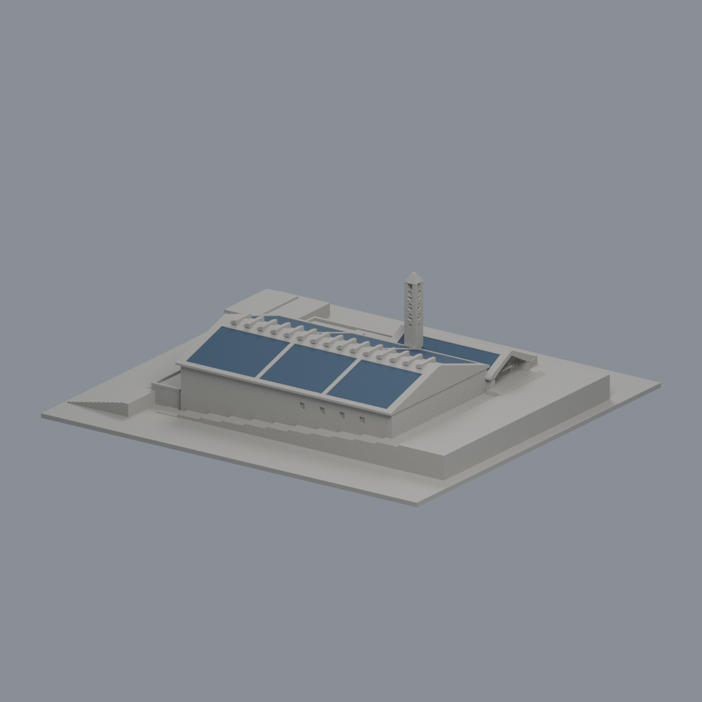
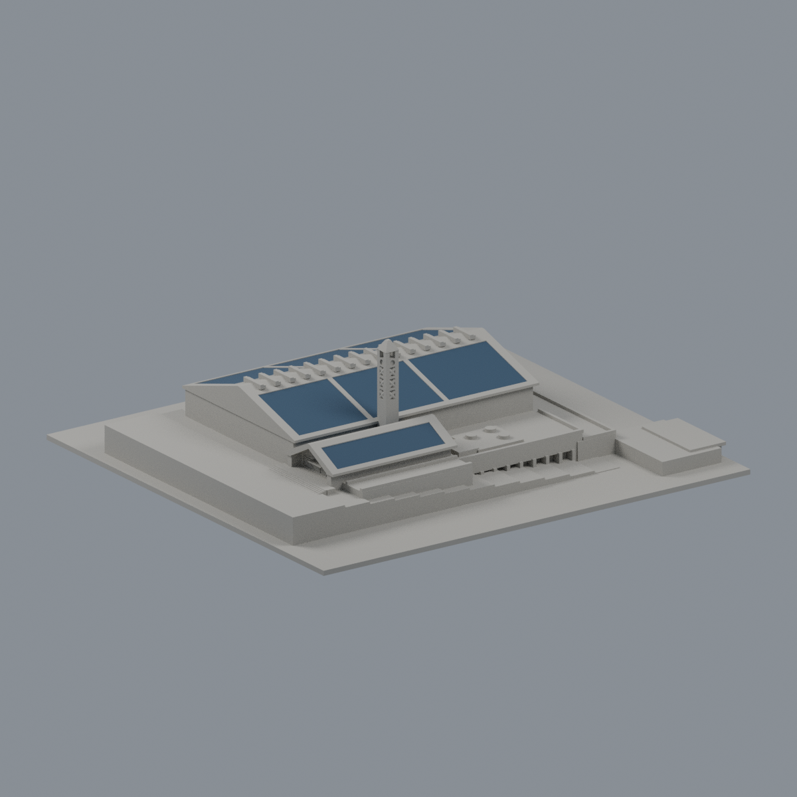
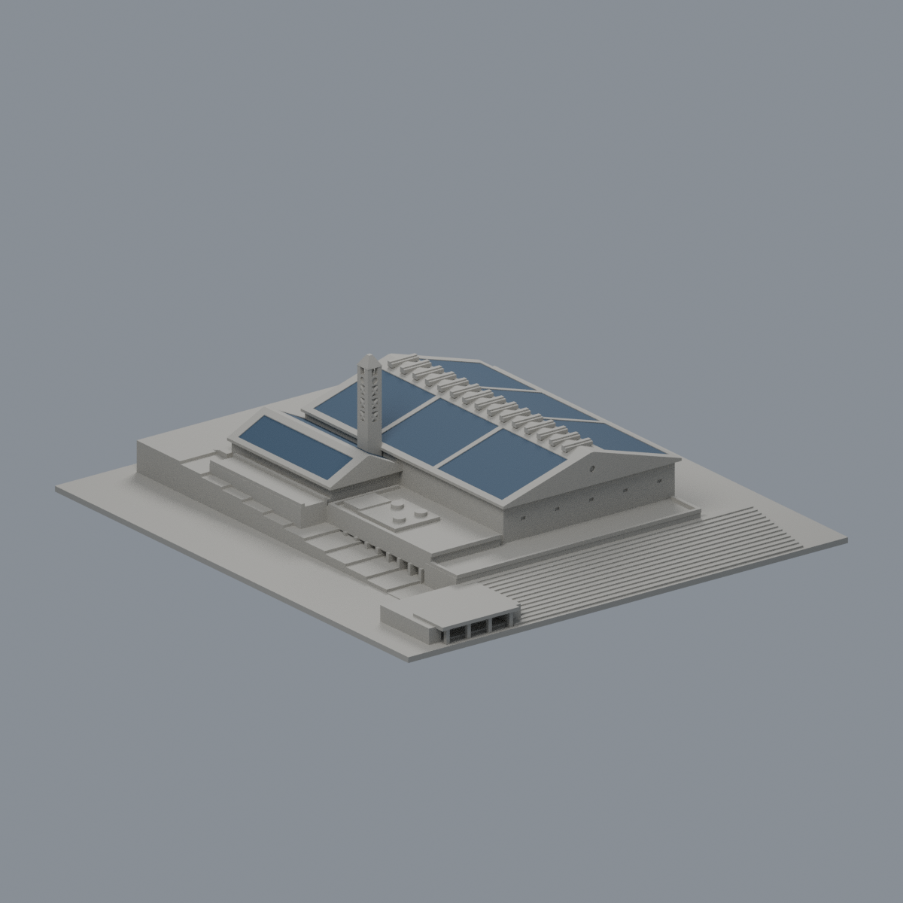
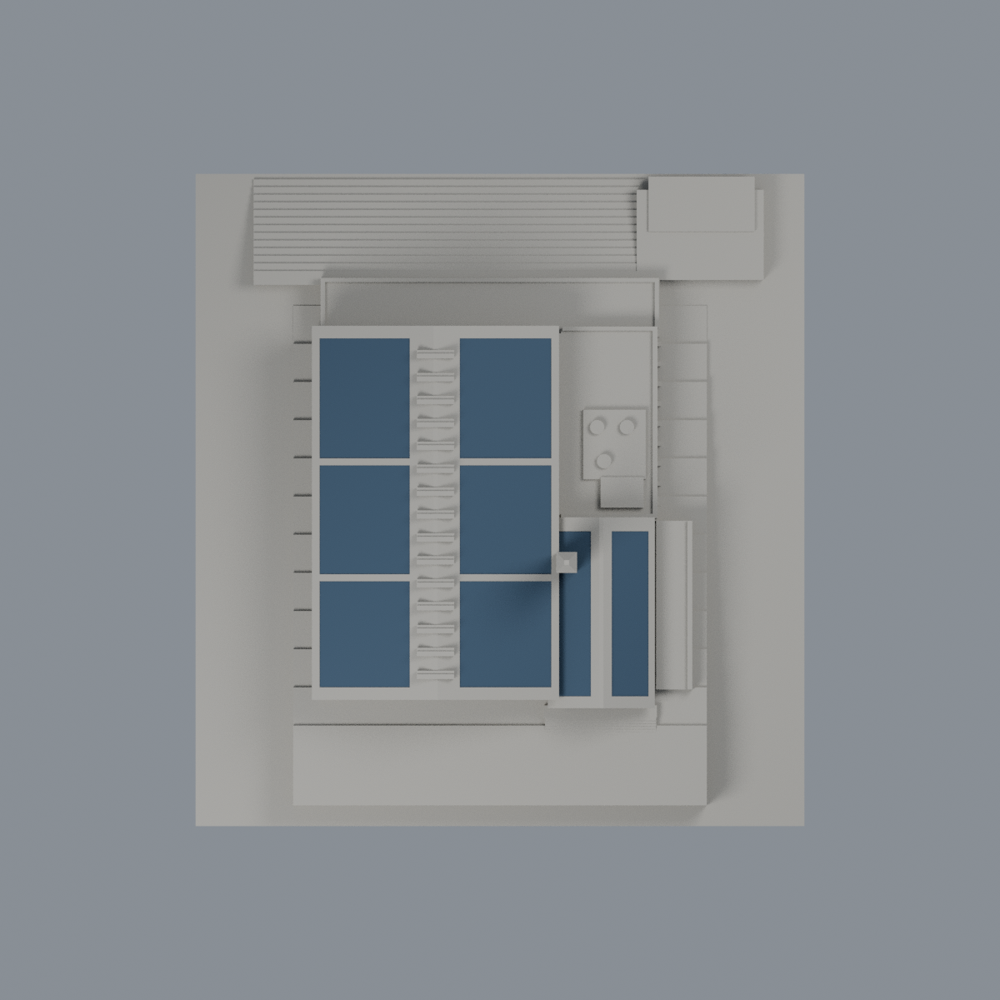
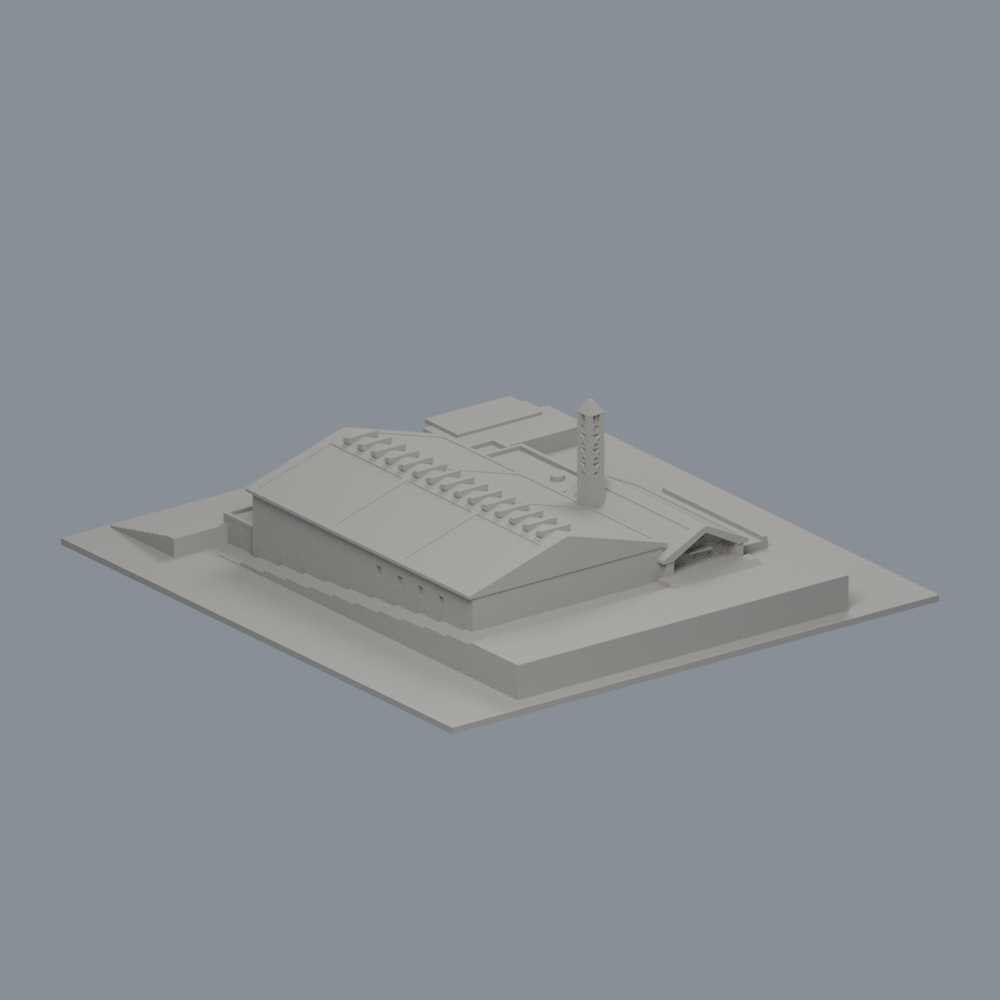

# 長庚大學學生活動中心｜屋頂PV限域外觀層

維持同一既有模型身份，只給8個既有大型屋頂PV區域加入深藍灰不透明展示代理：23原三角面、4055.465801mm²，其餘6245面中性。15屋脊蓋、所有邊條／步道、綠色低屋頂、牆、門窗、塔及地面均不著色。中性色不是實物灰色宣稱。原STL bytes、6268面座標／順序／法向全不變；不切面、修網、加模組格線或精確PV片數。

[彩色3MF](cgu-student-activity-center-appearance.3mf) · [可編輯Blender](scene.blend) · [材質](palette.json) · [逐面索引](face-materials.json) · [重建來源](rebuild-source.zip) · [校驗](SHA256SUMS.txt)

| 正面 | 左側 | 右側 |
|---|---|---|
|  |  |  |
| 背面 | 頂視 | 同角度單色對照 |
|  |  |  |

## 來源與界線
官網高斜照片確有主屋頂六個大型PV區及入口兩區，但拍攝年月未知。2022-07僅PV工程完成，非照片或主建物完工日期；2026-10-23是取閱日。代理色未經色卡或反射率校準。原模型跨用2018拓樸、2022PV年代、無日期立面，不是2026現況測繪。原15脊帽與照片斜板幾何不對應，因此保持中性。

## 幾何與歷史QA
原單一封閉表面殼3104頂點／6268面，140×150×43.60800171mm，正體積198299.520759mm³。原42檔完整保留；舊檢查不是本輪重跑。新QA只證明限域材質、3MF嚴格讀入／實改存讀、Blend材質與頂點實改存讀、重開渲染、原面一致與來源包重建。

原密集0.2mm篩查218層／564原Polygon，侵蝕及開運算未消失或分裂；50全層警示、最高損失8.530043254779153%。263高損紀錄是六族跨層樣本，非263實體：台4柱84、低翼9柱中8柱64、塔X芯31、15脊蓋唇30、塔頂4柱44、同一有限帽10。原787根控制、526高損面樣本均是歷史QA。另粗1mm篩查44層／7個逾1%／最高0.08472800609051537，不與密集口徑混合。六族是原具體例外，非放寬一般薄壁門檻。

原v1實際0.0132mm薄唇仍HOLD不發布；本v2移除四帽盲凹、實心有限截頂。外角／擦邊短弦0.022641／0.0028mm不是全域壁厚。塔X封背、入口約0.26mm背牆浮雕、屋頂唇約1.117mm、帽與支撐／比例限制保留。不任意縮小，不宣稱新增print-ready、實體試印或切片保證。原QA.md及其資料為完整控制文件。

原NLSC裁切旋轉仿射有記錄；初期把原生tile像素誤當生成座標的疑慮已撤回，不列成幾何缺陷。本輪未重驗地理比例。屋頂投影不等於牆基、Z高度仍照片估計。

## 重建
解壓rebuild-source.zip，安裝source/requirements.txt；使用Blender4.3.2。依序執行 `python appearance/source/build_appearance.py`、`python appearance/source/verify_exchange.py`、`blender -b -t 4 --python appearance/source/render_appearance.py`、`blender -b -t 4 --python appearance/source/verify_scene.py`。選面以實際有向法向、三頂點全在有限XY域與支持斜面、0.00006mm量化容差核對exact IDs，不用面中心。

參見[SOURCES](SOURCES.md)、[權利](LICENSE-NOTICE.md)及qa。
