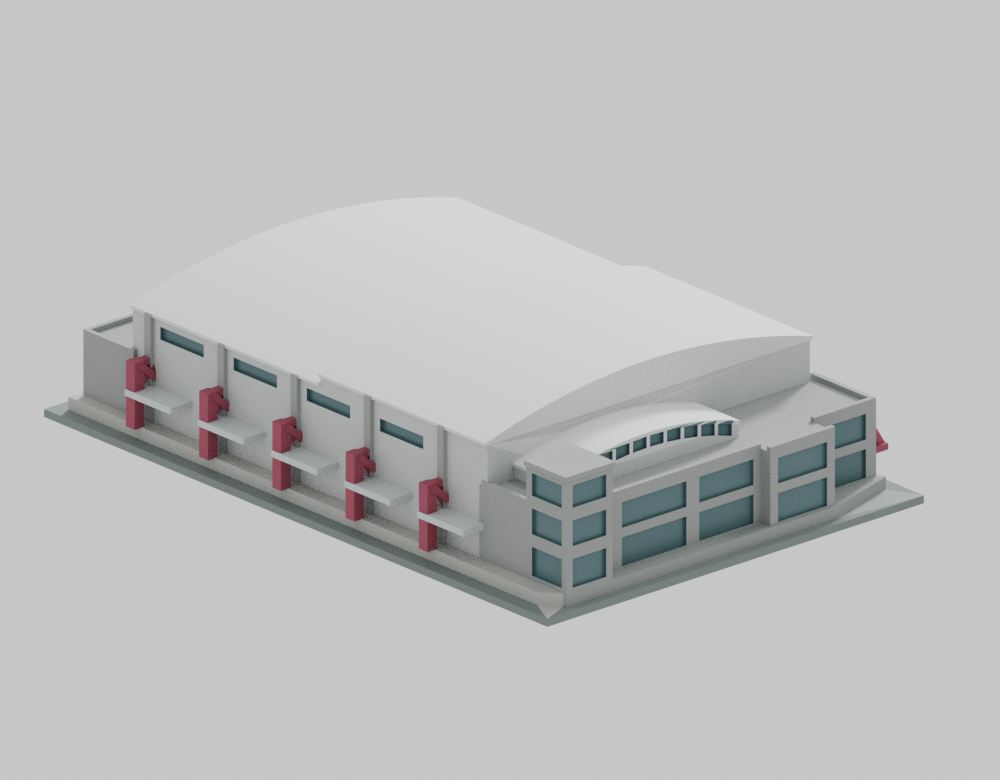
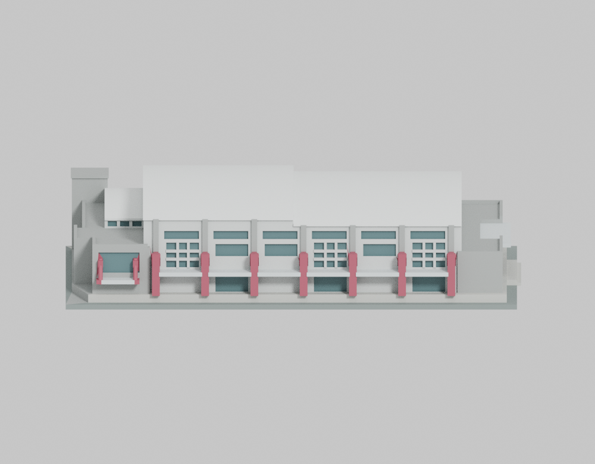
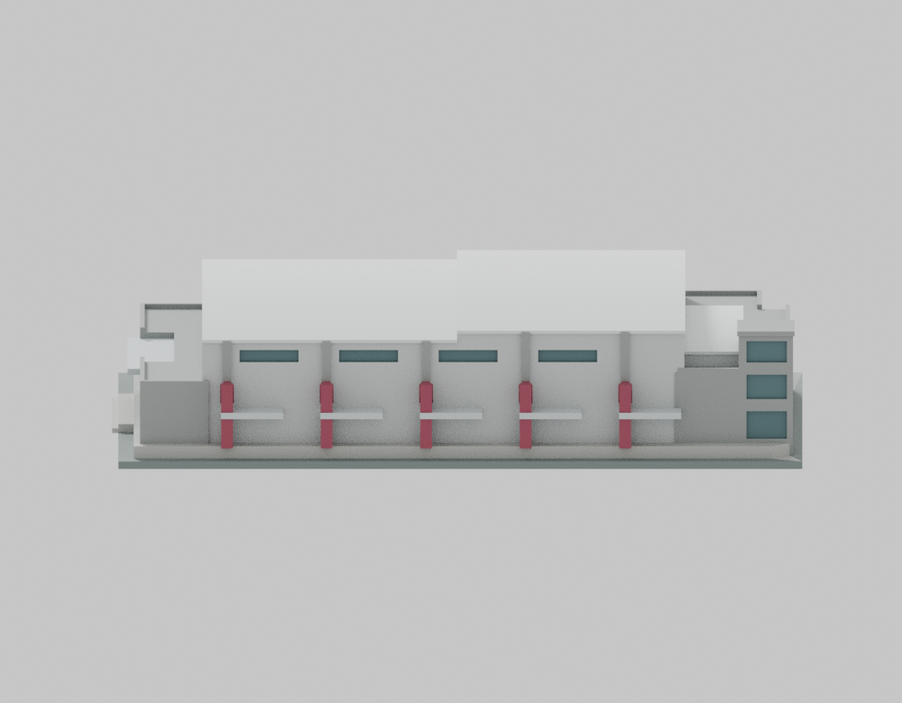
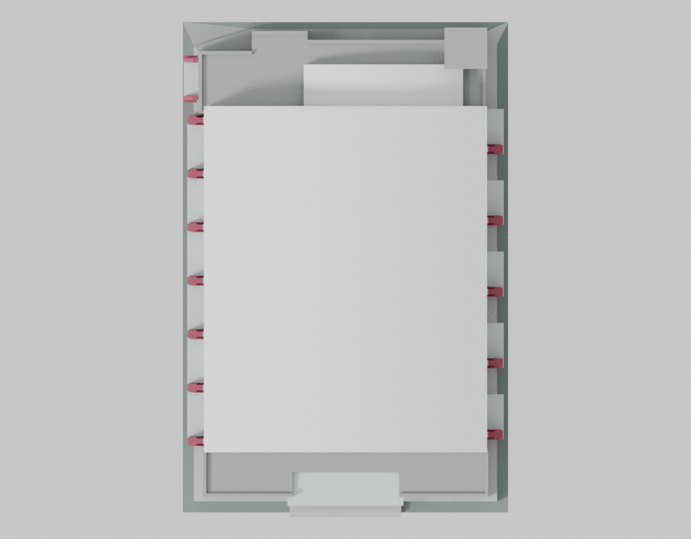
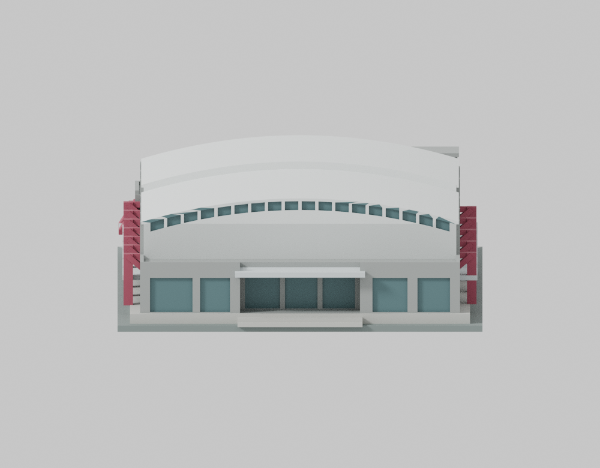
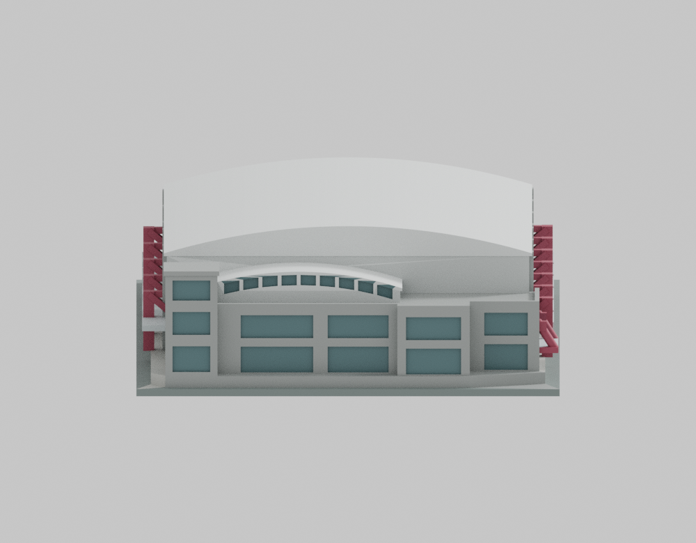
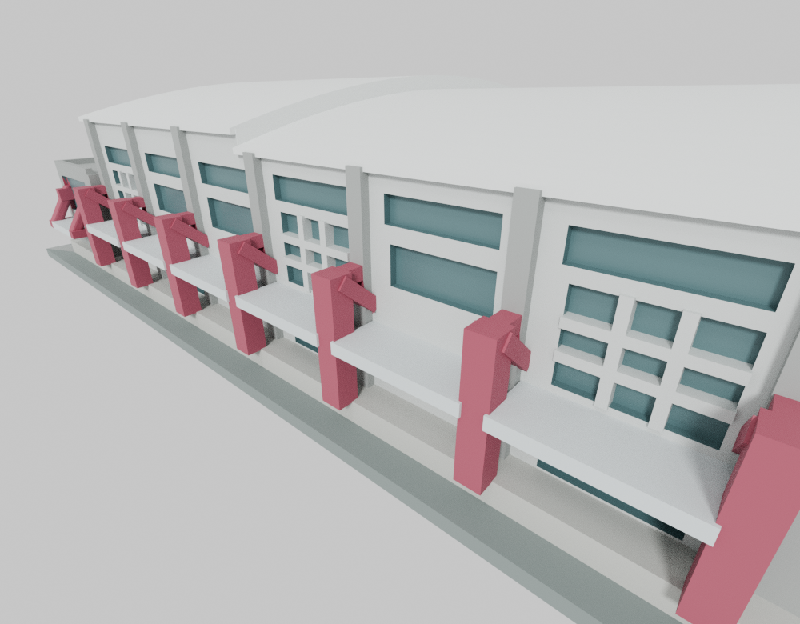
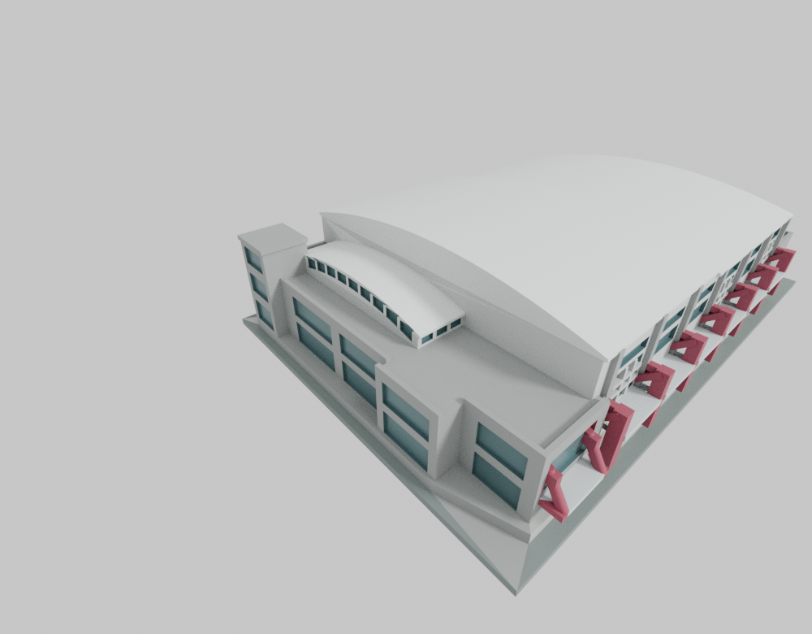

# 長庚科技大學｜林口體育館

依公開實景資料製作的原創、相對比例、低細節外觀代表。保留入口A端較低、設備B端較高的兩段主弧頂，偏教學樓T側的窄低次弧頂、球場S側及B向平台、不同附翼與入口退縮。

| 入口A端與球場S側 | 設備B端與教學樓T側 |
| :---: | :---: |
|  |  |

[下載 STL](models/v10/model.stl) · [下載 Blender 場景](models/v10/scene.blend) · [估計與簡化](ESTIMATES.md) · [作者數位檢查範圍](AUTHOR-GEOMETRY-SCOPE.md) · [完整QA與安全還原](qa/README.md)

模型146 × 222 × 53 mm，含146 × 222 × 3 mm底板。建築真實長寬與精確標高未知；官方15.5 m建物高度的量測基準未明，不用來推算完整模型尺規，不提供精準1:N，也不標為2026現況重建。2011–2012為所見工程期間，不是照片拍攝日期或已證實啟用日。

球場側窗群與教學樓側採不同處理，T側樹後未知下牆保守省略，不表示實際無窗。既有角落直立體用途未證，不命名為電梯；113學年度電梯只有規劃證據，未加假想井道。2022防水排水工程不當作主弧頂增建證據。外殼採實心內芯、加粗方柱、Y向加寬平面斜桿、B側局部厚接頭及加厚雨棚，主外架中央斜向露空仍保留；構造、粗分窗格與曲率均為模型估計，沒有重建室內。

## 列印限制

未實體試印，未驗證特定機器、材料或切片支撐策略。屋簷、雨棚與支架有懸空／橋接區，須評估支撐、接觸面與拆除路徑。222 mm長邊未含brim、skirt與支撐安全邊界，名義220 mm印床無法直接按此長邊放置。縮小或修改STL後不能沿用本尺寸的數位QA。有限截層與固定法線射線不證明任意位置、任意方向的全域最薄壁。

原normal／-O各10 flags、strict=false與實際exit1原樣保留；同次actualhex精確有界補證另列，沒有移樣本、替換理想線或降低0.8 mm門檻。原generic strict不改稱通過。STL SHA-256：66f0516f35df2df734b6d8a4d37a8f93b73e5685fd47b0b7d74ff15c88ccf978。

## 其他視角

| 球場S側 | 教學樓T側 | 屋頂俯視 |
| :---: | :---: | :---: |
|  |  |  |

| A端入口與寬弧窗帶 | B端窄弧窗帶與平台 | 主外架近景 |
| :---: | :---: | :---: |
|  |  |  |

圖片中文名稱見[圖說](VIEW-CAPTIONS.zh-TW.json)。east/west/north/south為固定機器鍵名，不主張真北；兩個courtyard代號分別為外架與B端屋面近景，不表示本棟有中庭。公開九圖僅移除指定非視覺metadata，原圖像資料及解碼像素保持一致。

## 來源與範圍

[來源連結與採用範圍](SOURCE-CREDITS.md) · [獨立來源外觀審核](source-review/SOURCE-APPEARANCE-SUMMARY-v10.public.zh-TW.md) · [指定原件憑據](source-review/SOURCE-APPEARANCE-CERTIFICATE-v10.public.json)

公開原創幾何、原碼、材質、渲染、來源文字連結及明列數位證據；來源照片、地圖、PDF與私有研究比較資料不公開，不宣稱來源作者授權或認可。只有林口體育館一件，未含鄰棟、嘉義分部或全校建物，非全校完成。

長庚科技大學為教育部代碼1070，與長庚大學不同校；前身長庚技術學院、長庚護理專科學校不另計校。展示名稱「林口校區」對應原手冊「林口本部」，原兩校區名稱及地址保留。

## 原碼與重現

[建模原碼](source/build_model.py)、[渲染原碼](source/render_preview.py)、[參數](parameters.json)、[環境需求](requirements.txt)保留原bytes。[作者重現說明](REPRODUCE.md)及完整QA的canonical/copy-map說明原相對路徑。先安全還原到新的工作副本再執行，不覆寫封存原件。
