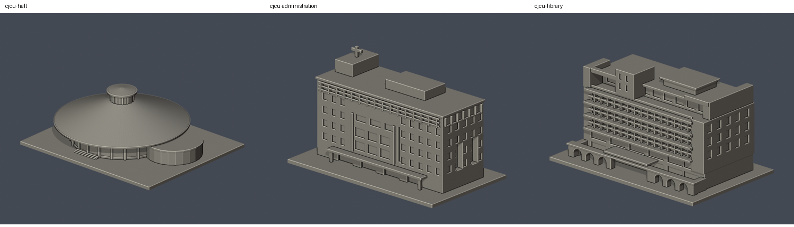

# 長榮大學｜公開外觀近似模型

目前包含長榮堂、行政大樓、蘭大衛紀念圖書館主量體及綜合體育館，共4件樓館模型；另有校門十字架鐘塔1件地標構造物，合計5個模型，不把地標算第5棟樓館。各件自行建構，不使用第三方3D模型；第三方照片只列來源連結，沒有再散布。模型獨立縮尺，含底座最大150mm。

- [長榮堂](歸仁校本部/buildings/cjcu-hall/README.md)
- [行政大樓](歸仁校本部/buildings/cjcu-administration/README.md)
- [蘭大衛紀念圖書館主量體](歸仁校本部/buildings/cjcu-library/README.md)：不含相接計算機與網路中心低層翼
- [綜合體育館](歸仁校本部/buildings/cjcu-gymnasium/README.md)：2020更新桶拱屋頂來源；採光罩數量粗化、進深與後側近似
- [校門十字架鐘塔（地標構造物）](歸仁校本部/buildings/cjcu-gate-cross-tower/README.md)：與校圖36號慎行鐘分開
- [校區目錄](歸仁校本部/README.md)
- [逐項來源、別名、分棟與缺口名錄](coverage-and-gaps.json)

## 完成範圍
全校尚未全部完成。官方2024校圖的38項是地點標籤，包含球場、停車場、構造物及建築群；前次16研究項也不是16個唯一建物。實體總棟數尚未完成核實，不提供虛構全校完成率。

歸仁校本部已核對公開地圖與導覽。官方健康科學學院記載2008年自歷史彰化分部遷回臺南；歷史分部建物/現況待查，沒有把彰基院舍誤列為現行校舍。其他校外資產亦未宣稱窮盡。

## 後續工作
優先補第一教學大樓、第二教學大樓、學生活動中心與珍古德教室的完整多角度實拍；確認教學大樓中庭、第三/四宿舍棟界及工場群。小型溫室、警衛室、污水處理/河川保育中心、各工作坊仍未建模。未觀察到的背面或棟界不能依示意地圖憑空補出。

## 列印和精度
這是照片導向外觀近似，不是測繪、室內模型或BIM。STL、可編輯Blender、重建程式、檢查腳本、驗證JSON、前後並排圖及SHA均附於各模型目錄。底座可能取代原有坡地或戶外台階。

原始STL不經repair；檢查水密、邊及頂點流形、原法向、單一表面殼、正體積、獨立重建SHA、Blender一致，以及0.2mm節距截面的閉合與多邊形有效性。0.8mm參考薄特徵篩查不是全面壁厚檢定、實際切片或試印。雨棚、拱廊、框架及寬出簷需在自己的切片器檢查支撐。

## 主要官方入口
- [校園地圖](https://dweb.cjcu.edu.tw/general/album/2660)
- [校園導覽](https://www163.cjcu.edu.tw/web2023/ja/about_campus_tour.php)
- [長榮堂設計理念](https://dweb.cjcu.edu.tw/general/article/7920)
- [健康科學學院沿革](https://dweb.cjcu.edu.tw/chs/article/1996)
