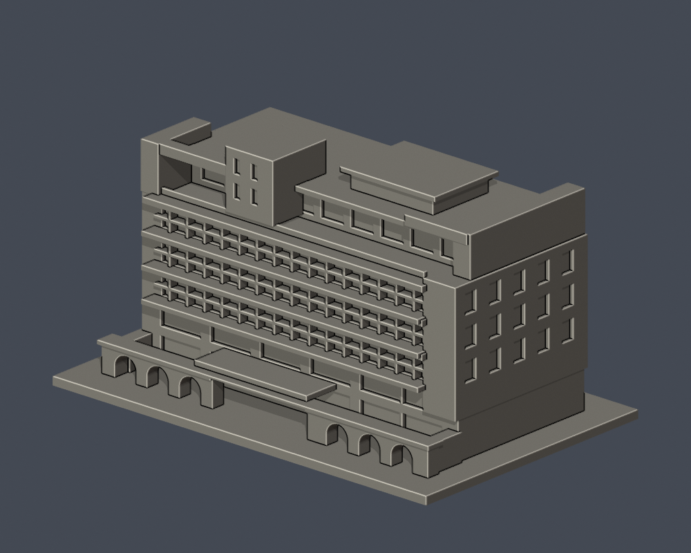

# 歸仁校本部

| 建築模型 | 建築模型 | 建築模型 |
| :---: | :---: | :---: |
|  **[長榮堂](buildings/cjcu-hall/README.md)** |  **[行政大樓](buildings/cjcu-administration/README.md)** |  **[蘭大衛紀念圖書館主量體](buildings/cjcu-library/README.md)** |
|  **[綜合體育館](buildings/cjcu-gymnasium/README.md)** |  **[校門十字架鐘塔（地標構造物）](buildings/cjcu-gate-cross-tower/README.md)** |  |

[長榮大學目錄](../README.md)

臺南市歸仁區長大路1號。以下4件樓館及1件地標構造物獨立縮尺；其餘項目見學校缺口名錄。

- [長榮堂](buildings/cjcu-hall/README.md)
- [行政大樓](buildings/cjcu-administration/README.md)
- [蘭大衛紀念圖書館主量體](buildings/cjcu-library/README.md)
- [綜合體育館](buildings/cjcu-gymnasium/README.md)
- [校門十字架鐘塔（地標構造物）](buildings/cjcu-gate-cross-tower/README.md)
