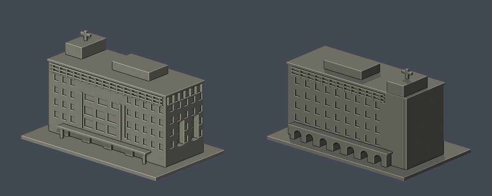
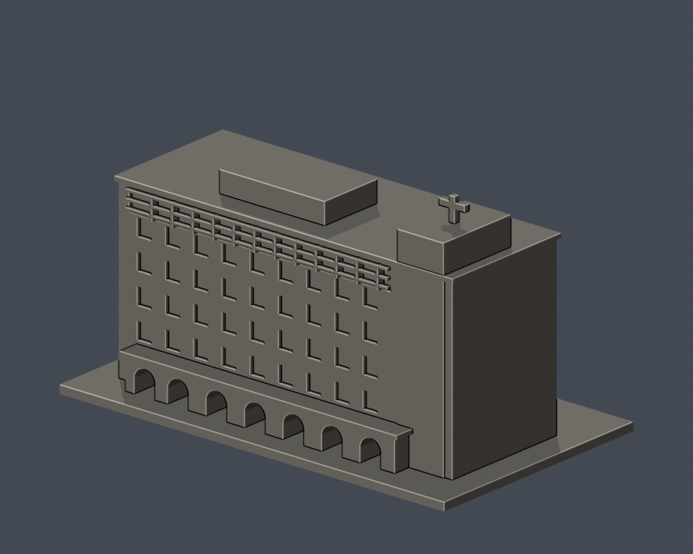

# 行政大樓｜長榮大學

[學校目錄](../../../README.md) · [校區目錄](../../README.md)

| 模型預覽 | 模型預覽 | 模型預覽 |
| :---: | :---: | :---: |
|  |  |  |

## 範圍與外觀
保留六層量體的長向立面、非對稱窗群、中央大開口、頂層遮陽格柵、短側長槽窗、屋頂量體及後侧階梯塔十字、拱廊。

尺度及進深均為照片視覺估計；不具測繪精度。左短側未獲充分照片，採無細節壁面；後側窗格節奏由營造商斜照概括，非逐窗精測。未含独立校門鐘塔、警衛室或圖書館。

這是公開外觀照片推估的可編輯、可再建構縮尺模型，不是測量、竣工圖或完整BIM。各件獨立縮尺；包含平底座的外框為 150.00 × 87.00 × 86.50 mm，最大150 mm，不代表同校模型使用相同比例尺。

## 檔案
- [原始模型 STL](model.stl)
- [可編輯 Blender 場景](scene.blend)
- [建模程式](build_model.py) · [Python依賴](requirements.txt)
- [正面](previews/front.png) · [背面](previews/rear.png) · [俯視](previews/top.png)
- [來源與不確定性](sources.json)
- [幾何驗證](validation.json) · [0.2mm層檢查](layer-check.json) · [輪廓多邊形有效性](contour-validity-check.json) · [0.8mm參考薄特徵篩查](thin-feature-check.json)
- [SHA256](SHA256SUMS.txt) · [重跑檢查](check_all.sh)

| 模型預覽 | 模型預覽 | 模型預覽 |
| :---: | :---: | :---: |
| 正面<br> | 背面<br> | 俯視<br> |

## 重建與驗證
需要 Python 3.12、requirements.txt 所列套件與 Blender 4.3.2+。在本目錄安裝依賴後執行：

```sh
python -m pip install -r requirements.txt
python build_model.py
blender -b -t 2 -P render_preview.py
sh check_all.sh
```

build_model.py 中各幾何參數單位為mm；修改視覺估計參數後必須重新建模、渲染和驗證，不能沿用舊驗證JSON。scene.blend只含一件與STL三角面位置一致的模型mesh、材質與相機。材質只用於預覽；STL不含顏色。

## 驗證與列印限制
原始STL未經repair：驗證水密、邊流形、頂點環單一、原始法向與繞序、正體積、單一連通表面殼、無分離內腔殼、150mm外框、獨立重建SHA及儲存Blender幾何一致。0.2mm節距、起始z=0.071mm逐層檢查閉合及degree2，並驗證各閉合多邊形及合併多邊形有效。

薄特徵篩查使用canonical edge interpolation，在1mm節距截面做0.8mm參考形態開運算；尖角與曲線也會造成損失。此檢查不是全面壁厚測量，不代表0.8mm最小壁厚合格，也不是實際切片、支撐可拆除性、走線或實體試印保證。

拱門、入口雨棚、後側拱廊與格柵下緣需切片支撐評估；十字加厚，不代表真實構材厚度。

## 來源
- [學校官方：キャンパス紹介／校園導覽](https://www163.cjcu.edu.tw/web2023/ja/about_campus_tour.php)：名稱和主要立面斜向實拍。
- [學校官方：行政大樓外觀](https://www163.cjcu.edu.tw/images/campus/campus_adm.jpg)：主長向及右短側照片；照片含獨立鐘塔，模型不包含該鐘塔。
- [華豐營造股份有限公司：長榮大學行政大樓新建工程](https://www.hwa-fong.com.tw/portfolio-single.php?id=93)：反側外觀實拍，確認石色階梯塔、十字、拱廊與上方大玻璃窗。
- [華豐營造股份有限公司：行政大樓反側與相鄰圖書館](https://www.hwa-fong.com.tw/upload/201807271455032.jpg)：行政大樓在圖右；左側為相鄰圖書館，不能混為一館。

公開封包不再散布來源照片，只提供連結與原創模型。全校尚未完成；見學校目錄的逐項缺口。
