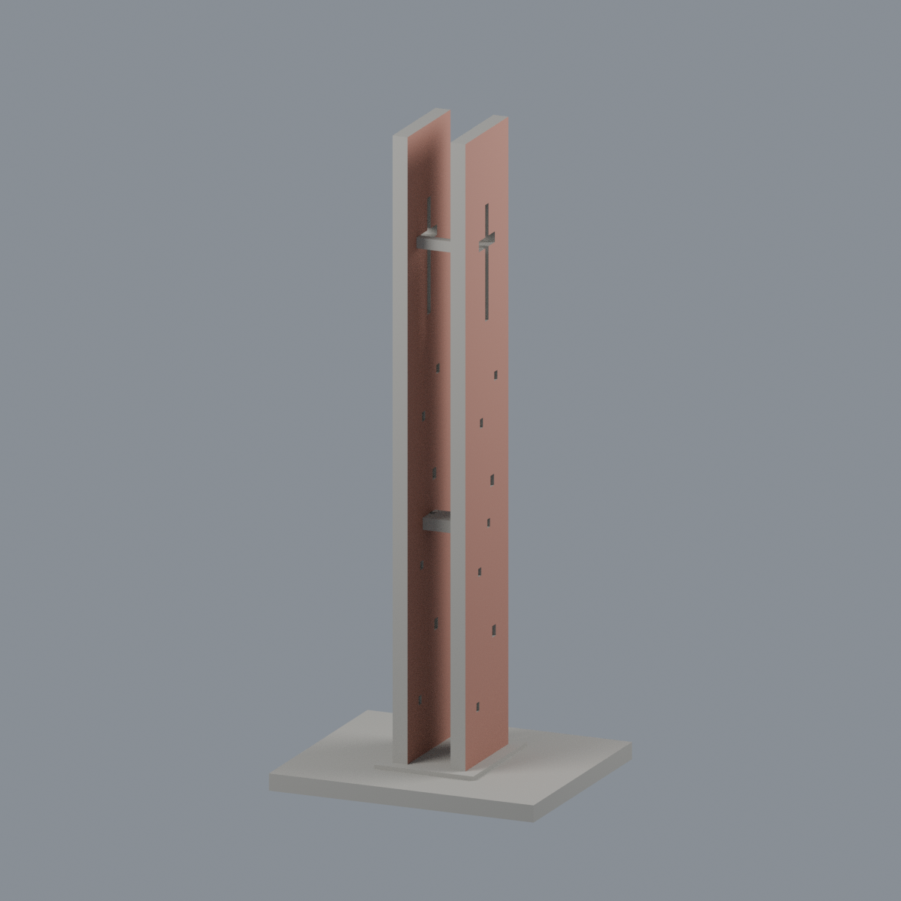
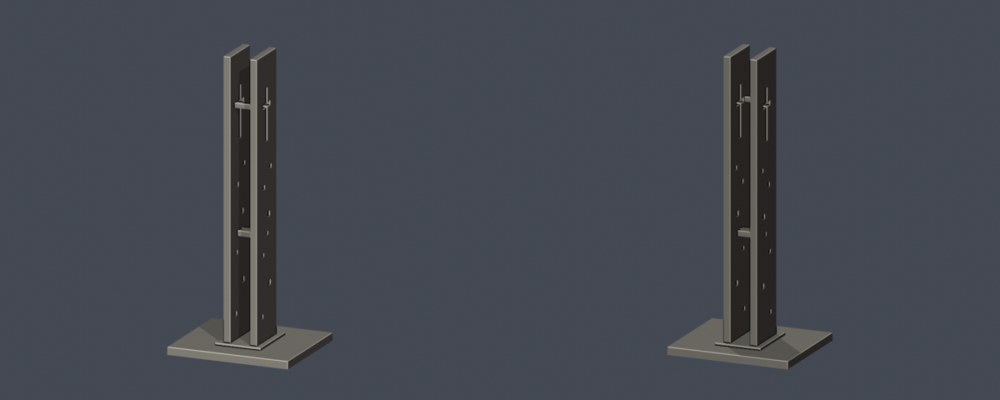
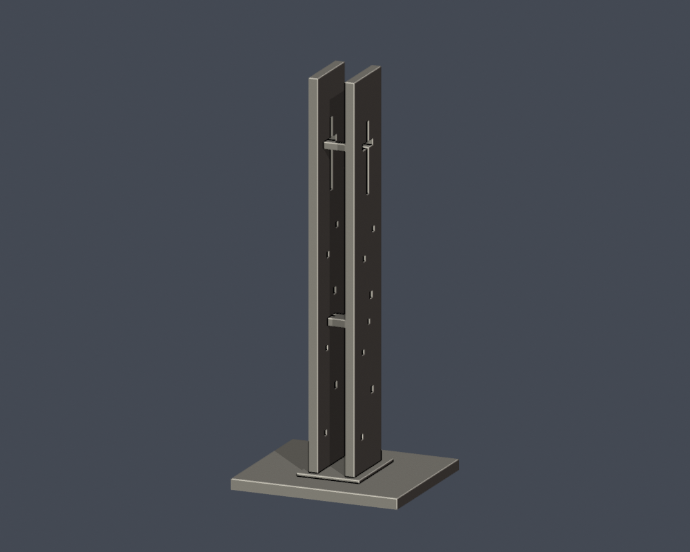
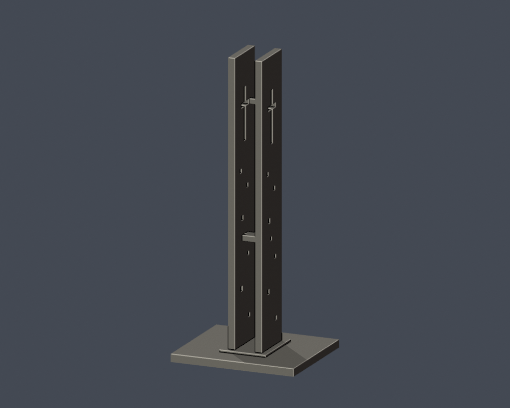

# 校門十字架鐘塔（地標構造物）｜長榮大學

## 同向寬面淺磚紅限域配色（2026-10-23）

[五視角、來源與限制](appearance/README.md) · [彩色3MF](appearance/cjcu-gate-cross-tower-appearance.3mf) · [可編輯Blender](appearance/scene.blend)

| 模型預覽 | 模型預覽 | 模型預覽 |
| :---: | :---: | :---: |
|  |  |  |

只為兩片塔朝+X寬面126個完整原三角配淺磚紅代理，合6744.980026mm²；反面、窄側、灰頂、孔壁、橫繫與底座374面皆中性。原500面座標、面序與STL bytes不變，不切面、不增套。官方航拍拍攝日未知，EXIF三日期空且無XMP；2024-04-24文章日與檔名20240408不是拍攝日，不稱2026現況。第二角本次503未取得，不作配色依據。原孔形與構件近似及未實體試印限制保留，照片不分發；本塔不是慎行鐘或長榮堂。


[學校目錄](../../../README.md) · [校區目錄](../../README.md)

| 模型預覽 | 模型預覽 | 模型預覽 |
| :---: | :---: | :---: |
|  |  |  |

## 範圍與外觀
保留雙片薄壁高塔、寬面十字穿孔、中央開放間隙、中段連繫板與上部橫向連繫；底座與細部均為獨立縮尺。這是地標構造物，不能算作教學樓館，也不是校圖36號慎行鐘。

雙面十字形及薄壁輪廓依公開多角度照片重建；小孔形狀/數量與連繫構件進深為粗化近似，未複製斑駁表面、細紋及鐘具。未納入警衛室、長榮堂、路面植栽。原高度及壁厚沒有測繪資料。

這是公開外觀照片推估的可編輯、可再建構縮尺模型，不是測量、竣工圖或完整BIM。各件獨立縮尺；包含平底座的外框為 64.00 × 55.00 × 150.00 mm，最大150 mm，不代表同校模型使用相同比例尺。

## 檔案
- [原始模型 STL](model.stl)
- [可編輯 Blender 場景](scene.blend)
- [建模程式](build_model.py) · [Python依賴](requirements.txt)
- [正面](previews/front.png) · [背面](previews/rear.png) · [俯視](previews/top.png)
- [來源與不確定性](sources.json)
- [幾何驗證](validation.json) · [0.2mm層檢查](layer-check.json) · [輪廓多邊形有效性](contour-validity-check.json) · [0.8mm參考薄特徵篩查](thin-feature-check.json)
- [SHA256](SHA256SUMS.txt) · [重跑檢查](check_all.sh)

| 模型預覽 | 模型預覽 | 模型預覽 |
| :---: | :---: | :---: |
| 正面<br> | 背面<br> | 俯視<br> |

## 重建與驗證
需要 Python 3.12、requirements.txt 所列套件與 Blender 4.3.2+。在本目錄安裝依賴後執行：

```sh
python -m pip install -r requirements.txt
python build_model.py
blender -b -t 2 -P render_preview.py
sh check_all.sh
```

build_model.py 中各幾何參數單位為mm；修改視覺估計參數後必須重新建模、渲染和驗證，不能沿用舊驗證JSON。scene.blend只含一件與STL三角面位置一致的模型mesh、材質與相機。材質只用於預覽；STL不含顏色。

## 驗證與列印限制
原始STL未經repair：驗證水密、邊流形、頂點環單一、原始法向與繞序、正體積、單一連通表面殼、無分離內腔殼、150mm外框、獨立重建SHA及儲存Blender幾何一致。0.2mm節距、起始z=0.071mm逐層檢查閉合及degree2，並驗證各閉合多邊形及合併多邊形有效。

薄特徵篩查使用canonical edge interpolation，在1mm節距截面做0.8mm參考形態開運算；尖角與曲線也會造成損失。此檢查不是全面壁厚測量，不代表0.8mm最小壁厚合格，也不是實際切片、支撐可拆除性、走線或實體試印保證。

高細比塔體與上部橫梁容易受列印震動影響，請自行檢查底板附著、支撐與冷卻；不可將幾何檢查解讀成實體剛性或抗跌測試。

## 來源
- [學校總務處：長榮堂設計理念中的校門鐘塔](https://dweb.cjcu.edu.tw/general/article/7920)：官方文字將校門鐘塔與圓形長榮堂分別介紹，照片显示已建成塔體。
- [學校總務處：長榮堂與鐘塔完工斜航拍](https://dweb.cjcu.edu.tw/ShepherdFiles/B0500/Album/Original/20240408114143807.jpg)：塔的兩片薄壁、十字穿孔、空隙和中段连繫板清楚可辨。
- [學校官方校園導覽：行政大樓前方校門鐘塔](https://www163.cjcu.edu.tw/images/campus/campus_adm.jpg)：從另一角度確認雙片薄壁與上部十字、連繫構件。
- [學校公共關係中心：體育館光導照明系統報導中的校園地標](https://dweb.cjcu.edu.tw/prnc/spotlight/3092)：官方文字區分西端慎行鐘與北端十字架校門鐘塔，兩者不合併。

公開封包不再散布來源照片，只提供連結與原創模型。全校尚未完成；見學校目錄的逐項缺口。
