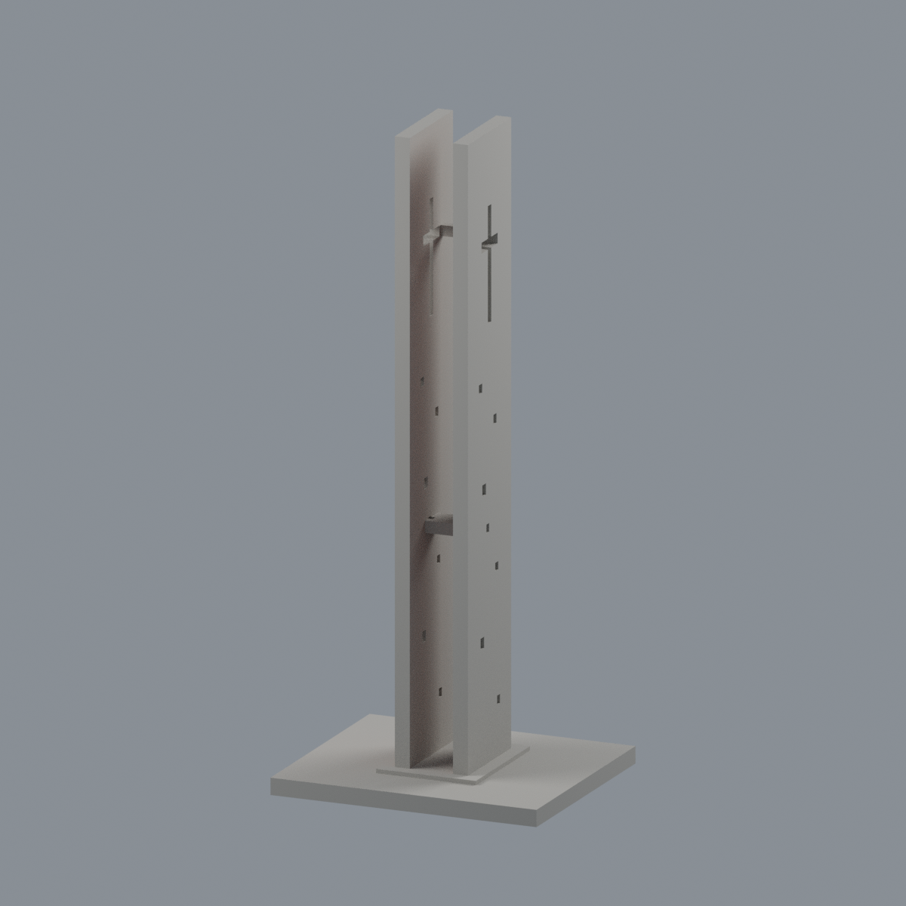
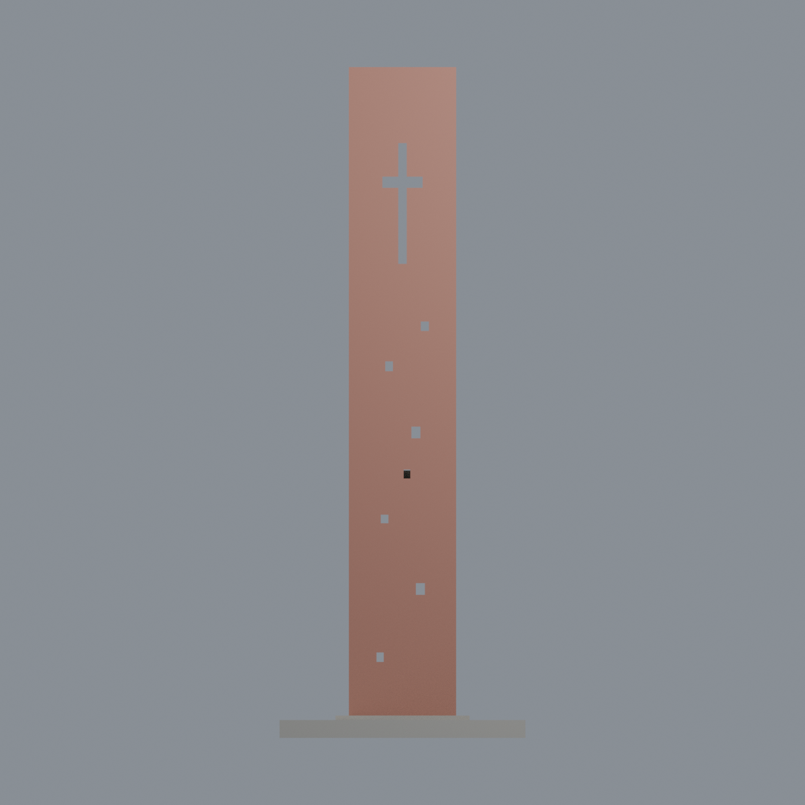
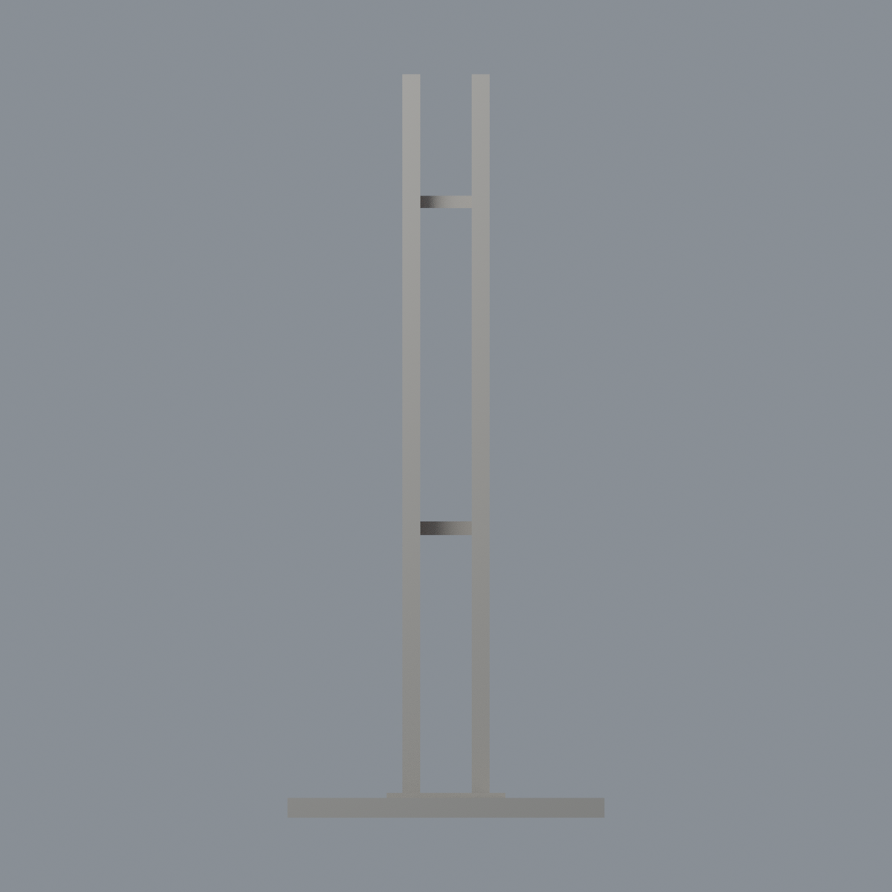
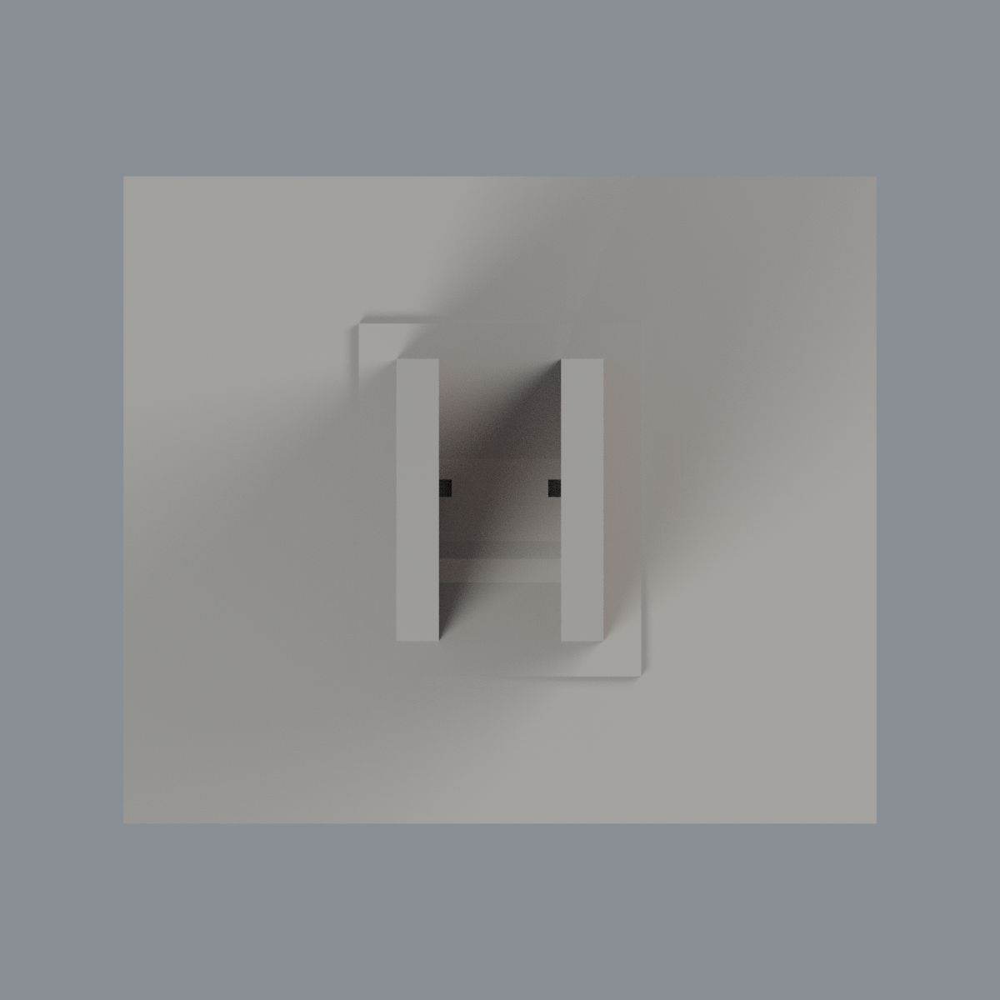

# 長榮大學校門十字架鐘塔 — 限域外觀配色

本層為既有地標構造物的附加材質，不是新建築套數，不是慎行鐘或長榮堂。原 STL bytes、500 三角座標與面序完全不變；沒有移點、切面或新增幾何。

依官方航拍和官方文字「淺磚紅色」，僅對兩片塔朝 +X 的寬大立面著色：x=-5.2／8.8 mm，y[-12,12]、z[5,150]。所有三頂點都須位於有限平面範圍內；分別 68／58 面，合計 126 面、6744.980026 mm²。#AD7868 是低飽和視覺代理，未經儀器測色、不是官方色號。其餘 374 面維持 #AAA79F 中性代理，包括反面、窄側、灰頂、孔壁、橫繫及底座；中性不代表實景顏色判定。

原雙塔孔形、連繫、尺寸與比例為近似；不補斑駁、細紋、鐘具或小孔細部，不以配色假裝完整復原。本次僅呈現官方歷史照片可支持的範圍，不聲稱 2026 現況。未做實體列印或重算原歷史製造 QA。

## 檔案與重建
- [彩色 3MF](cjcu-gate-cross-tower-appearance.3mf)、[Blender 原生場景](scene.blend)。
- [色票](palette.json)、[原三角材質對照](face-materials.json)。
- 五圖：[正斜視](previews/front.png)、[後斜視](previews/rear.png)、[寬面立面](previews/elevation.png)、[窄側](previews/side.png)、[頂面](previews/top.png)。
- [來源](SOURCES.md)、[許可](LICENSE-NOTICE.md)。

| 模型預覽 | 模型預覽 | 模型預覽 |
| :---: | :---: | :---: |
| 正斜視  | 後斜視  | 寬面立面  |
| 窄側  | 頂面  |  |

原 model.stl 與 appearance 同父層。Python（numpy 2.3.5、lib3mf 2.5.0）依序執行 source/build_appearance.py、source/verify_exchange.py、source/verify_material_boundaries.py；Blender 4.3.2 執行 source/render_appearance.py、source/verify_scene.py。重建另於乾淨目錄進行，核對 3MF、maps、五 PNG bytes；Blend 核語義，不宣稱二進位確定性。驗證含 strict lib3mf 真材質修改存讀與 Blender 真材質／頂點修改存讀及重開渲染。
