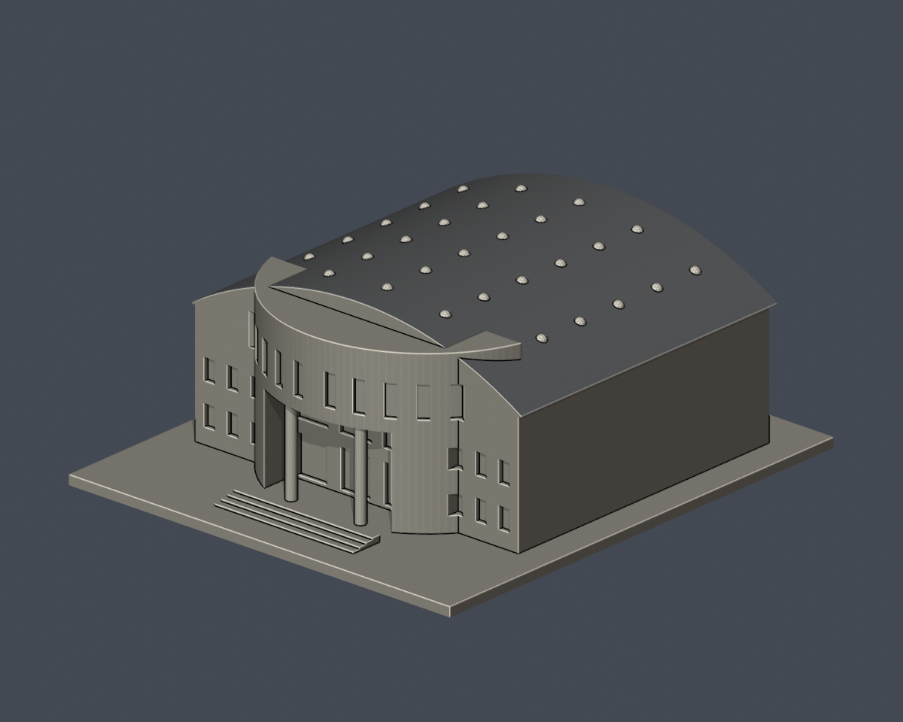
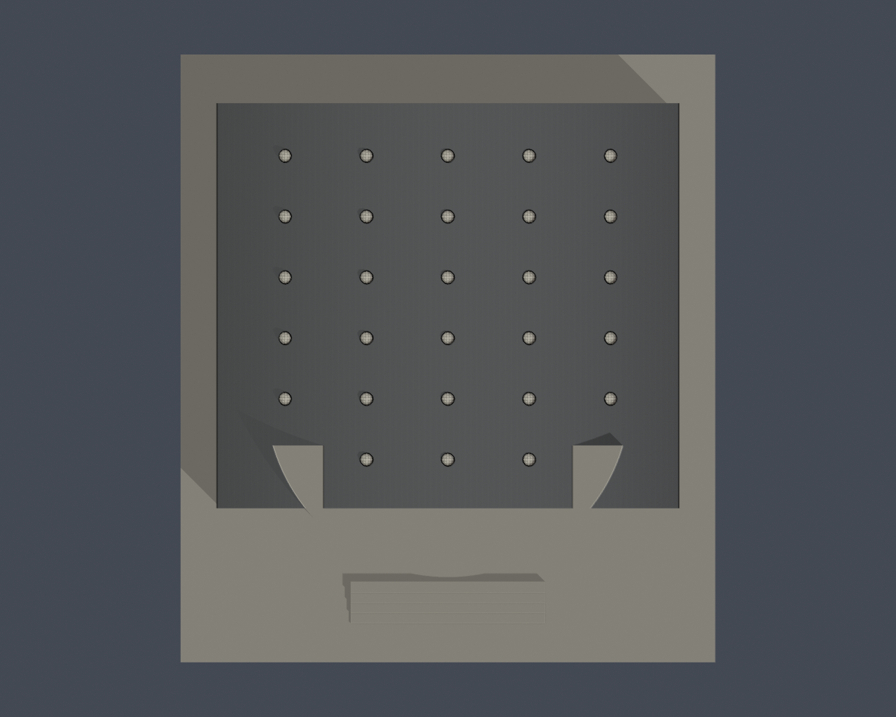
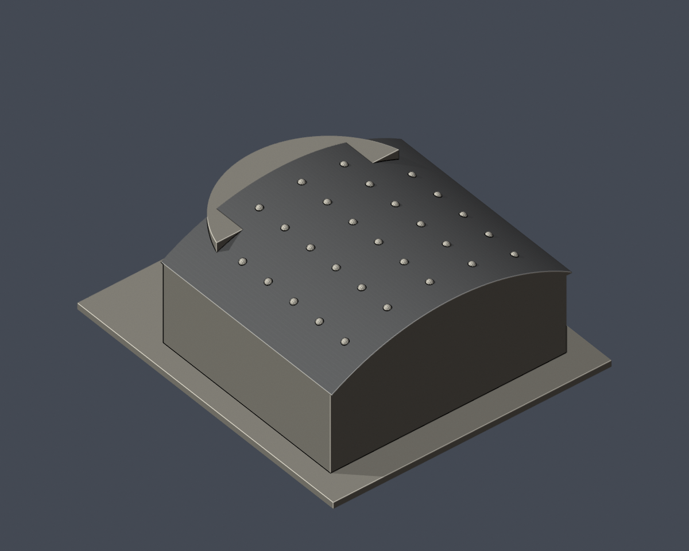
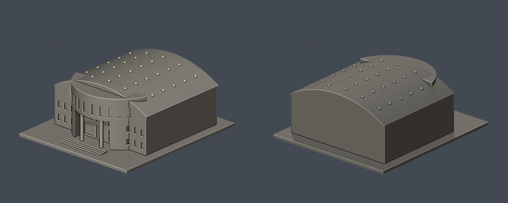
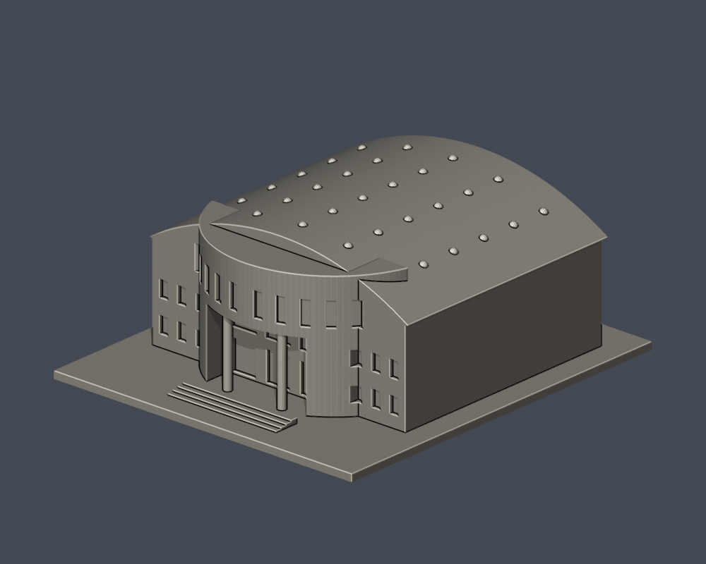
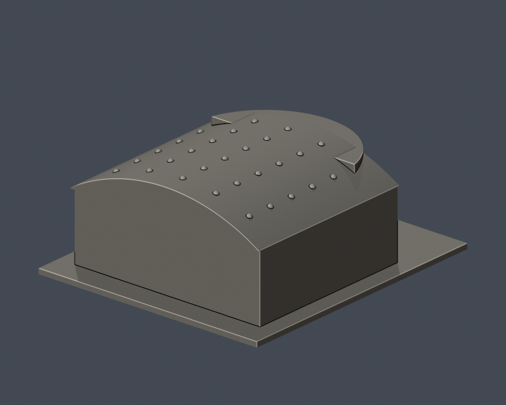
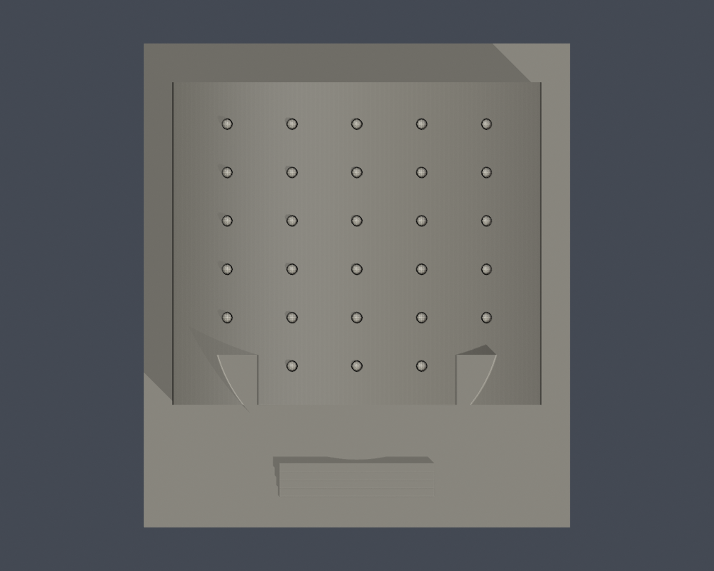

# 綜合體育館｜長榮大學

[學校目錄](../../../README.md) · [校區目錄](../../README.md)

## 桶拱屋面板材族中性示意（非實際配色）

[九視角、可編輯 Blender／3MF 與 Python 重建](appearance/README.md)。**依 2020 校方屋面夜景辨識的金屬板材族中性示意；非實際日光配色／材質規格，非 2026 現況。僅桶拱屋面；其餘保留原中性外觀。**

原 **4,694 個三角面、float32 座標、面序與繞序不變**；只對 **1,206 個屋面原面**使用任選無彩標記 `#8C8C8C`，其餘 **3,488 面**沿用原預覽值。這不是灰漆／銀漆、裸金屬光澤、精準歷史原色或全館配色完成；真實屋色、合金、塗覆及立面磚色仍缺證。沒有新增板肋、相片紋理、幾何或模型套件。

| 屋面族別正面示意 | 屋面族別俯視示意 | 屋面後斜視示意 |
| :---: | :---: | :---: |
|  |  |  |

可下載[原生 Blender](appearance/cjcu-gymnasium-roof-illustration.blend)、[逐面色彩 3MF](appearance/cjcu-gymnasium-roof-illustration.3mf)，用[公開重建程式](appearance/reproduce.py)與原 STL 重建，不需來源照片。原 STL、原 Blender、五張原預覽、建模程式及既有列印限制全部保留；示意標記不新增材料規格、可列印保證或實體試印證據。

## 原始幾何與既有中性預覽

| 模型預覽 | 模型預覽 | 模型預覽 |
| :---: | :---: | :---: |
|  |  |  |

## 範圍與外觀
保留三層入口圓弧立面、雙層挑空雙圓柱門廊、窄直窗列、較低的兩侧翼、縱向桶拱大屋頂及2020屋頂更新後可見的光導採光罩。

全館外部包絡為照片視覺近似；後側和側長向牆面缺少清晰實拍，保持簡化無窗。屋頂光導罩以30個粗化幾何點表現布局節奏，不是精測數量或設備施工圖。未移植室內結構，未建相鄰溜冰場與運動中心的其他戶外設施。

這是公開外觀照片推估的可編輯、可再建構縮尺模型，不是測量、竣工圖或完整BIM。各件獨立縮尺；包含平底座的外框為 132.00 × 150.00 × 59.47 mm，最大150 mm，不代表同校模型使用相同比例尺。

## 檔案
- [原始模型 STL](model.stl)
- [可編輯 Blender 場景](scene.blend)
- [建模程式](build_model.py) · [Python依賴](requirements.txt)
- [正面](previews/front.png) · [背面](previews/rear.png) · [俯視](previews/top.png)
- [來源與不確定性](sources.json)
- [幾何驗證](validation.json) · [0.2mm層檢查](layer-check.json) · [輪廓多邊形有效性](contour-validity-check.json) · [0.8mm參考薄特徵篩查](thin-feature-check.json)
- [SHA256](SHA256SUMS.txt) · [重跑檢查](check_all.sh)

| 模型預覽 | 模型預覽 | 模型預覽 |
| :---: | :---: | :---: |
| 正面<br> | 背面<br> | 俯視<br> |

## 重建與驗證
需要 Python 3.12、requirements.txt 所列套件與 Blender 4.3.2+。在本目錄安裝依賴後執行：

```sh
python -m pip install -r requirements.txt
python build_model.py
blender -b -t 2 -P render_preview.py
sh check_all.sh
```

build_model.py 中各幾何參數單位為mm；修改視覺估計參數後必須重新建模、渲染和驗證，不能沿用舊驗證JSON。scene.blend只含一件與STL三角面位置一致的模型mesh、材質與相機。材質只用於預覽；STL不含顏色。

## 驗證與列印限制
原始STL未經repair：驗證水密、邊流形、頂點環單一、原始法向與繞序、正體積、單一連通表面殼、無分離內腔殼、150mm外框、獨立重建SHA及儲存Blender幾何一致。0.2mm節距、起始z=0.071mm逐層檢查閉合及degree2，並驗證各閉合多邊形及合併多邊形有效。

薄特徵篩查使用canonical edge interpolation，在1mm節距截面做0.8mm參考形態開運算；尖角與曲線也會造成損失。此檢查不是全面壁厚測量，不代表0.8mm最小壁厚合格，也不是實際切片、支撐可拆除性、走線或實體試印保證。

双柱門廊、入口跨梁及窗楣需切片支撐評估；桶拱屋頂採實心連續量體，非內部中空競賽場館。0.8mm參考篩查不保證所有細部可直接列印。

## 來源
- [學校官方：校園導覽綜合體育館](https://www163.cjcu.edu.tw/web2023/ja/about_campus_tour.php)：正面遠景確認圓弧立面和兩侧較低翼。
- [學校官方：綜合體育館正面](https://www163.cjcu.edu.tw/images/campus/campus_gym.jpg)：三層窗列與中央雙層門廊的實拍。
- [學校全民運動中心：綜合體育館相簿](https://dweb.cjcu.edu.tw/grsc/Album/3398)：近距實拍確認挑空門廊的兩根圓柱、圓弧面及窄長窗。
- [學校全民運動中心：綜合體育館入口近景](https://dweb.cjcu.edu.tw/ShepherdFiles/Y0004/Album/Original/2024040817101591.jpg)：2024相簿影像，檢查入口結構與窗列。
- [學校公共關係中心：長榮大學體育館光導照明系統](https://dweb.cjcu.edu.tw/prnc/spotlight/3092)：2020屋頂更新與光導設施說明；實拍可見整段桶拱金屬屋頂。
- [學校公共關係中心：桶拱屋頂及光導採光罩實拍](https://dweb.cjcu.edu.tw/ShepherdFiles/B1202/Album/Original/2020102308391750.jpg)：用作曲面與附屬罩外觀依據；沒有把光亮斑點當精確設備數量。

公開封包不再散布來源照片，只提供連結與原創模型。全校尚未完成；見學校目錄的逐項缺口。
