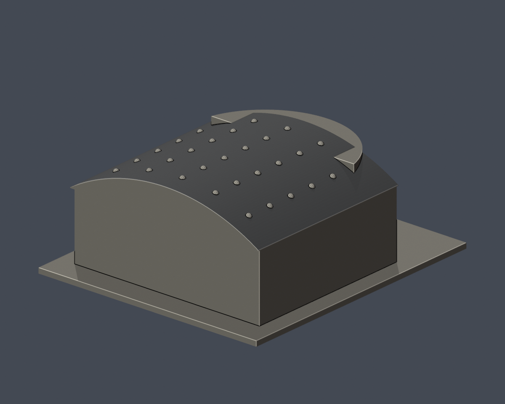
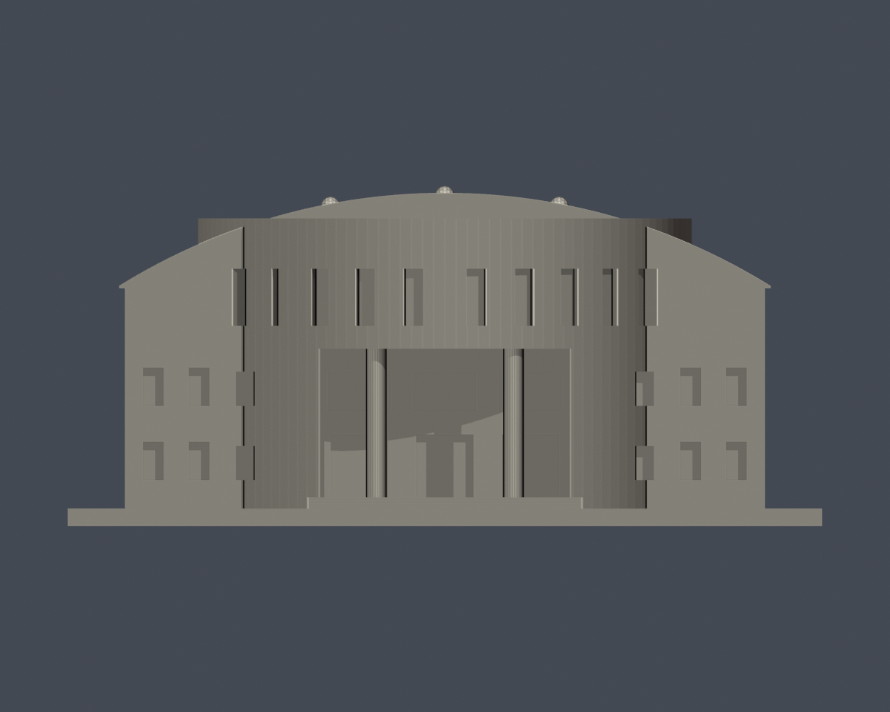
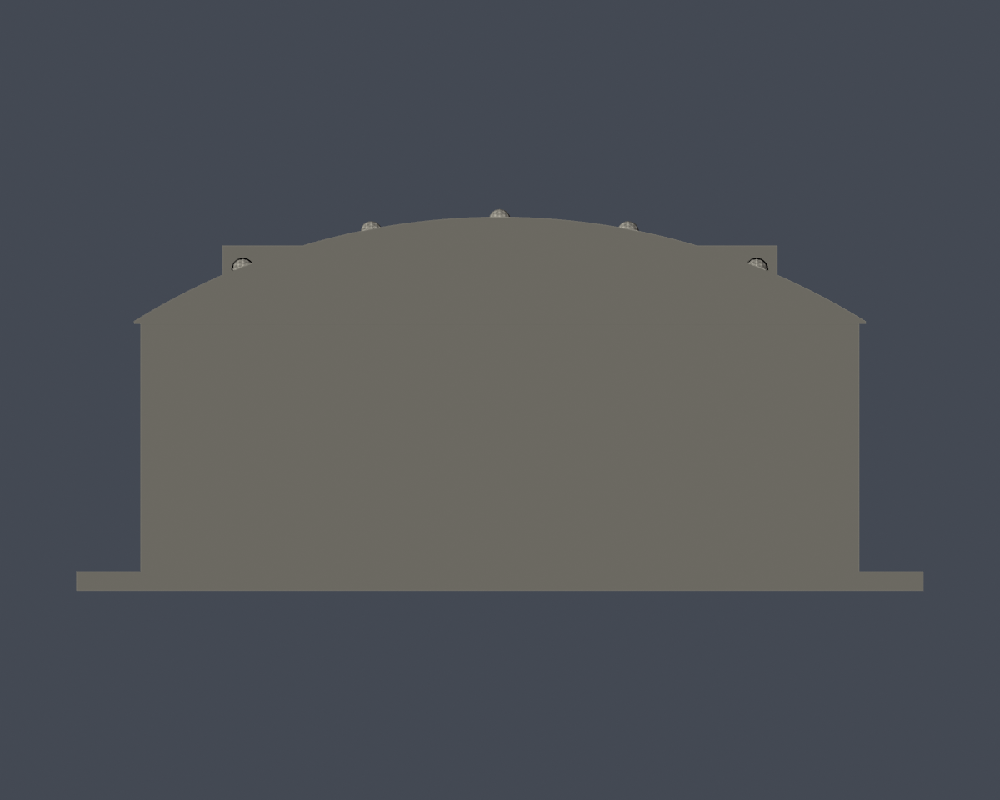
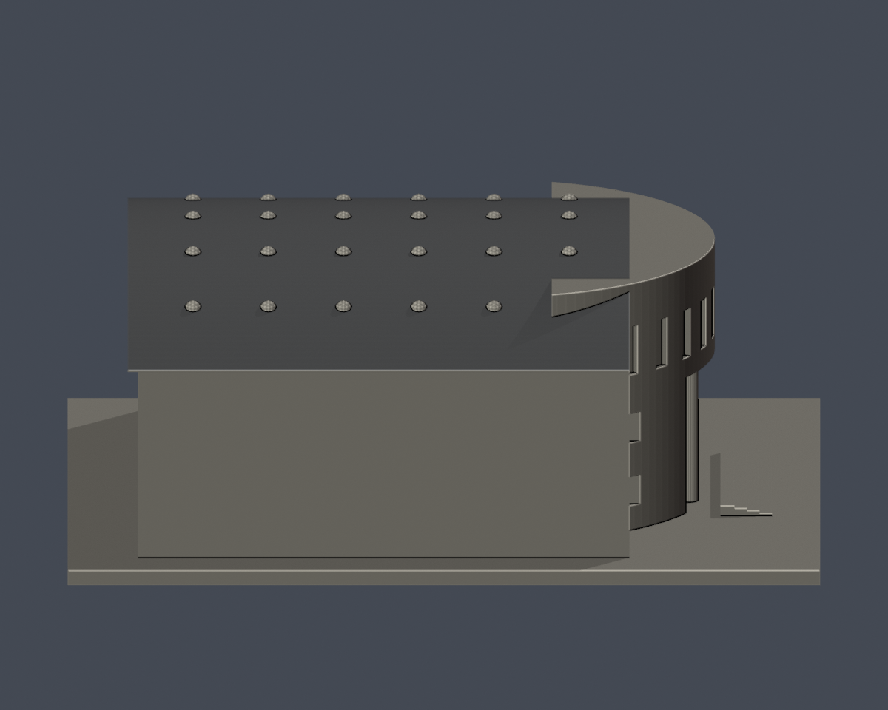
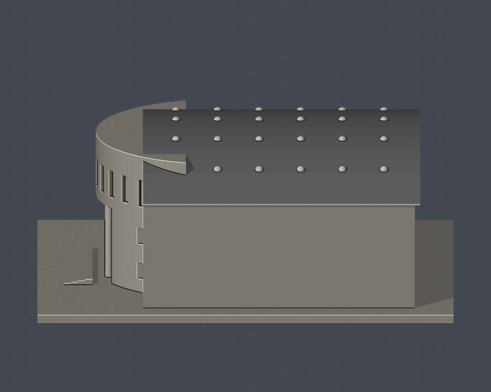
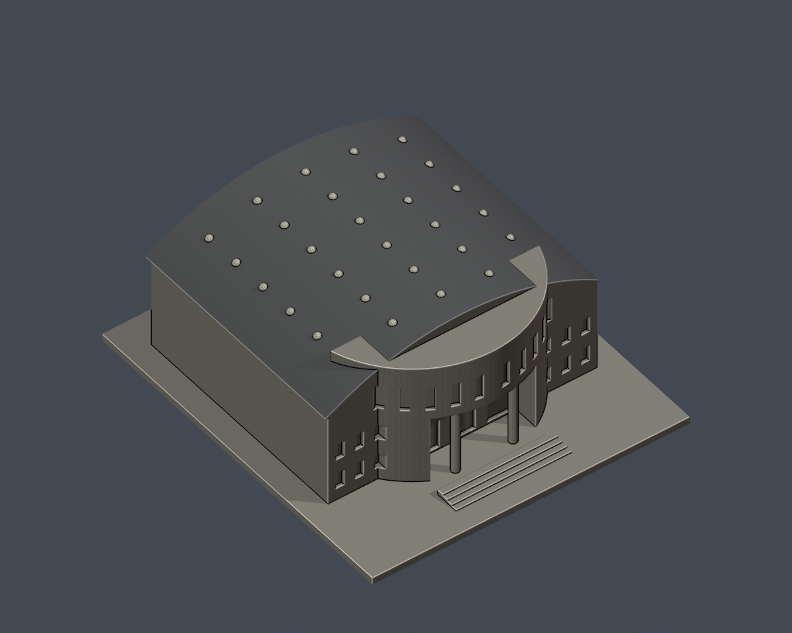

# 長榮大學綜合體育館｜桶拱屋面板材族示意

[回原模型](../README.md) · [原始 STL](../model.stl)

**依 2020 校方屋面夜景辨識的金屬板材族中性示意；非實際日光配色／材質規格，非 2026 現況。僅桶拱屋面；其餘保留原中性外觀。**

這不是「真實屋色復原」或全館上色。夜景能辨認連續、規則板肋的板狀屋面，支持建築外觀層級的金屬板材族**視覺推論**；不能鑑定金屬化學成分、合金、裸材／塗覆材、灰漆或銀漆。報導只說明屋頂更新及光導照明，沒有屋面材料、塗裝、色彩或光澤規格。

## 實際模型預覽

以下九圖皆由交付網格與面材質實際渲染。深灰只是一個任選的族別標記，**不是夜景抽色、日光模擬或已知屋頂漆色**；淺暖灰沿用原模型的預覽值，不是已證實的牆面／石材。板肋未新增；既有曲面分段可產生細微明暗。

| 正面斜視 | 背面斜視 | 俯視 |
| :---: | :---: | :---: |
|  |  |  |
| 正立面 | 背立面 | 左側抬高視角 |
|  |  |  |
| 右側抬高視角 | 屋面前斜視 | 屋面後斜視 |
|  |  |  |

## 檔案與可編輯性

- [原生 Blender 場景](cjcu-gymnasium-roof-illustration.blend)：一件可直接編輯頂點、三角面及材質的網格，保留原面號 attribute；兩種面材質，不含相片貼圖。
- [標準色彩 3MF](cjcu-gymnasium-roof-illustration.3mf)：Core `basematerials`、逐三角面顏色、不透明；mm 單位。不是需特定切片器私有格式的專案。
- [逐面數字與指紋 CSV](face-materials.csv) · [屋面原面號及有向指紋](roof-face-contract.json) · [色票與限制](palette.json)
- [可重建面材質程式](build_appearance.py) · [精確 3MF 輸出](export_3mf.py) · [渲染程式](render_appearance.py) · [依賴](requirements.txt)
- [來源與假設](sources.json) · [格式／幾何驗證](qa/independent-format-validation.json) · [原生編輯測試](qa/native-blend-validation.json) · [嚴格 3MF 讀取](qa/strict-3mf-validation.json) · [乾淨重建](qa/clean-rebuild-validation.json) · [失敗控制](qa/negative-controls.json) · [完整路徑 buffer 檢查](qa/path-buffer-validation.json)

原 STL、原 scene.blend、原預覽與原建模程式皆不覆寫。此資料夾只增加一個有明確限制的外觀示意層。

## 選面與色票邊界

原 STL SHA-256：`ebecf2597fbc17fd0faf5a8bcd3ac13d1d9511d70a9600c5c09084ddbd26d879`。

全部 **4,694** 個三角面維持原 float32 座標、面序與繞序。只有 **1,206** 個完整屋面三角面使用族別標記，面積 **11,489.578723 mm²／全表面 17.340954%**，是一個原邊連通區域；其餘 **3,488** 面不作新材料推論。選面同時驗證全部三頂點、原桶拱分段平面、Y 範圍、朝上法線與逐面指紋，不依重心、連續面號範圍或任意高度染色。

| 面材質 | 顯示值 | 含義 |
| --- | --- | --- |
| 屋面板材族示意 | sRGB `#8C8C8C` | 任選無彩標記，非實際色彩、材質或反射量測 |
| 其餘原預覽 | Blender linear RGBA `(0.69, 0.64, 0.54, 1)` | 原公開 renderer 的預覽值原樣保留；3MF 僅換算為最近的 8-bit sRGB `#D8D1C2`，不是建築色彩證據 |

Blender 採非光度 Workbench 工作室預覽，關閉鏡面亮點。為方便編輯另提供一般不透明節點，`metallic=0`、`roughness=0.65`、`emission=0`、`transmission=0`；這些都是通用示意設定，不是量測或經校準 PBR。金屬族別不等於宣稱裸金屬外觀。

**排除**：光導罩、屋端、磚牆、前後側立面、門廊、柱、窗、帽緣、底座及未知材料。沒有新增板肋、紋理、法線貼圖、分割、平滑、補洞、重建或幾何修補。真實日光屋色／塗裝、具體金屬種類及全部磚色仍缺證，不能將此示意延伸成全館實際配色。

## 從原公開 STL 乾淨重建

Python 3.12；Blender 4.3.2（另行安裝）。在本資料夾執行：

```sh
python -m pip install -r requirements.txt
python reproduce.py --input ../model.stl --out ../roof-illustration-rebuild --blender blender
```

輸出目錄必須尚不存在。重建只複製程式與文字參數，從原 STL 重新產生 NPZ、逐面 CSV、3MF、Blend 與九張 PNG；不以既有模型二進位或預覽作重建輸入。程式校驗輸入雜湊及面指紋，不符就停止。測試環境九張 PNG 的 bytes 與解碼像素皆相同；不同 Blender／顯示驅動的預覽位元組不保證相同。

3MF 直接使用精確小數座標 XML，避免函式庫寫檔造成座標捨入；另以 lib3mf 2.5.0 strict reader 驗證零警告、零 float32 座標差及全部面材質。原生 Blend 測試真的修改頂點、面材質指派及材質色值，存檔、重開後驗證；測試副本不交付，交付檔不變。

## 年代、來源與權利

1. [校方公共關係中心：長榮大學體育館光導照明系統](https://dweb.cjcu.edu.tw/prnc/spotlight/3092)：頁面最後更新 **2020-10-23**，不是已確認的照片快門日期；僅支持屋頂更新與光導設施背景。
2. [同篇官方屋面夜景原圖](https://dweb.cjcu.edu.tw/ShepherdFiles/B1202/Album/Original/2020102308391750.jpg)：直接檢視板肋連續性與附屬罩邊界。夜間照明、相機曝光及白平衡不能當作日光色票。
3. 原模型與預覽設定取自 [taiwan-buildings-3d 固定版本](https://github.com/root50643/taiwan-buildings-3d/tree/5948a59ac45d9c781d21b6e3e1570ff697cfa6d6/%E9%95%B7%E6%A6%AE%E5%A4%A7%E5%AD%B8/%E6%AD%B8%E4%BB%81%E6%A0%A1%E6%9C%AC%E9%83%A8/buildings/cjcu-gymnasium)。來源細節與雜湊見 sources.json。

研究檢視日 **2026-10-25** 不等於現況拍攝日。校方照片與頁面有著作權，未發現再散布授權；本交付不包含官方照片像素、裁切、嵌入圖片或其紋理，只有來源連結、原創模型渲染及文字觀察。這不是攝影測量、工程材料證明、竣工圖或完整 BIM。

## 列印限制

保留原模型 132 × 150 × 59.46669 mm 包絡與實心桶拱，原三角面沒有變更。原模型既有 30 個粗化光導罩只是佈局節奏，不是設備數量／施工規格；不因報導或本次示意重排。

標準色彩 3MF 能表達面色，不保證每個切片器都採用色彩或支援多材料；STL 本身仍無色。材質標記不等於實際列印材質建議。單一封閉網格與正體積不是可列印保證；門廊跨梁、圓柱、窗楣、細部、支撐、縮尺、機器與耗材仍須切片及試印評估。沒有新增壁厚保證、支撐方案或實體試印宣稱。
