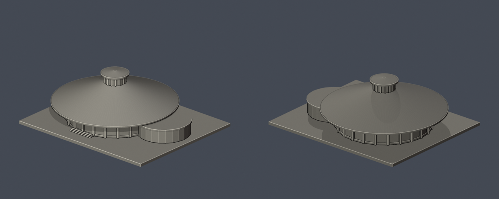
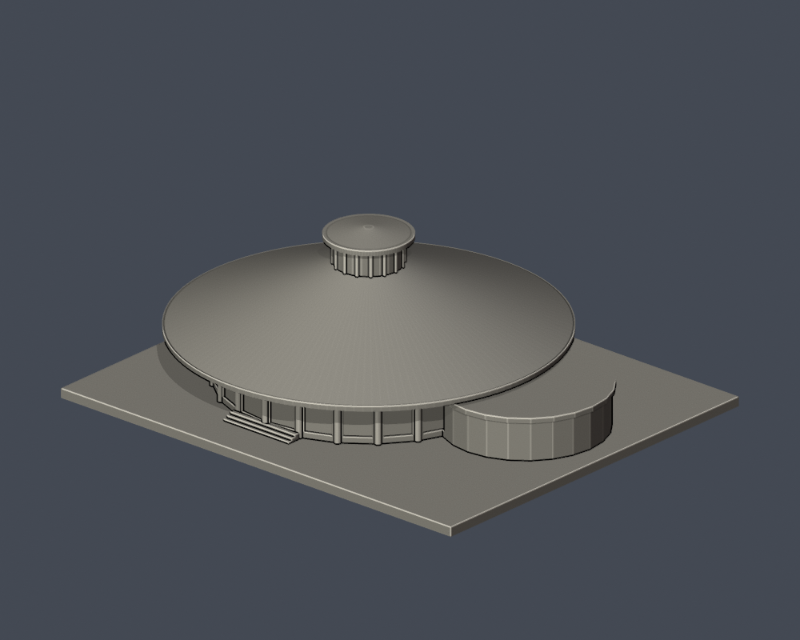
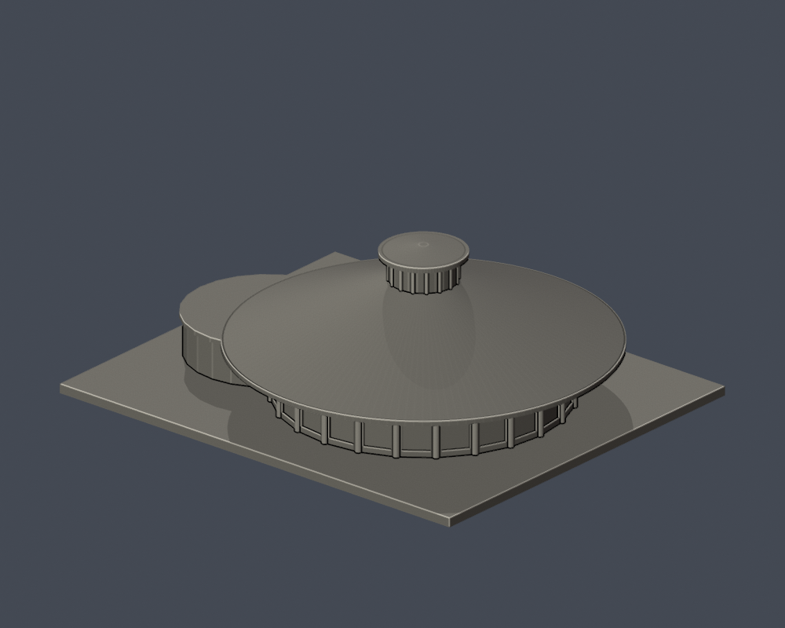

# 長榮堂｜長榮大學

[學校目錄](../../../README.md) · [校區目錄](../../README.md)

| 模型預覽 | 模型預覽 | 模型預覽 |
| :---: | :---: | :---: |
|  |  |  |

## 範圍與外觀
保留圓形主體、寬出簷圓錐金屬屋頂、頂部通風太子樓、24分節外牆柱列與低矮圓弧附屬體。

玻璃採實心外殼與淺凹窗表現；未重建室內24組竹桁架。附屬體平面及深度依航拍近似，未納入鄰接停車棚、鐘塔和戶外景觀。

這是公開外觀照片推估的可編輯、可再建構縮尺模型，不是測量、竣工圖或完整BIM。各件獨立縮尺；包含平底座的外框為 150.00 × 125.00 × 51.60 mm，最大150 mm，不代表同校模型使用相同比例尺。

## 檔案
- [原始模型 STL](model.stl)
- [可編輯 Blender 場景](scene.blend)
- [建模程式](build_model.py) · [Python依賴](requirements.txt)
- [正面](previews/front.png) · [背面](previews/rear.png) · [俯視](previews/top.png)
- [來源與不確定性](sources.json)
- [幾何驗證](validation.json) · [0.2mm層檢查](layer-check.json) · [輪廓多邊形有效性](contour-validity-check.json) · [0.8mm參考薄特徵篩查](thin-feature-check.json)
- [SHA256](SHA256SUMS.txt) · [重跑檢查](check_all.sh)

| 模型預覽 | 模型預覽 | 模型預覽 |
| :---: | :---: | :---: |
| 正面<br> | 背面<br> | 俯視<br> |

## 重建與驗證
需要 Python 3.12、requirements.txt 所列套件與 Blender 4.3.2+。在本目錄安裝依賴後執行：

```sh
python -m pip install -r requirements.txt
python build_model.py
blender -b -t 2 -P render_preview.py
sh check_all.sh
```

build_model.py 中各幾何參數單位為mm；修改視覺估計參數後必須重新建模、渲染和驗證，不能沿用舊驗證JSON。scene.blend只含一件與STL三角面位置一致的模型mesh、材質與相機。材質只用於預覽；STL不含顏色。

## 驗證與列印限制
原始STL未經repair：驗證水密、邊流形、頂點環單一、原始法向與繞序、正體積、單一連通表面殼、無分離內腔殼、150mm外框、獨立重建SHA及儲存Blender幾何一致。0.2mm節距、起始z=0.071mm逐層檢查閉合及degree2，並驗證各閉合多邊形及合併多邊形有效。

薄特徵篩查使用canonical edge interpolation，在1mm節距截面做0.8mm參考形態開運算；尖角與曲線也會造成損失。此檢查不是全面壁厚測量，不代表0.8mm最小壁厚合格，也不是實際切片、支撐可拆除性、走線或實體試印保證。

屋簷大幅外伸；列印前必須在切片器檢查支撐，避免僅靠橋接。太子樓細肋加厚；沒有實體試印。

## 來源
- [學校官方：長榮堂設計理念](https://dweb.cjcu.edu.tw/general/article/7920)：完工航拍、窗側與室內照片；2024-04-24；記述環形柱列、圓錐屋頂和24組竹桁架。
- [大藏聯合建築師事務所：2022 長榮大學竹構集會堂](https://architdz.com/portfolio/2022-%E9%95%B7%E6%A6%AE%E5%A4%A7%E5%AD%B8%E7%AB%B9%E6%A7%8B%E9%9B%86%E6%9C%83%E5%A0%82/)：多角度竣工航拍和外觀；不是未建成效果圖。
- [學校官方：長榮堂完工斜航拍](https://dweb.cjcu.edu.tw/ShepherdFiles/B0500/Album/Original/20240408114143807.jpg)：確認寬出簷、太子樓、圓弧附屬體；照片只在私有QA參照，不再散布。

公開封包不再散布來源照片，只提供連結與原創模型。全校尚未完成；見學校目錄的逐項缺口。
