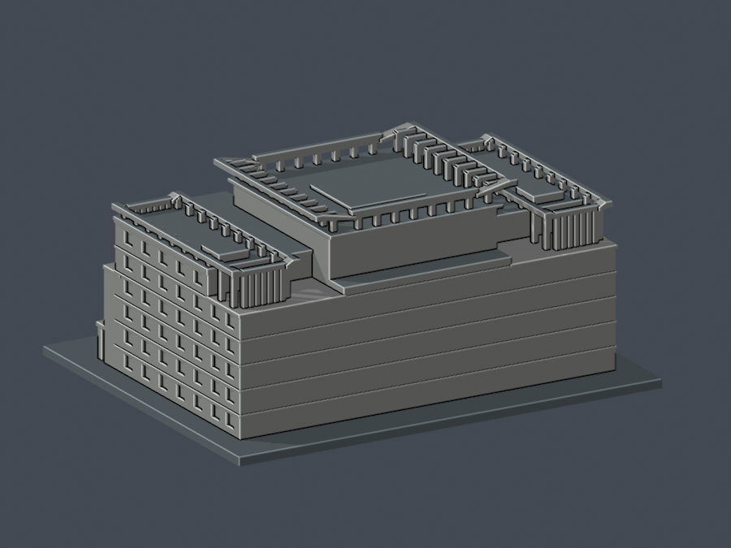

# 開南大學圖書館｜150mm 有界近似原型

## 模型預覽

| 模型預覽 | 模型預覽 | 模型預覽 |
| :---: | :---: | :---: |
| 正面  | 背面  |  |

正面與背面均直接由交付 STL 渲染：

## 來源與外觀

官方記載全棟地上 7 層／地下 1 層，館用 1–4F 不代表整棟四層。本件保留全地上量體、雙塔深拱與窗格、中央真凹入口、三組透空挑簷框、中央封閉採光頂。地下室、室內、完整地景不包含。

[來源與參數界限](sources.json)。全寬約 74m、地面主體深約 43m、含入口約 54m 是 OSM／影像交叉候選；低屋頂深 32.6m（影像約 30–33m）、最高框深 35.5m（候選 33–36m）、側框全包絡 41.7m（影像約 38–42m）分層處理。高低屋頂視差未閉環，後部退台／支承位置為有界近似，不能讀成實測牆線或巨型無柱懸挑。

最高名義 36.3m，照片推估寬界 32–39m，非測量。入口凹深名義 9.8m（照片工作區間 8–12m），玻璃門淺格位於後牆，未填平拱口。西南側六層窗帶有官方側照依據，逐窗分格仍推估；東北窗節奏未實證，背牆缺照片，僅保守結構分帶。不能稱四面如實還原。

## 列印與數值證據

模型 150 × 122 × 68.3454mm，底板 3mm，名義比例約 1:555.6。原 STL 9444 三角面、單連通水密表面；每邊兩面、頂點 link 單環、正體積、零重複／退化原面。重建 STL SHA、Blend 幾何及九張 PNG bytes 一致。

0.2mm 層距、0.071mm 起點共 342 層／3641 個原 Polygon，0.4mm 侵蝕及開運算逐件零消失、零分裂。仍有 15 整層、3184 跨層構件樣本損失 >1%，已獨立重現並核可此限定樣本例外，不能當作薄件全通過。

最差構件 z=52.871mm，面積 3.4093722852mm²，損失 0.1397069559mm²（4.09773249%），保留 95.90226751%。其 0.41mm 頂點鄰域外仍損失 0.000846249030mm²（0.02482126%）；全部高損樣本的角外最大 0.001054324092mm²，不能稱全純角落。原 STL 局部法向兩方向 caliper 最小 1.810798645mm，不是全方向全域最小壁厚。浮點與幾何庫可能產生微小數值變化，非零值不得抹除。

原面射線逐件檢查 102 屋框柱、60 椽、14 門廊柱、8 深拱窗格根接；54 屋框空位向上無遮擋，3 入口射線驗真凹深，3 採光頂射線驗封閉。這些是指定位置證據，不是全面強度或支撐分析。未試印；不可任意縮小；拱頂及挑簷應在實際切片中判斷支撐。

## 重現與檔案

以 requirements.txt 所列環境及 Blender 執行 `python build_model.py`、`blender -b --python render_preview.py`，再執行 `python run_all_checks.py`。原創 CSG 在布林前加入 0.003m 交疊，來源實體簡化公差 0.00005mm，以避免共面數值退化；驗證讀取原 STL，沒有修網、補洞或自動重算法向。

- [STL](model.stl)、[Blender](scene.blend)、[參數源](build_model.py)
- [完整 QA](qa-summary.json)、[原網格與重現](validation.json)、[逐層](layer-opening-check.json)、[逐構件](detailed-component-check.json)
- [薄損審核](thin-feature-review.json)、[局部原面 caliper](warning-caliper-check.json)、[根連接](root-ray-check.json)、[真凹與透空](open-space-check.json)
- [九視圖清單](render-manifest.json)、[完整 SHA256](SHA256SUMS)

狀態：已完成獨立數位審核及限定薄損例外核准。來源原圖私人留存，公開包只含自建模型、渲染與來源網址。

## 獨立補充數值
原STL全部342層3641原Polygon零侵蝕／opening消失或分裂。15整層超過1%，整層最大3.95862968487%；3184個跨層警告截面樣本不是3184根實體柱。單構件最大4.09773249159%、保留95.9022675084%。警告截面均為凸矩形，指定原三角面法線厚度最小1.8107986mm，全部射線起點在原實體內。102屋框柱、60椽、14門廊柱、8窗格根接與54透空射線獨立重現，未見薄頸或封閉薄皮。
原截面頂點0.41mm鄰域外損失最高0.001054324092mm²、占原構件比例最高0.02924663558%；只為定位轉角去除0.00001mm內共線細分點後，真正轉角mask外損失最高0.001054594230mm²（最高比例0.02925412914%）。兩種定位口徑均保留原始opening結果，不能概稱純角或零角外損失。這些是限定位置量測與例外，並非全域／全方向最小壁厚、全面強度或支撐分析；挑簷及框架仍須切片確認支撐與拆除風險，不得任意縮小，未實體試印，不保證無支撐可印。
