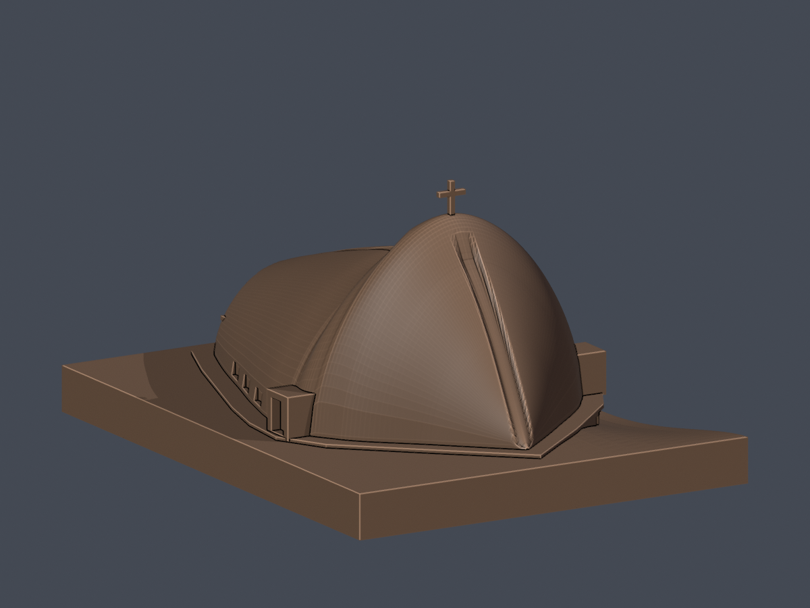
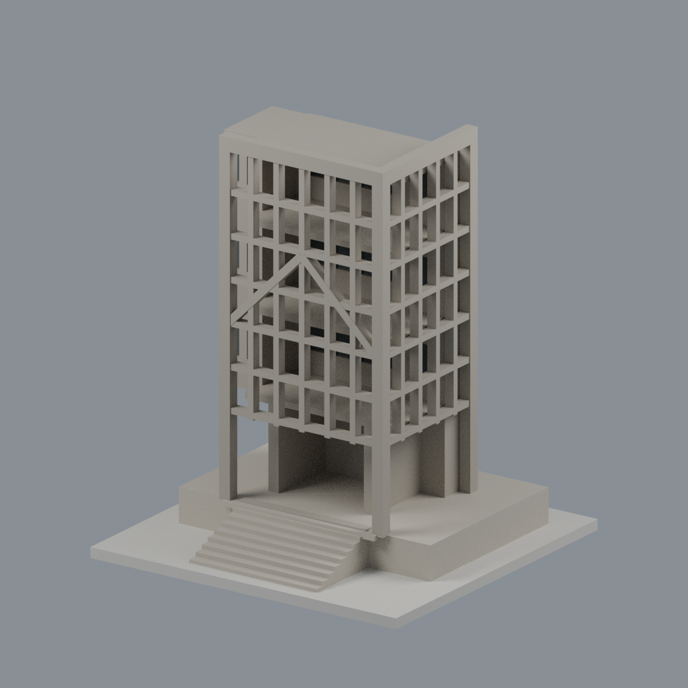

# 靜宜大學｜校園建築外觀近似模型

歷史首件主體近似模型：已在GitHub公開（[歷史提交](https://github.com/root50643/taiwan-buildings-3d/commit/897897849bca52f9e43f6b573f71600927d93221)）。既有作者數位QA報告通過，另有固定STL的44層十字架局部例外紀錄；完整總體獨立放行紀錄未確認，並非判定審查失敗。公開狀態不代表所有QA或列印驗證均已完成。這不代表全校建物清查或全校完成。

[沙鹿校本部](沙鹿校本部/README.md)

## [主顧聖母堂｜2019–2022](沙鹿校本部/buildings/pu-providence-chapel/README.md)

| 入口側 | 背面 |
|---|---|
|  |  |

單件正背並排；不以同館不同角度冒充多棟。獨立避靜中心未建模，其餘建築研究狀態見下列更新。本包不含第三方原圖與PDF。

列印警示：主顧聖母堂十字架有44個超過1% opening面積損失的細件警告層，最高6.407799248768964%；已作固定STL的特定例外審查。仍需評估支撐及拆除、勿任意縮小，尚未實體試印；[精確數據與限制](沙鹿校本部/buildings/pu-providence-chapel/README.md)。

## 新增：蓋夏圖書館舊館入口格構轉角片段

目前本校 **2 套**，套件數不等於整棟建築數，非全校完成。

官方地面照片與2021刊載俯視照片交叉建立的舊館入口格構轉角片段；真實雙面格孔、前人字斜撐、挑高入口與簡化階梯。4色3MF／Blend／STL；只取局部、相對照片尺度，不含十層增建館或壁畫，無確認2026現況。565層分量核心存活；最差局部切片開運算損失2.1599%，非總體積損失，未實印。

[模型、來源與 QA](沙鹿校本部/buildings/pu-luking-library-entry-lattice-segment/README.md)
