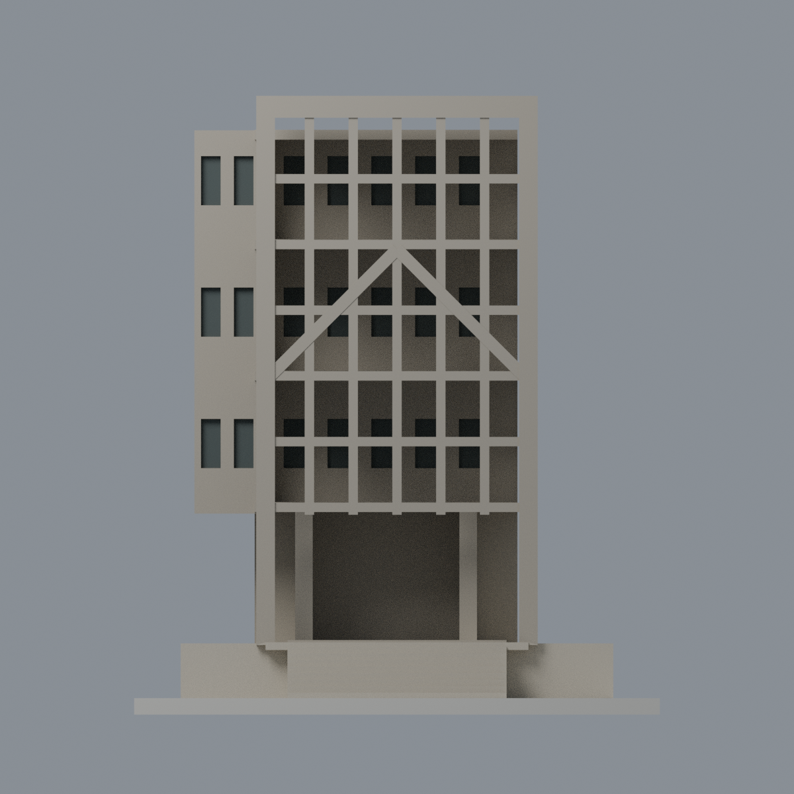

# 靜宜大學蓋夏圖書館舊館・入口格構轉角片段

## 模型預覽

| 模型預覽 | 模型預覽 | 模型預覽 |
| :---: | :---: | :---: |
|  |  |  |

靜宜大學・沙鹿校本部。以官方校園歷史照片及 **2021-06-30 出刊期刊的俯視照片**交叉建立的照片相對比例模型，僅包含舊館入口的兩面垂直開孔格構、前方斜撐、架高開放入口、階梯平台與有限退縮背景。**不是整棟圖書館，不含後方十層增建館及壁畫。** 兩張照片拍攝日期皆未明，不能視為 2026 現況或同日測繪。

## 下載與編修
- [model.3mf](model.3mf)：四種可獨立改色的顯示材質，非列印機分料配置。
- [scene.blend](scene.blend)：原始交付網格、材質、攝影機與燈光，可直接編修。
- [model.stl](model.stl)：單一封閉連通表面；STL 不含顏色。
- [build_model.py](build_model.py)：可改參數的幾何生成器；[palette.json](palette.json) 保存材質色彩。
- [SOURCES.md](SOURCES.md)、[QA.md](QA.md)、[qa/](qa/)：來源、驗證及限制。

## 形體與尺度
含底座 **96 × 92 × 113 顯示 mm**，沒有可靠實際尺寸，不能換算真實比例尺。雙面格構開孔均為實際空隙，前 6 欄、側 5 欄、各 6 排；前人字斜撐嵌入格構，而非獨立屋頂山牆。下方保留通透的高入口。色彩取照片暖灰小面磚／混凝土印象，窗退縮面採暗灰，不是塗黑假格孔。

## 刻意限定／未測繪部分
- 僅取入口轉角，後側及左側均為截斷界面；短翼牆、退縮背景、平台是為表達深度的有限上下文，不代表完整平面或後立面。
- 格數依照片判讀，等跨、正交、層距、斜撐端點、格條厚度及退縮量皆是透視近似。格條 1.7 mm、深度 2.8 mm、主柱 3.4 mm、斜撐 2.2 mm，為微縮加厚值，不是真實構件尺寸。
- 九階展示階梯、矩形基座及階梯寬度是可列印的簡化示意，**不主張原址階數、地形或平台尺寸已測量**。未建庭園、人物、文字、附屬機電、增建館或壁畫。
- 屋頂高度、背景退縮量與樓板深度未實測；低角度可見最上排天空不代表屋頂一定低一層，本版保持退縮高屋板，以額外 qa/low-angle.png 驗證視角可見空隙。
- 後方短背景塊與樓板僅保留照片可辨的退縮關係，未重建室內。背面平截不是新設計或實況立面。
- 五張預覽皆由交付模型渲染，無來源照片貼圖、AI 美化或隱藏幾何。

## 製作與列印
原始 STL 邊、頂點 link、面向及切片檢查通過，不等於實機列印成功。局部 0.8 mm 開運算會損失角部細節；請看 QA 的最差切片數值，不能將元件存活解讀為細節零損失。細格、橫樑、斜撐及樓板懸空可能需支撐或變更方向；未生成 FFF 路徑／未實機列印。

Python 3.12 安裝 requirements.txt；在本目錄執行 `python build_model.py`、`python qa_model.py --out .`、`python check_features.py`、`python verify_exchange.py`；Blender 執行 `blender -b -P render_model.py` 及 `blender -b -P verify_scene.py`。lib3mf 需其原生庫。預覽：front / rear / elevation / top / side。

與既有靜宜主顧聖母堂模型不重複。原始照片／期刊不隨包重散布。
