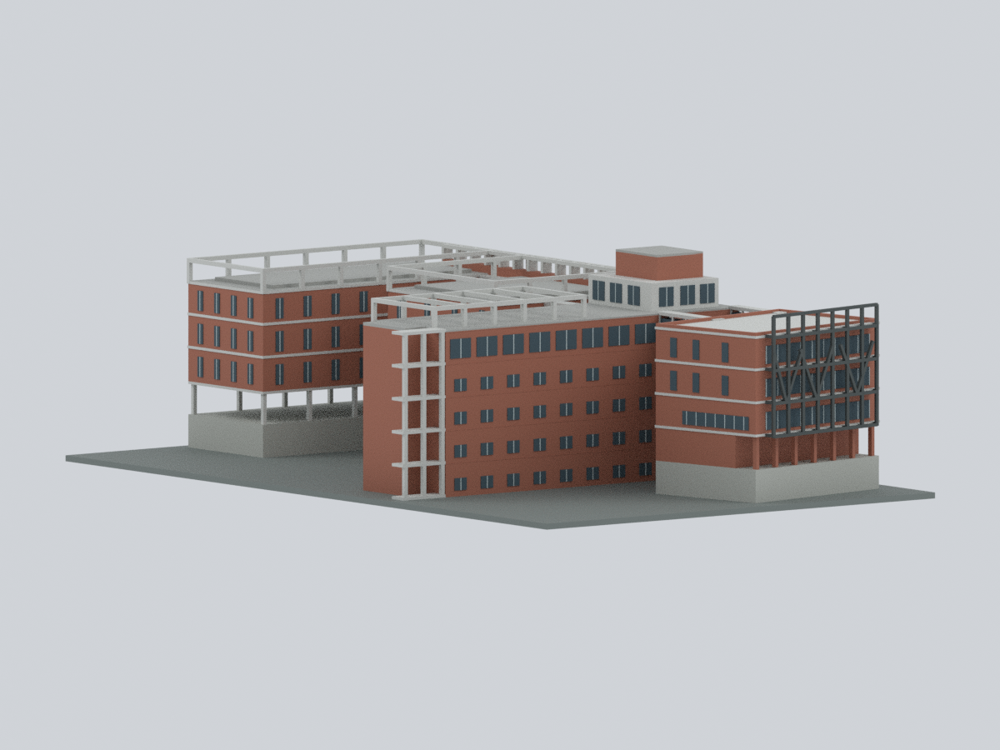

# 校本部（三芝校區）

現收錄2套：多功能教學活動中心（K棟）2013落成版本，以及第二教研大樓D–G完整相連組的早期出版外觀有限細節近似；D–G合計一套，未稱全校完成。2025年8月1日前校名馬偕醫學院，為同一校，不與馬偕醫護管理專科學校混同。校區用教育部「校本部」，校方亦稱「三芝校區」。

## 模型圖鑑（2套）

| 模型預覽 | 模型預覽 | 模型預覽 |
| :---: | :---: | :---: |
| 坡下長玻璃面  |  **[第二教研大樓D–G｜完整相連組歷史外觀有限細節近似](buildings/mmu-teaching-phase2/README.md)** |  |

[多功能教學活動中心模型與完整說明](buildings/mmu-multifunctional-2013/README.md) · [STL](buildings/mmu-multifunctional-2013/model.stl) · [Blend](buildings/mmu-multifunctional-2013/scene.blend) · [來源限制](buildings/mmu-multifunctional-2013/sources.json) · [QA](buildings/mmu-multifunctional-2013/qa-summary.json)

**K棟既有模型：** 含底最長150毫米。保留大跨館、白色折面禮堂、入口翼與外廊、設備槽；主體高度只按照片界定，非測繪。兩根外廊方柱78跨層樣本的特定角損例外詳見建物README；不是全域壁厚或實體試印保證。原圖/PDF不隨包散布。

## 待續範圍

尚未建模：第一期教研樓A–C、行政及其他教學建築、宿舍與其他校園設施；新D–G套件不代表這些範圍已完成。這是未完成範圍，不表示不存在或缺乏全部資料。

K 棟已補[坡下可見六材質交換版](buildings/mmu-multifunctional-2013/appearance/README.md)：磚紅、白框與深窗，未確認屋後中性；原 STL 與兩柱 78 筆角損例外保留。僅色界共面細分，不增量體或包數，未作新 FFF／試印。

[第二教研大樓D–G｜完整相連組歷史外觀有限細節近似](buildings/mmu-teaching-phase2/README.md)：第二教研大樓D–G：完整相連D/E/F/G教研組只計一套，依2014/2016早期作品出版外觀及較晚校方導覽圖作有限細節近似；不是精確2013原貌、2026現況或測繪比例。保留偏轉D、長E/G、內縮F、連廊、主要中庭/光井、真開孔分枝鋼架及不同平屋頂退縮/開放梁列；不因7F圖名外推七個完整標準樓層，排除一期A–C、藍色多角玻璃塔、宿舍及既有K活動中心。265×161×75.55mm為模型製造尺寸；底板與下方支撐塊為坡地展示抽象，非實測地形/地下室。含STL、8材質3MF、可編修統一網格及843原構件Blend、公開Python與9張實際圖；隱藏建構物不與成品同印。不同上層/屋面與未知細節有界簡化，灰屋頂不補造小設備。數位閉殼/交叉/開口/原生編修/重建通過，非切片或實印保證；1.0–1.4mm細件、265mm底板、柱廊/連橋/外梯/屋頂梁需支撐與列印床評估。
