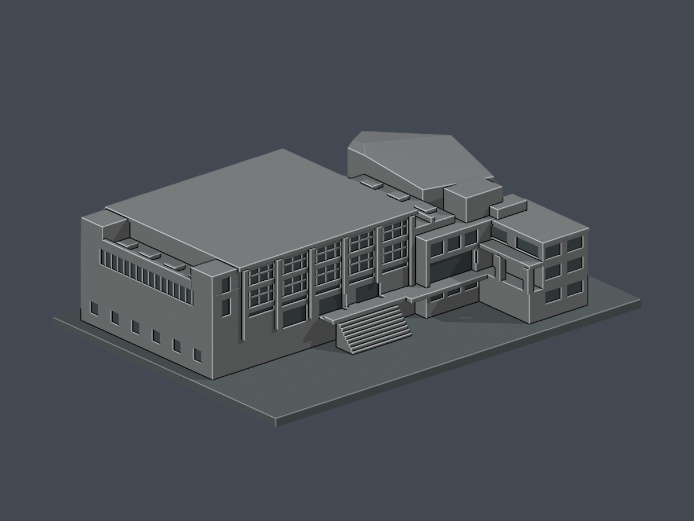

# 校本部（三芝校區）

本批只完成多功能教學活動中心（K棟）2013落成版本的來源限定外觀近似；未稱全校完成。2025年8月1日前校名馬偕醫學院，為同一校，不與馬偕醫護管理專科學校混同。校區用教育部「校本部」，校方亦稱「三芝校區」。

## 本件模型

| 坡下長玻璃面 | 同件坡上入口面 |
|---|---|
|  |  |

[多功能教學活動中心模型與完整說明](buildings/mmu-multifunctional-2013/README.md) · [STL](buildings/mmu-multifunctional-2013/model.stl) · [Blend](buildings/mmu-multifunctional-2013/scene.blend) · [來源限制](buildings/mmu-multifunctional-2013/sources.json) · [QA](buildings/mmu-multifunctional-2013/qa-summary.json)

含底最長150毫米。保留大跨館、白色折面禮堂、入口翼與外廊、設備槽；主體高度只按照片界定，非測繪。兩根外廊方柱78跨層樣本的特定角損例外詳見建物README；不是全域壁厚或實體試印保證。原圖/PDF不隨包散布。

## 待續範圍

本批未建模：教研樓、行政及其他教學建築、宿舍與其他校園設施。這是未完成範圍，不表示不存在或缺乏全部資料。
