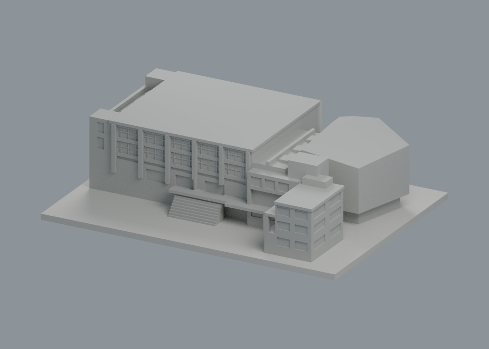
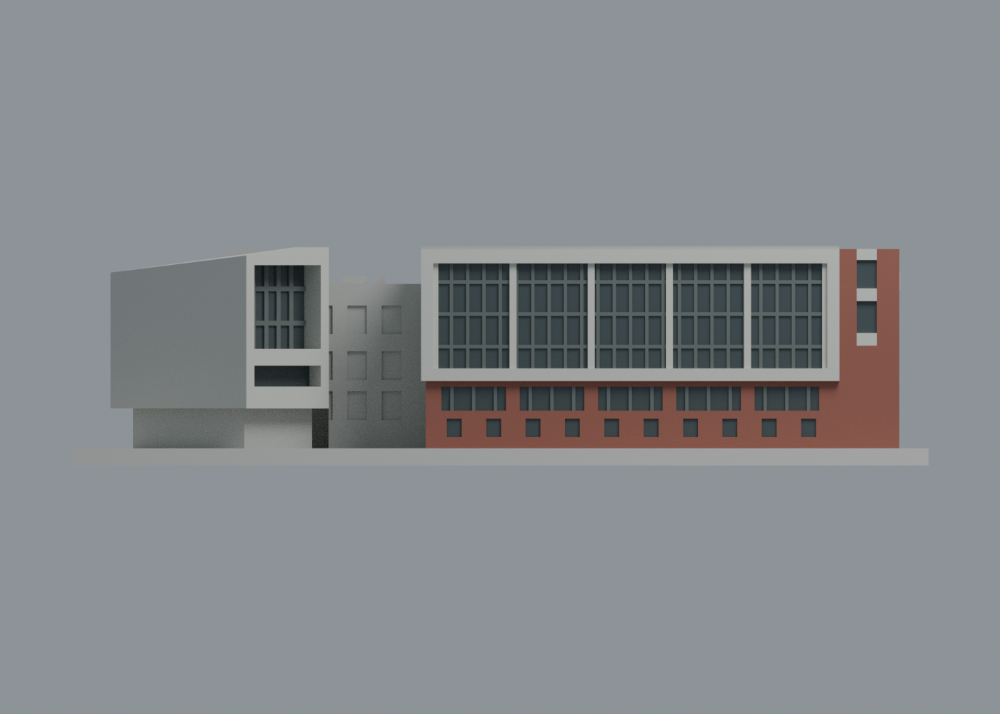
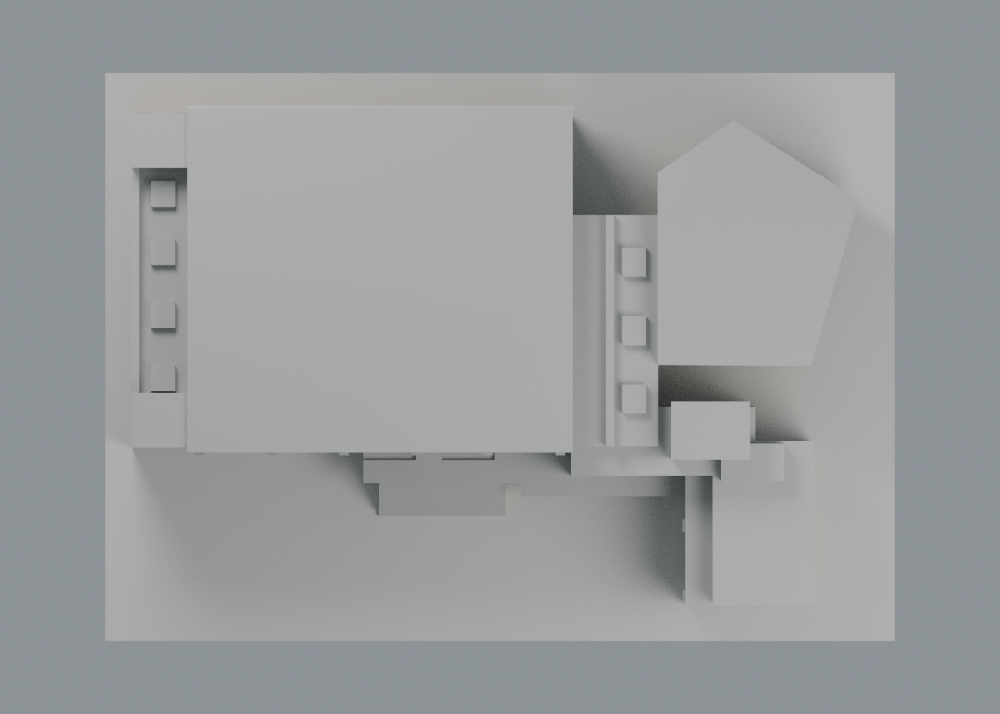

# 馬偕醫學大學｜多功能教學活動中心（K棟）

2013落成版本的來源限定外觀近似模型。現校名為馬偕醫學大學，2025年8月1日前為馬偕醫學院，兩者為同一學校；不是馬偕醫護管理專科學校。本件只含活動中心，未含相鄰教研樓、宿舍或整個校園。

| 坡下長玻璃面 | 坡上入口與教室翼 |
|---|---|
|  |  |

[原STL](model.stl) · [可編輯Blender網格](scene.blend) · [參數源碼](build_model.py) · [來源](sources.json) · [完整QA](qa-summary.json) · [原面ray](architectural-ray-check.json) · [逐構件loss](feature-loss-locations.json)

## 最新可見外觀配色

[六材質通用 3MF](appearance/mmu-appearance.3mf) · [彩色 Blender scene](appearance/scene.blend) · [四圖、來源與色界限制](appearance/README.md)。依既有坡下實照補低層／右端紅磚、白框、深玻璃與細窗格，未確認屋後中性。原 STL 位元保留；僅交換網格為右端主要磚白色界作共面細分，2,881 頂點／5,778 面，並非原面序不變。原兩柱 78 筆角損樣本與歷史 QA 仍適用，未作新 FFF／試印。

## 建模依據與範圍

- 建築師2000px三樓平面，0–6m尺約133px，描出矩形場館、側設備帶、五邊形白禮堂、入口外伸教室翼。採每來源像素0.078毫米，約1:578；圖北箭頭向模型+X，模型+Y為坡下玻璃面，未把紙張上方誤當北。
- 校方1–4F用途圖確認側房、教室與禮堂的層次；場館挑空不做四個等高外觀樓層。室內填實為外觀列印模型，並非可拆樓層或室內模型。
- 建築師／承包商實照與空拍支持大跨近平屋頂、兩側開放設備槽、五角折面白禮堂、坡下長玻璃與坡上五大跨兩排窗。坡地以入口高平台及階梯近似，非地形測繪。
- 白禮堂端部真凹口、後接玻璃分格及下小窗帶；入口翼外廊有真通空，沒有用黑色面假造通廊。細窗框融合背牆；玻璃不通穿整座建物。
- 2011–2012施工與2013作品年依來源分別記錄。2024校方頁面及NLSC2024標示用於後期對照，航照標示年不宣稱精確攝影日。照片與平面不保證同年測繪。

## 有界尺度與簡化

含底座150 × 108 × 約38.4毫米，底厚3毫米。模型主館離底座頂約35.4毫米，對應約20.47公尺；18–22公尺僅照片配景界限，沒有取得官方分棟高度或標高剖面。平面最大包絡約80 × 54公尺，屋面航照有視差，不當成牆基測量。

保留屋頂折面及高低差，主屋面不增造尖脊。禮堂原始影像配景尖端39毫米只局部截至38.2毫米，削0.8毫米，並非整個禮堂降低：實際平面38.3906平方毫米，最小旋轉外接框寬5.40913毫米，原STL向下實體根已核。這是列印幾何簡化，不是真實建築的平頂尺寸。極細欄杆、百葉葉片、設備管線與室內隔間省略；照片遮蔽處小窗不宣稱逐扇精確。來源原圖/PDF不重新散布。

以下均為最終模型毫米，不是來源像素或公尺：
- 大窗細分格寬0.6、凸出玻璃背面約0.325，融合厚背牆；選點原面法向連續實體62.85毫米以上。這些分格不是0.6毫米獨立細柱。
- 白禮堂高玻璃凹深5.1、小窗凹深3.5；分格面深4.625。原面法向剩餘連續實體最小34.228毫米（所列四探點），沒有封閉薄前皮。
- 入口平台頂13.4、外廊簷底21.2，淨高7.8；入口翼外廊通至教室背牆，長向通至門廳。階梯與平台連接、門廳凹口、設備槽開天皆有原STL ray證據。

## 數位QA與明示角損例外

[驗證報告](validation.json)、[0.2毫米逐層](layer-opening-check.json)、[每個原Polygon](layer-component-check.json)、[逐構件定位](feature-loss-locations.json)、[原面與根接ray](architectural-ray-check.json)。原始STL只合併完全相同座標作拓撲檢查，不repair、不重算法向吞錯。

原始網格單殼、水密、每邊兩面、vertex-link單環；無分離封閉內腔殼。每個原Polygon在0.4毫米erosion及opening後均未消失或分裂。獨立源碼重建STL SHA一致，保存Blend實際幾何一致，7張actual-STL PNG逐位元重現。逐構件高loss不可用整層平均代替。

**特定例外：入口翼兩根2.4毫米方柱，在78個跨層樣本中有純角損。78是樣本數，不是柱數。** 最大opening損失2.3984824%，保留97.6015176%；全部落在原方形四角0.41毫米鄰域內。原STL X/Y法向均至少2.39999毫米，向下接平台／底座、向上接22.6毫米簷頂，無分裂／消失。此具體例外經外觀主審原則接受，已由獨立原STL幾何審核重現；不是放寬其他薄皮或全域壁厚標準。

底座朝下，入口外廊、白禮堂局部懸挑與簷口可能需要支撐。數位篩檢不是Cura/Prusa工具路徑、全域最小壁厚證明或實體試印，不保證免支撐或任意尺寸縮小可印。

## 重建

安裝 [requirements.txt](requirements.txt) 所列Python套件，另需Blender4.3.2。依序執行 `python build_model.py`、`blender -b -t 4 -P render_preview.py`、`python run_all_checks.py`。所有檢查須exit0且checks全true；不可修補失敗輸入後沿用舊報告。Python源碼是參數來源，scene.blend是交付STL匯入的可編修單網格。

## 補充視角

| 坡下正立面 | 屋頂：未確認中性 |
|---|---|
|  |  |

[歷史坡下正視](previews/elevation.png) · [歷史側視一](previews/west.png) · [歷史側視二](previews/east.png)

獨立補充：192層482原Polygon零侵蝕／opening分裂或消失；兩方柱78個跨層樣本最大損失2.39848241135%、保留97.6015175886%，原四角0.41mm鄰域外損失為0。指定原三角面法線最小量得2.3999977mm，上下根實連重現。整層最大損失0.12703223848%不能取代此構件警告。禮堂局部平頂實際面積38.39061226mm²、旋轉外接框最窄5.40912916mm；指定點從z38.199向下連續28.199mm才出實體，這只證明該點根接，不能當全域壁厚。外廊、入口與折面禮堂仍須評估支撐及拆除，不得任意縮小，尚未實際試印。

## 保留的歷史展示

原 scene.blend 與七張舊圖完整保留：[坡下](previews/front.png)、[坡上](previews/rear.png)、[坡下正視](previews/elevation.png)、[西側](previews/west.png)、[東側](previews/east.png)、[坡上低角](previews/rear-elevation.png)、[頂視](previews/top.png)。歷史 QA 仍指原 STL／scene／舊圖；本次新圖與表面細分交換網格另行驗證，沒有改寫舊製造紀錄。
