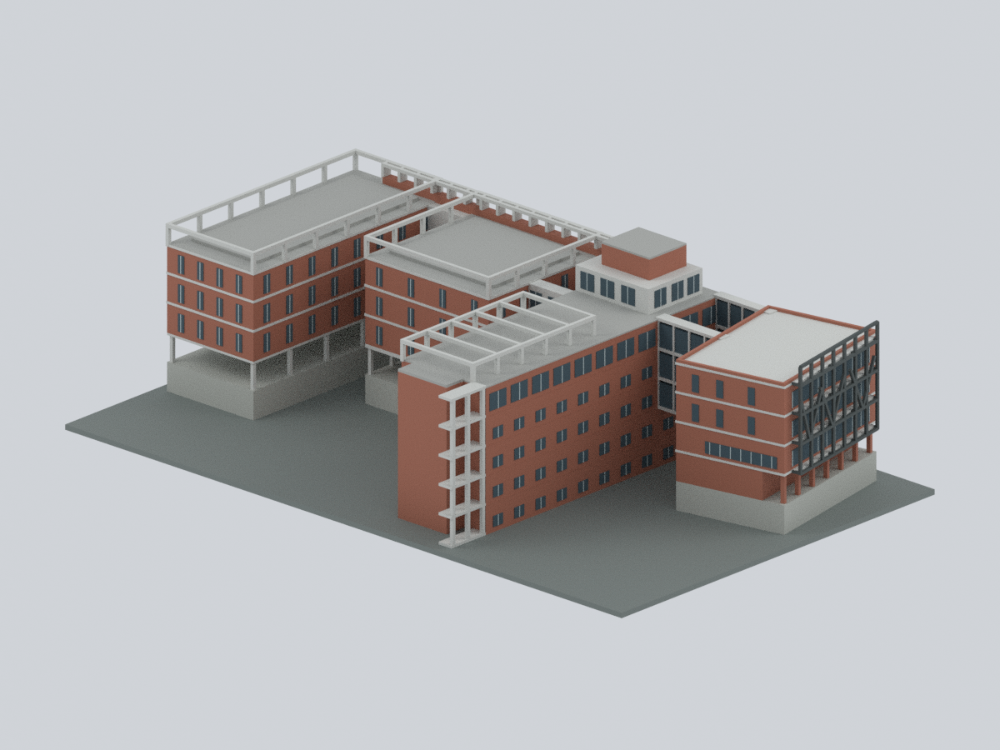
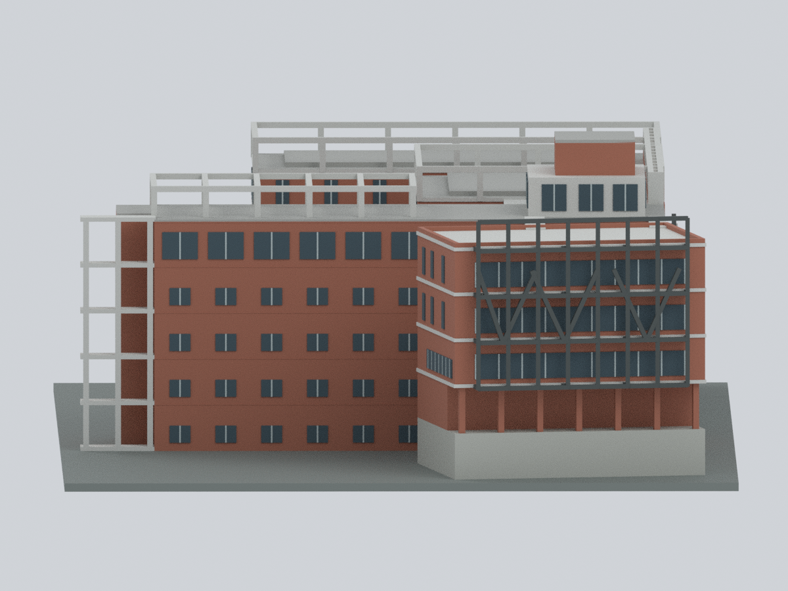
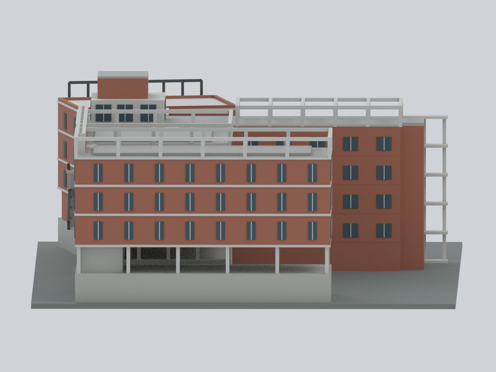
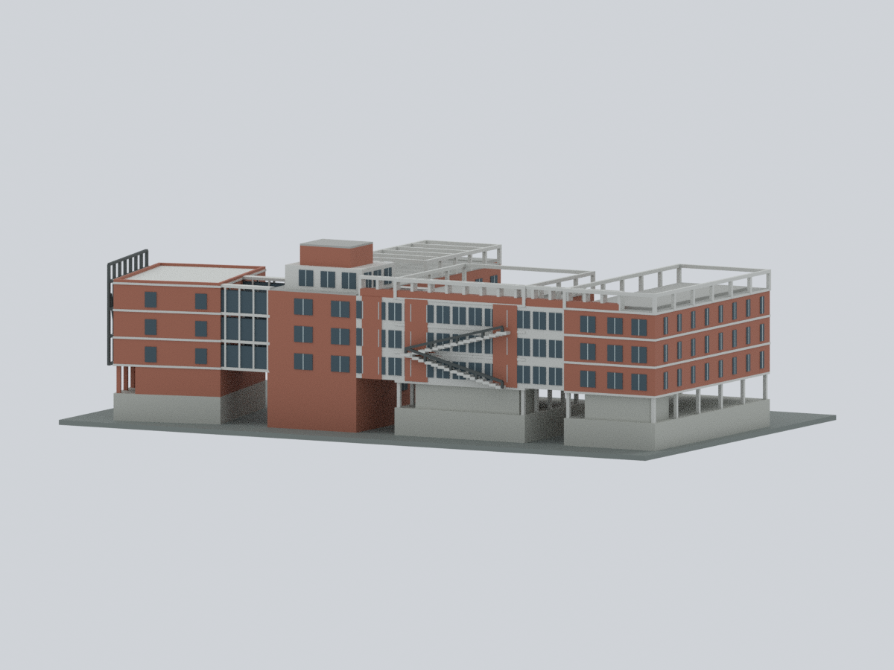
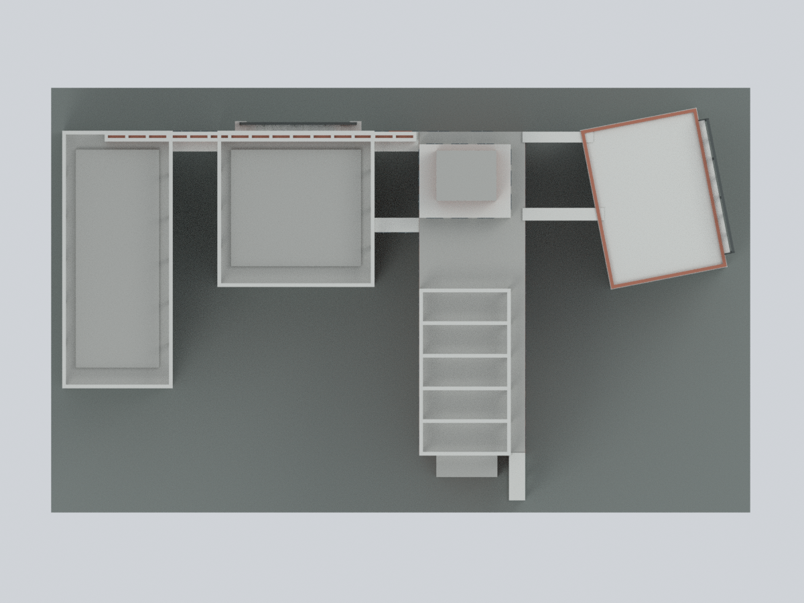
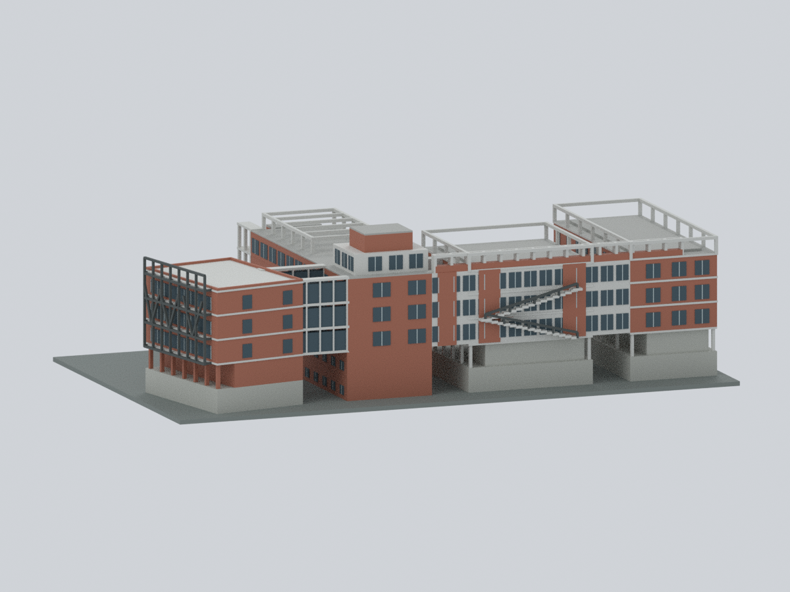
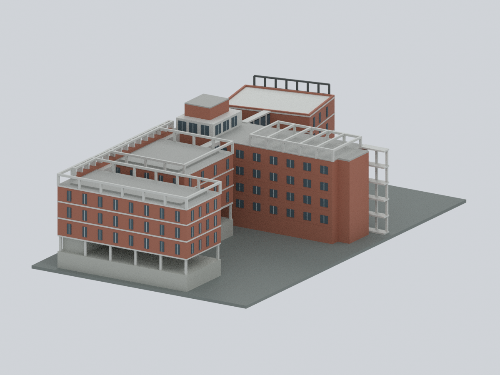
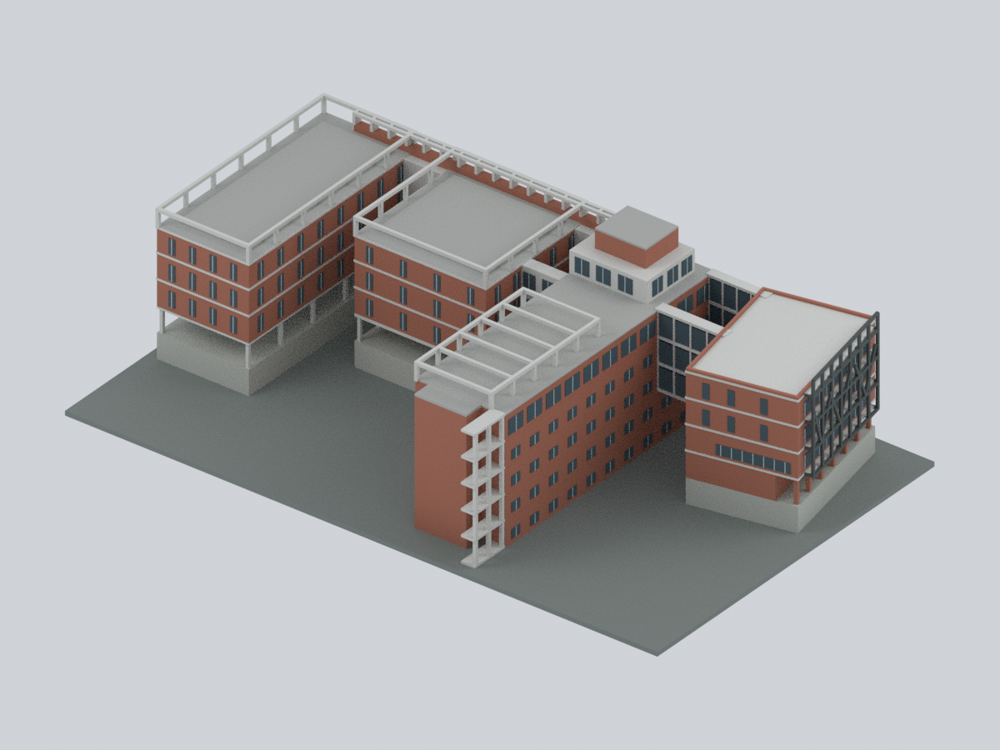

# 馬偕醫學大學｜第二教研大樓 D–G

**一件相連的完整 D–E–F–G 教研組，彩色、有限細節外觀近似。** 保留偏轉 D、長 E/G 翼、內縮 F、連廊、主要中庭與小光井；不包含一期 A–C、藍色多角玻璃塔、宿舍或 K 活動中心。

年代標示為 **2014／2016 早期作品出版所示外觀，並以較晚校方導覽圖交叉核對拓樸**。這不是精確 2013 原貌、2026 現況、室內／結構 BIM，也沒有經測量建立建築公尺或比例尺。所有 mm 都是本件模型的製造尺寸。

## 實際模型預覽

以下九圖均由同一個交付網格及面材質實際渲染，沒有來源照片貼圖或 AI 示意圖。方向依官方平面圖的上／下／左／右，**不宣稱方位角**。

| D／E 花園側 | 全組斜視 | 圖面右側 |
|---|---|---|
|  |  |  |
| 圖面左側 | 後側 | 正投影頂視 |
|  |  |  |
| 路側連廊／外梯 | G 翼回轉側 | 空拍對照視角 |
|  |  |  |

## 檔案與編輯

- [`mmu-teaching-phase2.blend`](mmu-teaching-phase2.blend)：可直接編輯頂點及面材質的統一網格；另有隱藏的 `EDITABLE components` 原始構件集合，供構件修改。隱藏構件是布林合併前的重疊建構物，不應與最終網格一起列印。
- [`mmu-teaching-phase2.3mf`](mmu-teaching-phase2.3mf)：單一網格、逐三角面基礎材質顏色，不是印表機專用工作檔。
- [`model.stl`](model.stl)：相同外殼的單色 STL。
- `source/`：可重建的 Python；`parameters.json`：相對平面及高度數值；`palette.json`：近似材色。
- `mesh-data.npz` 保存最終頂點／面／材質索引；`construction-parts.json` 與 `editable-parts.json` 保存構件及來源限定說明。
- `sources.json`、`uncertainty-ledger.json` 列明來源、對位與已知／未知。

## 保留的主要特徵

- **D**：平面偏轉、平屋頂與女兒牆、下層退縮／柱廊、真正開孔的分枝鋼架。植栽與細網孔省略，並非任意實心綠牆。
- **E**：長磚色立面、不同於 D 的窗帶、開放屋頂梁列；接合端保留白窗上層及更高磚色頂塊兩個局部階段，沒有外推成整層。
- **F／G**：不同長短與內縮關係、退縮平屋頂／露台、高開放周邊框及路側磚牆／玻璃框架語彙。
- E 的五個主要露出立面帶，與 F／G 的較高下緣、開放低層及三個上層帶分開處理；**沒有因圖名「7F」而擠出七個完整標準樓層**。
- 主要中庭、G–F 縫院、F–E 光井與 E–D 凹院都保持空間開放。底部展示板不代表庭院建築體。

## 來源與權利

主要依據：

1. [ArchDaily：Phase II Building Complex, Mackay Medical College／J. J. Pan & Partners](https://www.archdaily.com/570635/phase-ii-building-complex-mackay-medical-college-j-j-pan-and-partners)，2014-12-09 刊出，專案年份標示 2013；照片／圖面 Courtesy of JJPan。教研 5F 圖與 D/E、路側照片是主要依據，整篇也包含非本件建築。
2. [建築師雜誌：馬偕醫學院二期校舍](https://www.twarchitect.org.tw/works/%E9%A6%AC%E5%81%95%E9%86%AB%E5%AD%B8%E9%99%A2%E4%BA%8C%E6%9C%9F%E6%A0%A1%E8%88%8D/)，2016-06；建築師潘冀，攝影謝偉士／曾彥智。全校斜空拍中目標是左上背景 D–G，不是前景大型 K 屋頂。
3. [馬偕醫學大學校園導覽](https://www.mmu.edu.tw/xmdoc?xsmsid=0O268619186836768754)：官方棟別圖及 3F–7F 平面交叉核對完整相連拓樸與一期界線；網頁更新日不是圖面／照片拍攝或改建日。
4. [利晉工程專案](https://lijin.com.tw/Projects/Detail/62BC2639-75C2-43C4-B271-FC94FAAAE609)：D/E 正面及磚牆框架回轉面佐證。回轉照片未逐棟標記，只作 G 側粗部語彙支援，沒有宣稱每扇窗已測定。
5. [校方 2022 簡介手冊](https://secretariat.mmu.edu.tw/files/file_pool/1/0P295351135076173092/20220929142002.pdf)，第 99–102 頁輔助確認教研照片身分；出版時間不等於照片日期。

完整逐項 URL 及信用資訊見 [`sources.json`](sources.json)。原始照片、PDF、圖說或來源像素**不隨本包散布，也未嵌入為材質**。建築設計、攝影、圖說與商標權利各歸原權利人；公開可瀏覽不等於再散布授權。本件為獨立製作的近似模型，不是校方、建築師或施工單位提供的官方模型；本包不新增或改變儲存庫既有授權。

## 限制與列印注意

- 模型外界約 **265 × 161 × 75.55 mm**。它不是經測量的真實建築尺度；不要由這些數字回推公尺。
- 屋頂表面採中性灰；未知小設備、管線、家具與植物不捏造。各翼下方中性支撐塊／底板是坡地展示抽象，**不是測繪地形、地下室或實際擋土牆重建**。
- 窗數、細分、梁柱截面、細欄杆與外梯踏步均簡化；未知次要立面不作完整測繪宣稱。紅磚、混凝土、玻璃與鋼架色皆未經色彩校準。
- 最細獨立欄杆約 **1.0 mm**，D 鋼架約 **1.05 mm**，主要開框約 **1.4 mm**。薄玻璃色面是附著浮雕，不是獨立壁厚。縮小前須重新檢查細件。
- 265 mm 底板可能超出常見列印床；請使用足夠尺寸的設備，或在切片軟體分件。柱廊、連橋、外梯、鋼架及屋頂橫梁需要支撐／跨橋評估，**不保證免支撐**。
- 3MF 是顏色資料，不包含指定噴頭／線材配置。請自行在切片器對應材質；STL 不含顏色。
- `qa/` 提供閉殼、邊／點流形、數值三角交叉預檢、水平截面、真開口射線、原生編輯及重建比對。這些不是實機列印、切片路徑或全域壁厚保證。

## 重建

已測試 Blender **4.3.2**、Python **3.12.14**，套件版本見 `source/requirements-model.txt` 與 `source/requirements-export.txt`。兩份依賴可裝在同一 Python 環境，或以 `--model-python`／`--export-python` 分別指定。Blender 自帶 Python 使用其內建 NumPy。

```bash
python -m pip install -r source/requirements-model.txt -r source/requirements-export.txt
python source/rebuild.py --out rebuilt --blender blender
python source/compare_rebuild.py . rebuilt --report rebuilt/qa/rebuild-comparison.json
```

預設讀取本包 `parameters.json`。可用 `--parameters custom-parameters.json` 改變相對尺寸／高度，再檢視幾何、材料及列印限制。重建不讀取照片、不連網、不依賴未提供的檔案。固定版本及相同 CPU 渲染環境下，已逐一檢查頂點／面／材質陣列、STL bytes、九張 PNG bytes 與像素重現性；其他版本或硬體不保證相同的渲染位元組。
