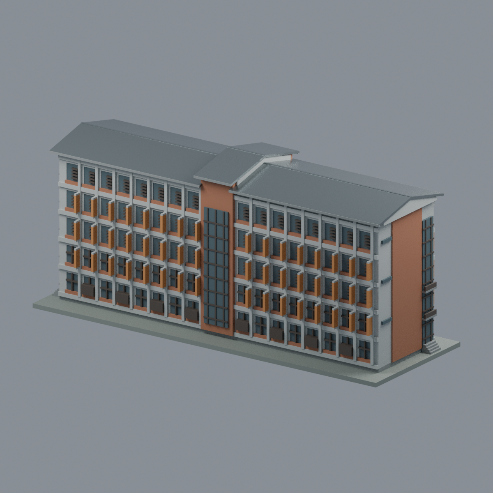
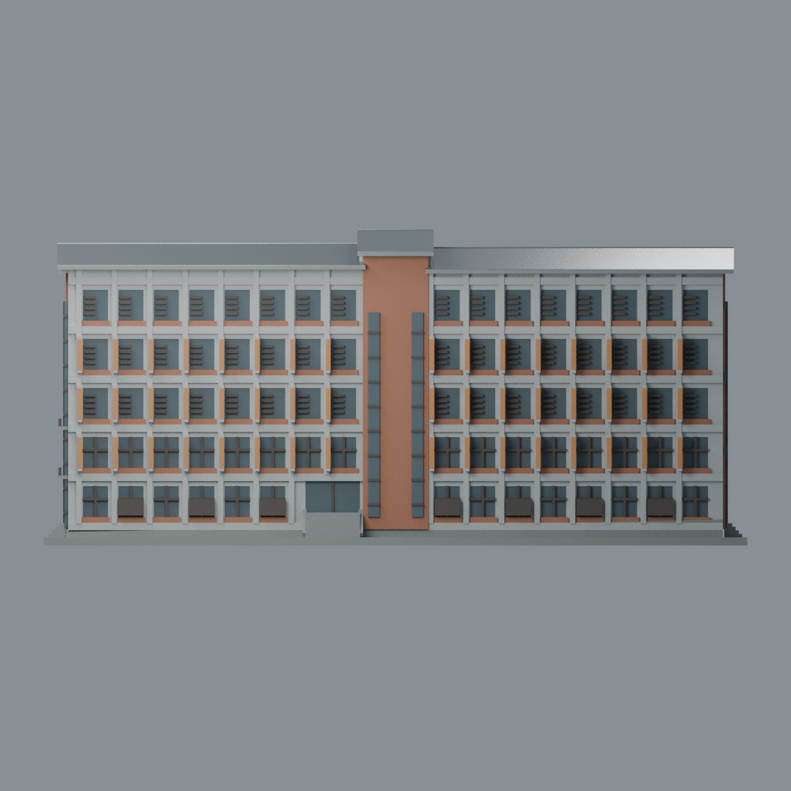
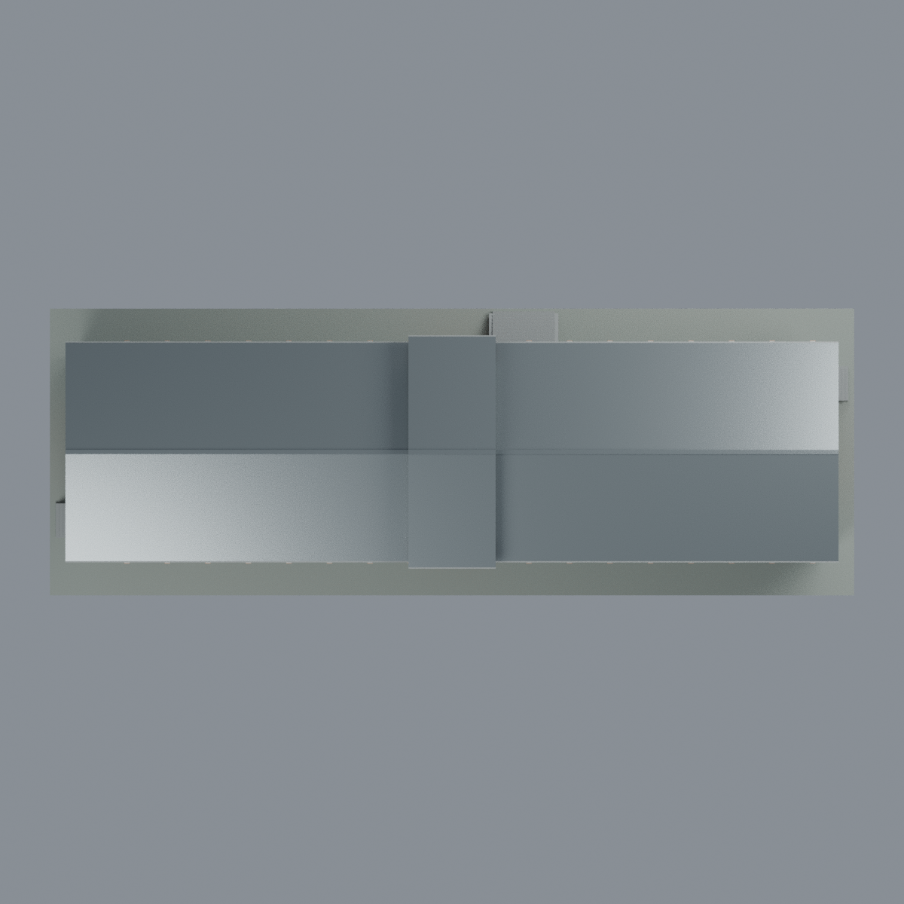
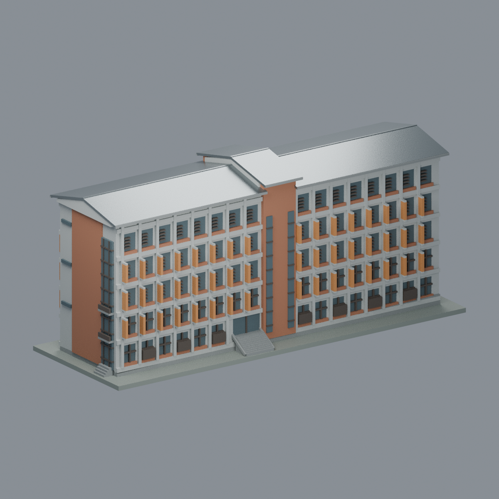

# 馬偕醫護管理專科學校｜三芝校區｜綜合大樓（共同教室大樓）

完整地上主棟的照片比例近似模型。**不是馬偕醫學大學，也不是關渡校區工程。** 金石聯合建築師專案名「共同教室大樓」，現場題名與落成新聞稱「綜合大樓」。五層長矩形量體、中央服務核、三段異高低坡屋蓋、兩長面及兩短端、入口與可見端部階梯均納入。

## 版本與範圍
採設計者**無太陽能板實拍狀態**；2019是完工年，不是每張照片的已知拍攝日期，亦不宣稱2026現況。NLSC正射只核主要屋面輪廓、長脊方向與鄰棟間隔；其PV組界不當屋蓋段界，「NLSC2024」浮水印不當已確認航拍年。

前中央磚柱與兩窄玻璃帶，後中央較寬連續玻璃分別建模，不作鏡像。兩側灰白框格、橘紅磚帶、外挑橘色遮陽片、深窗及百葉、低層深褐屏帶有區別。短端保留偏置玻璃梯帶、磚牆、窄窗與一端小平台。

尺寸、坡角、層高、窗格和百葉小格數均按可見比例近似，**沒有測繪比例尺**。後基部小門窗及坡地接地收口部分遮擋，有限近似；不宣稱每扇窗已逐件證實。低矮斜基部只表達可見接地關係；灰綠展示底台不是真實地形。屋脊增為約1.4mm平頂窄脊，階梯及小欄板加厚以保留列印連接。校徽、字樣、細機電與地下室內部省略。鄰接舊樓、低綠色場地、湖、樹、整片道路擋牆均排除；無虛構連接盒。

## 可編輯與列印
- `scene.blend`：單一可編輯三角網格、8個可編輯材質；可修改頂點與材質。
- `model.3mf`：毫米單位、每面真實材料指派；可編輯基礎材質。
- `model.stl`：同一閉合實體，**沒有顏色或透明度**。玻璃為不透明列印實片；3MF/Blend亦以不透明材質示意。
- `previews/`：五張實際交付網格渲染，非AI建築圖或原始照片；同模型多視角。
- `build_model.py`、`render_model.py`、`rebuild.py`：幾何、場景與乾淨目錄重建；詳見QA。

模型約258×92×116mm；實心閉外殼，實際填充率由切片器設定。屋簷、遮陽片、窗沿、小平台和階梯有懸挑，應依設備方向加支撐；沒有實印或免支撐保證。原來源照片不隨包散布。

## 圖鑑
| 正面斜視 | 背面斜視 | 正立面 |
|---|---|---|
|  |  |  |
| 屋頂 | 另一端斜視 | |
|  |  | |

本校首頁代表圖**待使用者選擇**；此處首張僅為模型視圖排序，不指定首頁代表。
