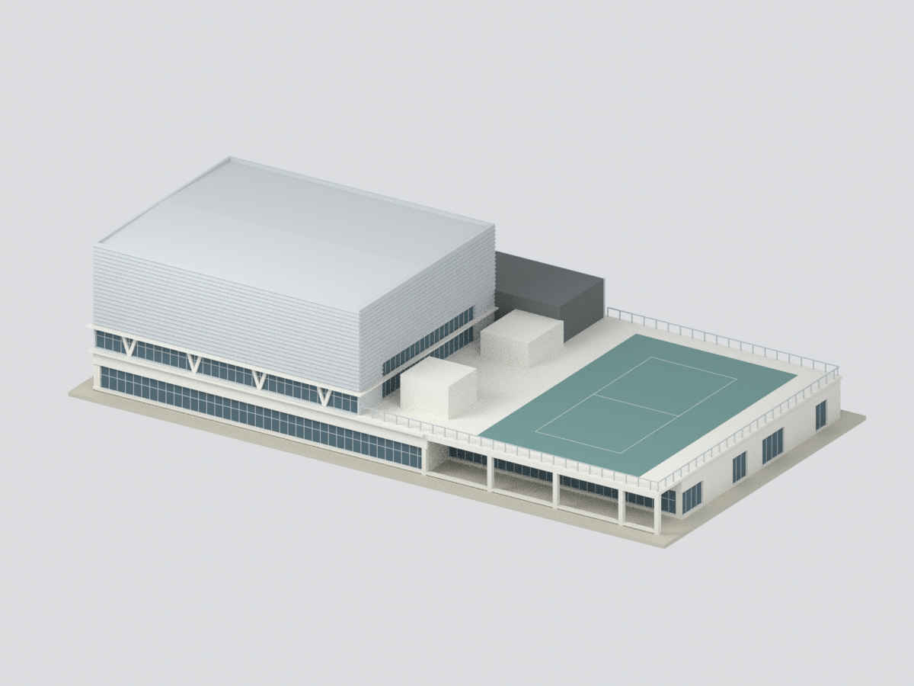
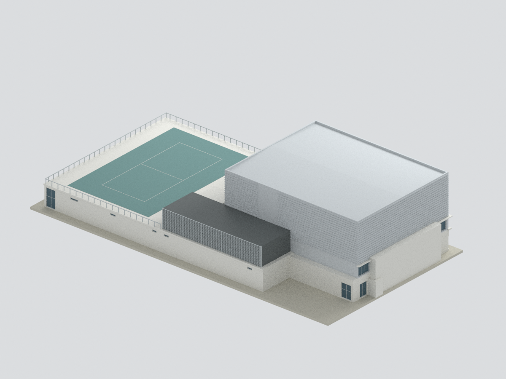
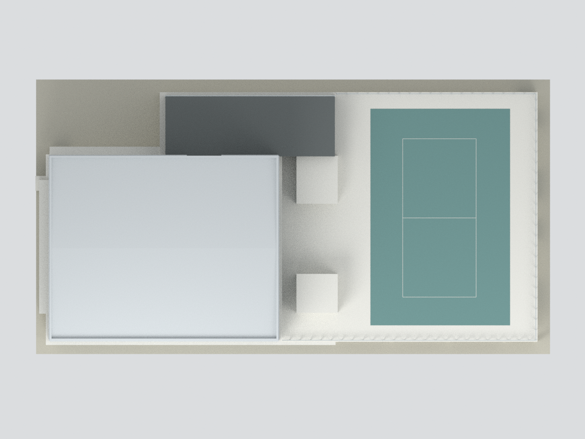

# 高雄美國學校 Thomas Farrell 運動中心

**2016 建築師竣工供圖外觀｜不是精密竣工測繪，也不代表 2026 現況。**

## 模型
[彩色 3MF](model.3mf) · [STL](model.stl) · [可編輯壓縮 Blender](scene.blend) · [建模程式](build_model.py) · [參數](parameters.json) · [QA](QA.json)

比例 **1:300**，尺寸約 **255.1 × 136.0 × 59.7 mm**（以最終 QA 為準），含自行設計列印底座；毫米單位。

## 來源與範圍
建築師張瑪龍、陳玉霖／MAYU architects+，2015 年 6 月至 2016 年 11 月施工。[建築師雜誌](https://www.twarchitect.org.tw/works/高雄美國學校運動中心/)明載建築高度 17.4 m、地下二層及地上二層。[校方](https://www.kas.tw/about-us/our-campus/)稱 Thomas Farrell Athletic Complex。

採[建築師供稿圖集](https://www.archdaily.com/888117/kaohsiung-american-school-athletic-complex-mayu-architects-plus)的 B1／1F／2F、四向立面、兩剖面、總配置與竣工照片。原圖尺度條 10 m 約 119 px，外框約 72.4 × 36.8 m、高館約 34.0 × 27.5 m，均為比例估算，不是標註施工尺寸。

- 包含高體育館、餐廳低翼、屋頂戶外運動平台、廚房及後側機電屏風；不是只有高盒。
- 高館屋頂按剖面做內縮淺雙坡，非把 2F 平面誤當成平屋頂；外牆四面不鏡射，保留北端樓梯實牆、東面玻璃及西面高窗／開口差異。
- 略去原總圖灰色的一期校舍、操場、圍牆與地下泳池／水槽／機電，模型接口不是新設實際外牆。
- 不透明背板表現玻璃，V 柱及窗框簡化為可列印外觀；百葉、金屬板折邊、欄杆及屋頂線條有尺度簡化。顏色為完工照片近似，不是材料色票。
- 不含室內、地下結構、品牌題字及未核實後加設備，不能用於施工、結構判定或精密量測。

**尚未實體試印**；欄杆、屋簷與細窗框需自行檢查縮放、支撐及切片強度。原始圖像不隨包散布；詳見[來源署名](SOURCE-RIGHTS.md)、[原圖與校準](SOURCE-PROOF.json)。
