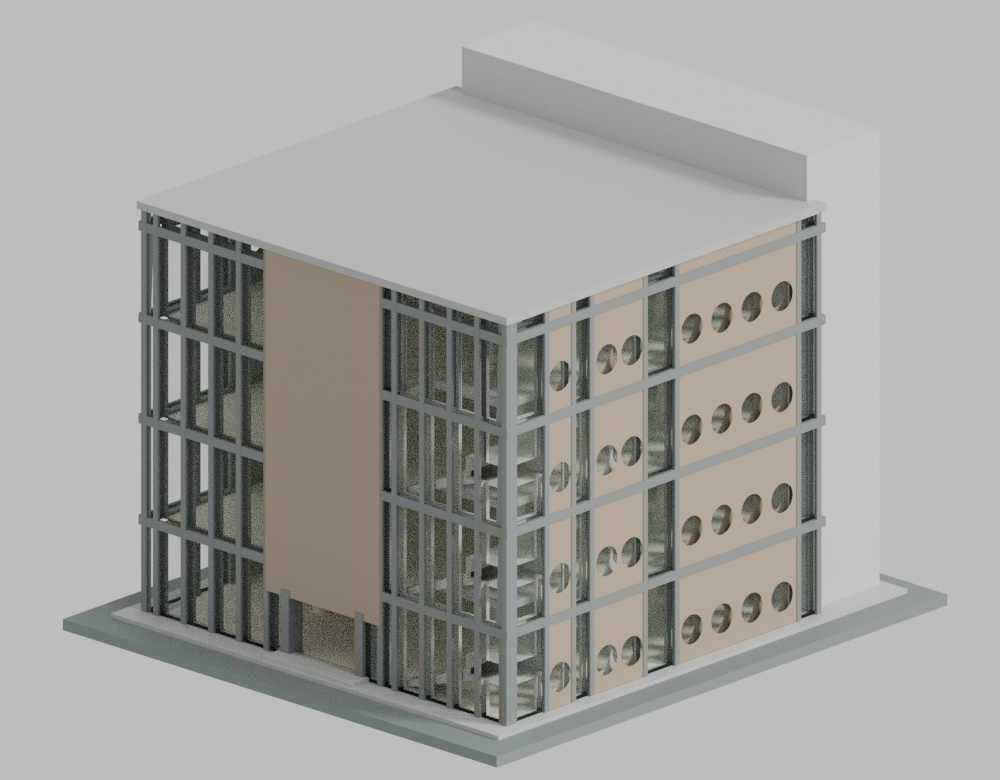

# 高雄醫學大學建築模型圖鑑

目前收錄1套：圖書二館，以建築師2005作品集所呈現的早期完成外觀為準，照片日期未知，不代表2026現況。本校為教育部115學年度正式大學，代碼1019；前身高雄醫學院不另計學校。校區沿用原教育部手冊「校本部」，地址十全一路100號；其他建物及全校逐棟清單仍未完成。

## 建築圖鑑

| 建築模型 | 建築模型 | 建築模型 |
| :---: | :---: | :---: |
|  **[圖書二館｜早期完成外觀](校本部/buildings/kmu-library-two-early/README.md)** 四層玻璃主體、南側較高服務核、西北L形梯 122 × 135 × 約102.4 mm |  |  |

[完整模型、正反並排預覽與下載](校本部/buildings/kmu-library-two-early/README.md) · [來源摘要](inventory/sources/kmu-library-two-early-source-summary.md) · [QA摘要](inventory/qa/kmu-library-two-early-review.md)

金石建築師事務所作品。主體為四層近方形閱讀空間，北側入口及中央實牆牌、西北L形開放梯、南側較高灰色服務核，西側上層1＋2＋4圓窗分組保留；下層受遮擋而採近似重複，不宣稱各層窗格完全核實。東側圓窗有內景及平面方位佐證，但完整數量、分組與間距未證，採低細節估值；南側與老館的接合也採保守收口，不鏡像北面。

名義約1:200；主屋面20.4×18.9m只是同高程正射的量級，南服務帶與主屋面分開，樓高與開口皆有推估。1931m²為樓地板面積，並非占地。官方表列2004、地下4層、梯1與其他資料有衝突，不據此新增地下四層或刪除南側封閉梯。未含老館藥食園、未核實光電、相鄰校舍或完整室內。

STL中的玻璃仍是有厚度的實體殼，一般不透明列印會遮住內梯；透明渲染僅為材質示意。內部樹狀柱與L形斜梯均有粗化及接根製造簡化，並非實測構造。原數值檢查各1個flag與strict false完整保留；同一原run事件有精確補證，不能改稱原strict pass。未實體試印，屋頂、樓板和樓梯需要支撐，內部支撐清除及樹脂排液仍未獲製程驗證。

公開內容只含自行建立的幾何、程序材質、渲染、來源連結與數位檢查證據；不含原照片、PDF、正射、私人比較板，不宣稱建築師或攝影師授權、認可。
