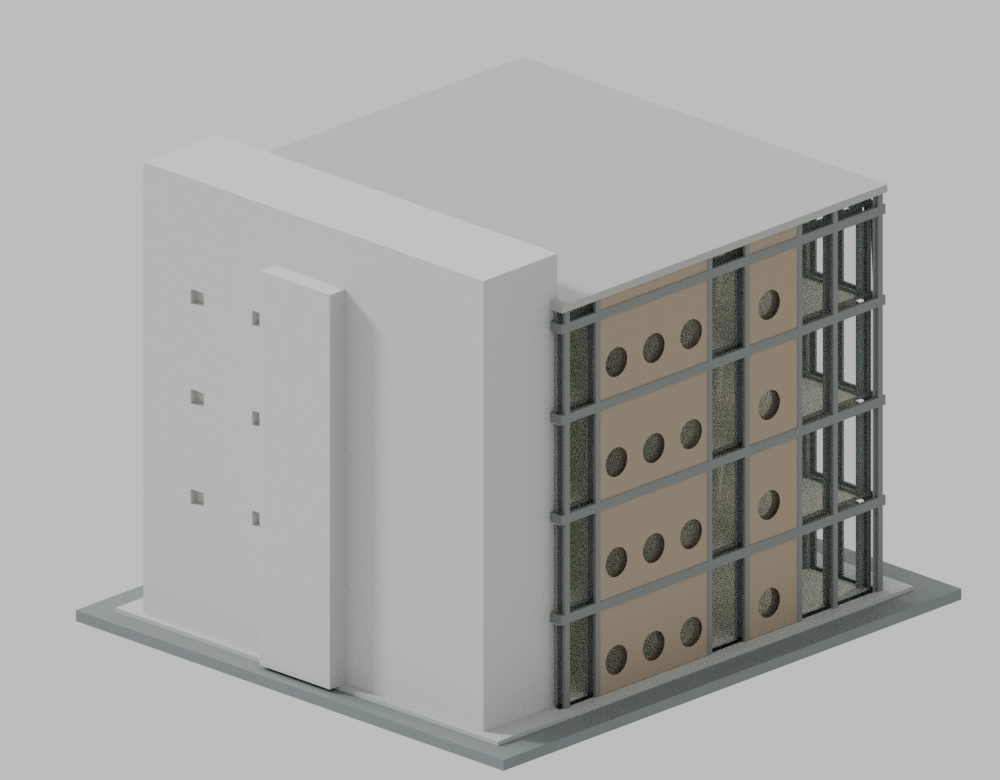

# 高雄醫學大學圖書二館

MOE 1019。作者2005作品集所呈現的早期完成外觀，照片確切日期未知，不代表2026現況。這是來源約束的估計比例外觀模型，不是精確測繪或結構模型。

v5已完成作者雙模式與原flag精確補證。來源與獨立檢查各自綁定檔案hash；獨立結果另附，不能由作者結果推定。未試印。

| 北入口與西圓窗 | 南服務核與東側概略分區 |
|---|---|
|  |  |

## 建築識別

四層透明閱讀主體、北面懸掛式中央實牆牌、西北角L形開放梯、東西圓窗語彙，以及南側較高灰色廁所/電梯/封閉梯服務帶。模型只含2005新館，不含老館屋頂藥食園或相鄰校舍。

- 名義比例1:200；模型基座122×135mm，總高約102.4mm，STL毫米單位。
- 主屋面約20.4×18.9m採正射同高程量級；南服務帶與主屋面分開，不把樓板面積1931m²當占地。
- 所有樓高、開口尺寸、玻璃厚度與不完整立面分格為明示估值或製造調整。
- architect-07/09內景支持東側圓窗，官方平面輔助方位，但完整排數未證；採低細節分區，沒有鏡像北面。南面僅保守量體與接合收口。
- 官方表列2004、地上4/地下4、梯1有衝突。沒有憑表新增4層地下室，南第二封閉梯保留於服務帶量體中。

## 檔案與重現

目前候選位於 models/v5；source/ 有可重建的參數化原碼，parameters.json記載尺度與版本。Blender展示直接讀取STL原三角面，不修復、不增加STL不存在的建築細節。透明玻璃與原創程序色帶只為材質表達；來源照片沒有貼入模型。

## 來源

- [金石建築師事務所，作品83](https://www.ksarch.com.tw/en/work/83)：2003設計、2005完成、1931m²、早期建成外觀與內景。
- [高雄醫學大學防災計畫](https://osa.kmu.edu.tw/images/s_mil/safe/Plan_for_sure.pdf)：2016文件PDF38–40頁的一至四層平面、正面及側面照片；第37頁資料表保留衝突註記。
- 校方校園圖與國土測繪中心PHOTO2只輔助定位及同層屋面量級；圖片拍攝年代未確認，不能作當期立面或屋頂設備證據。
- 確切來源URL、檔案hash、用途與衝突見sources.json；來源圖片/PDF/正射只作研究，不隨模型或公開庫傳播。

正式庫485套在2cf0507的完整tree中沒有高醫中英別名路徑；本件屬高雄醫學大學的新覆蓋候選。這不表示全校建築已完成。

## 製造與驗證界線

玻璃增厚至約1.5mm、樓板約1.7mm，窗框/柱/階梯有粗化與實體接合。內部僅保留外觀需要的簡化樹狀柱，沒有完整室內與家具。細節差異見ESTIMATES-AND-SIMPLIFICATIONS.md。

未試印。屋頂、樓板與樓梯需要支撐；內部支撐清除受入口與梯井限制。單件普通FDM、樹脂排液及實際強度都未獲製程驗證。STL玻璃區仍為有厚度的實體殼；一般單材不透明列印會遮住內梯。透明渲染僅為材質示意，沒有透明材料或後處理實測，不承諾實物透視。詳見PRINTING-LIMITS.md。

網格檢查保留原始法線/拓樸、閉AABB原三角相交、每原面10射線、每層Polygon窄根的真實結果及全部失敗。有限採樣通過也不是全表面連續壁厚或實體試印保證。

### v5作者正式雙模式

原始23,920個三角面單一表面、拓樸與法線通過；1,536層與12,350個原Polygon均通過。239,200條原面法線射線，0條低於0.8mm，最短1.1174mm。數值程式留有1個交點排序flag，原strict=false保留；使用同一原CSV的lossless hex描述逐條精確分類後，首段實體弦合格。這不是將flag刪去或偽裝零flag。閉AABB原三角相交完整檢查0壞對。一般 Python 與 -O 分別重跑，所列科學資料與原CSV hash一致；每模式1個原flag各自補證，原 strict=false 未改。詳見qa/AUTHOR-FINAL-V5-READOUT.json及綁定的完整原報告；獨立結果另附。

## 展示與檢查紀錄

九張正式預覽為Cycles CPU、64 samples、單執行緒，未用OIDN/其他降噪。公開PNG只移除允許的非視覺File/時間文字欄位；IDAT、解碼RGBA像素及保留的色彩chunks逐張不變，綁定見previews/v5-public/metadata-cleanup-binding.json。

作者以原碼重建STL逐byte一致，Blender本件材質/場景狀態及原三角面一致；Noise mapping與內建色帶集合的比較已補強並通過正反控制。這是本件使用的狀態集，沒有聲稱涵蓋任意Blender RNA。完整獨立重跑與九圖重渲染以隨附獨立報告為準。

- [來源外觀覆核](qa/source-appearance/PUBLIC-SOURCE-REVIEW.md)
- [獨立數位檢查結果](qa/independent/QA-RESULT.json)
- [重現方法](REPRODUCE.md)
